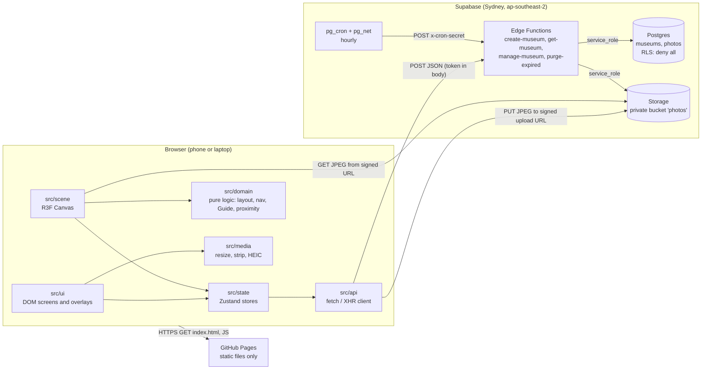
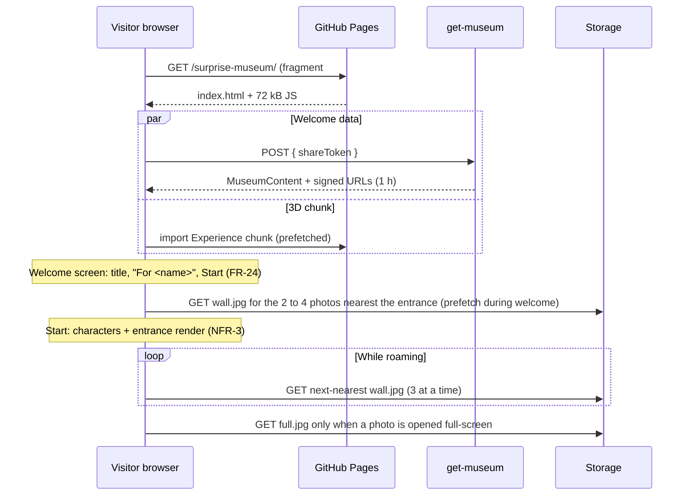

# Architecture: Surprise Museum

Version 1.0 | 27/10/2026 | Owner: architect | Based on requirements v0.2 and user stories v0.2

## 1. Summary

| Concern | Decision | ADR |
|---|---|---|
| Frontend | Vite + React + TypeScript + React Three Fiber + drei + Zustand (default stack, no deviation) | 0001 |
| Hosting | Static site on GitHub Pages at `https://patlu29.github.io/surprise-museum/`, Vite `base: '/surprise-museum/'` | 0002 |
| Deep links | **Hash routing** (`/#/m/<token>`), using `wouter` | 0002 |
| Backend | Supabase in Sydney (ap-southeast-2): Postgres, one private Storage bucket, four Edge Functions, pg_cron | 0003 |
| Access control | Edge Functions are the only gateway. RLS on, no policies, privileges revoked from `anon`. Tokens stored as SHA-256 hashes | 0003 |
| Photo processing | In the browser before upload: decode (HEIC via a lazy decoder), resize, re-encode JPEG (strips all metadata). The server verifies | 0004 |
| Photo delivery | Three renditions (2048 px full, 1024 px wall, 24 px inline placeholder), signed URLs, loaded nearest-first | 0005 |
| Live-readiness (NFR-25) | `CharacterStateSource` abstraction and a pure `src/domain` layer | 0006 |
| Guide navigation | Waypoint graph with A* and 2D circle-versus-box collision. No physics engine, no navmesh | 0007 |
| Avatars | Procedural stylised rig built from primitives, with procedural idle, walk and present animation. glTF kit can replace it later | 0008 |
| Museum layout | Deterministic linear chain: entrance hall, 1 to 5 gallery rooms (4 photos each), finale room | 0009 |
| Retention | Hourly pg_cron job calls the `purge-expired` Edge Function through pg_net | 0010 |
| Name labels | DOM labels (drei `Html`) hidden by a cheap 2D line-of-sight test | 0011 |
| Browser API client | Thin `fetch`/`XMLHttpRequest` client, no `supabase-js` in the bundle | 0012 |
| Package registry | Project `.npmrc` pins the public npm registry | 0013 |

## 2. Stack and versions

Installed on 27/10/2026. Versions are pinned exactly (`save-exact`). Node 22.12 or later is required (built locally on Node 26.7).

| Package | Version | Role | Why |
|---|---|---|---|
| `react`, `react-dom` | 19.3.1 | UI | Default. R3F 9.8 supports React `>=19 <19.4`; do not upgrade React past 19.3 until R3F widens its range |
| `three` | 0.186.1 | Renderer | Default |
| `@react-three/fiber` | 9.8.2 | React renderer for three.js | Default |
| `@react-three/drei` | 10.7.9 | Helpers (`Html`, `KeyboardControls`, `StatsGl`) | Default. Import named helpers only, for tree shaking |
| `zustand` | 5.0.16 | Stores shared by UI and scene | Default |
| `wouter` | 3.13.0 | Hash router (about 2 kB) | ADR 0002. Smaller than React Router; has a built-in hash location hook |
| `heic-to` | 1.6.6 | HEIC decoder (libheif WASM), lazily loaded, `heic-to/csp` build | ADR 0004. Maintained (release 10/2026). **LGPL-3.0**, needs legal sign-off |
| `vite` | 8.3.5 | Build | Default |
| `@vitejs/plugin-react` | 6.1.2 | JSX and Fast Refresh | Default |
| `typescript` | **6.0.3** | Types (`strict`) | TS 7.0 is current, but `typescript-eslint` 8.72 supports only `<6.1`. Move to 7 when it does |
| `vitest` | 5.0.5 | Unit tests | Default |
| `@playwright/test` | 1.64.1 | End-to-end tests | Default |
| `eslint` 10.13.0, `typescript-eslint` 8.72.1, `eslint-plugin-react-hooks` 7.1.1, `eslint-plugin-react-refresh` 0.5.7, `eslint-config-prettier` 10.1.8, `globals` 17.13.0 | | Lint | Default |
| `prettier` | 3.9.10 | Format | Default |

**Deliberately not added:**

| Package | Reason |
|---|---|
| `@react-three/rapier` | Collision needs are 2D circles against boxes (ADR 0007). Rapier adds about 1.5 MB of WASM to the first view |
| `@react-three/postprocessing` | No effect in the MVP needs it, and it costs fill rate on phones |
| `@supabase/supabase-js` | ADR 0012. It adds about 45 kB gzipped and offers no upload progress |
| `leva`, `r3f-perf` | Use drei `StatsGl` in development. Add these later, with a note in this file, if needed |
| `three-pathfinding`, `recast-navigation` | Overkill for a known, axis-aligned layout (ADR 0007) |

Measured from the empty scaffold: first-view JS is 72 kB gzipped, and the lazy 3D chunk is 242 kB gzipped.

## 3. System diagram



The browser never talks to Postgres. It talks to the Edge Functions, and to Storage only through URLs that an Edge Function has signed.

## 4. Source layout and module boundaries

```text
surprise/
├── docs/                       architecture, ADRs, handoffs, requirements
├── public/                     .nojekyll, favicon; models/ textures/ env/ (technical-artist)
├── src/
│   ├── main.tsx, App.tsx       entry and hash routes
│   ├── config/env.ts           VITE_ variables
│   ├── api/                    Edge Function client (no React)
│   ├── media/                  image pipeline and worker (no React)
│   ├── domain/                 pure TypeScript, no React, three or stores
│   │   ├── characters/         CharacterState, sources (NFR-25)
│   │   ├── layout/             generateLayout(photos) -> MuseumLayout
│   │   ├── navigation/         waypoint graph, A*, collision, line of sight
│   │   ├── presentation/       PresentationDirector (FR-26 to FR-29)
│   │   └── guide/              Guide state machine (FR-30, FR-31)
│   ├── state/                  Zustand stores and transient input state
│   ├── hooks/                  shared React hooks
│   ├── scene/
│   │   ├── Experience.tsx      the single Canvas
│   │   ├── objects/            museum geometry, frames, podium
│   │   ├── characters/         Avatar rig and animation; kit/ = part definitions
│   │   ├── photos/             texture loader and priority queue
│   │   ├── controllers/        CharacterRegistry wiring, input to local source
│   │   ├── cameras/            third-person follow camera
│   │   ├── lights/
│   │   ├── materials/          technical-artist
│   │   └── shaders/            technical-artist
│   ├── ui/
│   │   ├── screens/            Home, Create, Preview, Visit, Edit, NotFound, Loading
│   │   ├── builder/            builder steps and customiser
│   │   ├── overlays/           HUD, joystick, caption panel, viewer, finale panel
│   │   └── components/         shared controls
│   └── styles/                 tokens.css, base.css (ux-ui-designer)
├── supabase/
│   ├── config.toml
│   ├── migrations/             schema, RLS, bucket, cron
│   └── functions/              _shared/contract.ts + one folder per function
└── tests/                      unit/ and e2e/ (qa-engineer)
```

### Import rules (enforced by `eslint.config.js`)

| Layer | May import | Must not import |
|---|---|---|
| `src/domain` | `@contract`, other `src/domain` files | React, three, Zustand, `@/state`, `@/api`, `@/scene`, `@/ui` |
| `src/api` | `@contract`, `@/config` | React, three, stores, scene, UI |
| `src/media` | `@contract` | React, three, stores, scene, UI |
| `src/state` | `@/domain`, `@/api`, `@/media`, `@contract`, Zustand | three, `@/scene`, `@/ui` |
| `src/scene` | `@/domain`, `@/state`, `@contract`, three, R3F, drei | `@/ui`, `@/api`, `@/media` |
| `src/ui`, `src/hooks` | `@/state`, `@/domain` (types), `@/api`, `@/media`, `@contract` | three, R3F; `@/scene` only by `lazy(() => import('@/scene/Experience'))` |

Aliases: `@/` is `src/`, and `@contract` is `supabase/functions/_shared/contract.ts`. Both are configured in `tsconfig.app.json` and `vite.config.ts`.

**Naming:** code identifiers use US spelling (`color`, `hairColor`) to match three.js, CSS and the DOM. All copy and documents use Australian English.

## 5. Data flow

### 5.1 Visitor session



Inside the scene, once per frame:

```text
input (joystick/keys) -> LocalVisitorController.tick -> visitor CharacterState
visitor state + layout -> PresentationDirector.update -> presentation intent
intent + visitor + camera -> AutonomousGuideSource.tick -> guide CharacterState
CharacterRegistry: on presentation change -> sessionStore (UI caption panel, viewed count)
renderers (Avatar, NameLabel, PhotoLoader priority) read CharacterState; never write it
```

### 5.2 Creator: build, upload, publish

```mermaid
sequenceDiagram
  participant C as Creator browser
  participant W as media worker
  participant EF as Edge Functions
  participant S as Storage
  C->>W: add file(s)
  W-->>C: full.jpg, wall.jpg, lqip, width, height (metadata gone)
  C->>EF: create-museum (first photo only)
  EF-->>C: editToken (draft, expires in 7 days)
  loop each photo (3 in parallel)
    C->>EF: manage-museum reserve-photo
    EF-->>C: photoId + two signed upload URLs (2 h)
    C->>S: PUT full.jpg, PUT wall.jpg (XHR with progress, FR-4)
    C->>EF: manage-museum confirm-photo { width, height, lqip }
    EF->>S: download and verify both objects
    EF-->>C: ready (or invalid_image and objects deleted)
  end
  Note over C: captions, names, avatars stay local until publish; preview uses local blobs
  C->>EF: manage-museum publish { document }
  EF-->>C: shareToken, expiresAt (90 days)
```

Uploading starts as soon as each photo is processed, not at publish, so publishing a 20-photo museum is one small request (NFR-18). A failed upload is retried alone with `renew-upload` (FR-4).

### 5.3 Preview equals published

Preview (`#/create/preview`) builds a `MuseumContent` from the local draft, using `blob:` URLs for the same `wall.jpg` and `full.jpg` files that are uploaded. Layout, avatars and Guide behaviour come from the same deterministic functions, so preview and published are identical (US-8) without any server round trip. Preview works without a backend, which also makes local development possible before Supabase exists.

## 6. 3D scene

### 6.1 Conventions

| Item | Value |
|---|---|
| Units | Metres. A medium-height character is 1.70 m |
| Axes | +Y up. The route runs from the entrance at `z = 0` towards `-Z`. +X is the Visitor's right on entry |
| Heading | Radians about +Y. 0 faces +Z |
| Single canvas | `src/scene/Experience.tsx`. The builder's avatar preview is a second, separate small canvas that is only mounted in the builder. Never mount both at once (iOS WebGL context limits) |

### 6.2 Procedural museum layout (ADR 0009)

`generateLayout(photos: { id, width, height }[]): MuseumLayout` lives in `src/domain/layout`. It is pure and deterministic, and unit-tested for 1 to 20 photos.

```text
 z=0  ┌────────────┐  Entrance hall 8 x 6 m. Spawn: Visitor (0, -2) facing -Z, Guide (1.0, -1.6)
      │  ENTRANCE  │  Title plaque on the left wall
      └────┐  ┌────┘  Doorway 2.4 m wide, centred
      ┌────┘  └────┐
      │ 1        2 │  Gallery room k: 8 m wide; 10 m deep (3 or 4 photos) or 6 m deep (1 or 2)
      │            │  Slot order in a room: left-near, right-near, left-far, right-far
      │ 3        4 │  Near/far slots at 2.5 m and 7.5 m into a 10 m room; 3 m into a 6 m room
      └────┐  ┌────┘
          ...           rooms = ceil(n / 4), 1 to 5
      ┌────┘  └────┐
      │   FINALE   │  Finale room 8 x 8 m. Podium disc r = 1.5 m at room centre + 1 m;
      │    (◎)     │  trigger zone r = 1.8 m; lectern (solid, 0.6 x 0.4 m) at the far edge
      └────────────┘  Closed end: the museum has no exits (FR-34)
```

| Parameter | Value | Requirement |
|---|---|---|
| Wall height and thickness | 3.2 m, 0.2 m | |
| Photo display box | Fits within 1.6 m wide by 1.4 m high, keeping aspect ratio; centre 1.55 m above the floor; frame border 0.06 m | FR-39 (no crop or distortion) |
| Left and right walls | 8 m apart, so a Visitor in the middle is 4 m from both photos and outside both 3 m zones | FR-26 |
| Presentation zone | Front-centre point 0.3 m off the wall; enter at 3 m after 1 s, exit at 4.5 m; "same side" means `dot(wallNormal, visitor - point) > 0.2 m` | FR-26 to FR-28 |
| Length | 6 m + rooms + 8 m. 64 m at most for 20 photos (about 40 s of walking) | |

`MuseumLayout` contains: `rooms`, `colliders` (axis-aligned boxes at true size; navigation inflates them by the character radius), `slots` (photo id, position, normal, size, zone), `finale` (centre, radius), `spawn` (visitor and guide), `navGraph` (nodes and edges) and `bounds`.

### 6.3 Navigation and collision (ADR 0007)

| Part | Approach |
|---|---|
| Collision | Characters are circles (r = 0.3 m) against static axis-aligned boxes. Move, then push out along the shortest axis, two passes, so characters slide along walls. The Visitor and Guide do not collide with each other (A-18) |
| Line of sight | 2D segment against boxes inflated by 0.35 m. Used by the Guide, the name-label occlusion (ADR 0011) and the camera boom |
| Graph | Generated with the layout: nodes on the centreline every 2.5 m, at each doorway, at each photo standing spot, at spawn and at the finale. Edges join nodes with line of sight. About 60 to 120 nodes |
| Path | A* with a Euclidean heuristic, then string-pulling (skip any node that has line of sight to a later one). Re-plan only when the target moves more than 1 m or every 0.5 s |
| Cost | Under 0.2 ms per frame on the reference phone. Runs in the main thread; no worker needed |

### 6.4 Presentation director (FR-26 to FR-29, FR-71, A-17, A-19)

`src/domain/presentation/PresentationDirector` is a pure state machine updated once per frame with the Visitor's position and `dt`. It outputs an **intent**: `none`, `photo(id)` or `finale`.

| Rule | Behaviour |
|---|---|
| Candidates | Zones with distance 3 m or less and on the same side |
| Dwell | The nearest candidate must stay nearest for 1 s. The timer resets when the nearest candidate changes or disappears |
| Exit | The active photo ends past 4.5 m or on the other side |
| Switch | During a presentation, a different nearest candidate that completes its dwell replaces the current one. Nothing is queued |
| Dismiss | Ends the presentation and suppresses that photo until the Visitor goes beyond 4.5 m, after which it can present again (A-19) |
| Finale | Entering the finale zone starts the finale intent immediately. Leaving to more than r + 1 m ends it. Keep exploring dismisses it with the same suppression rule |
| Viewed | A photo is viewed when its presentation starts, or when opened full-screen (A-17). Stored in `sessionStore` |
| No caption | The intent and the Guide behaviour are unchanged; the UI shows no panel (FR-71) |

The UI shows the caption panel when the Guide's `presentation` changes. The Guide sets it on arrival, or 1.5 s after the intent at the latest, so the panel never waits on a long walk. Both delays are tuning constants (A-16).

### 6.5 Guide AI (FR-30, FR-31, FR-62, NFR-26)

`AutonomousGuideSource` (in `src/domain/guide`) implements `CharacterStateSource`. It is constructed with the layout, the navigation API and the director.

| State | Behaviour | Leaves when |
|---|---|---|
| `follow` | Target: 2.5 m behind the Visitor and 0.8 m to the side away from the camera's line to the Visitor. Idle while within 2 to 5 m and the Visitor is still. Walks at 1.25 times the Visitor's speed to catch up | Intent set: `approach`. More than 8 m away or no progress for 3 s: `relocate` |
| `approach` | Path to the presentation spot: 1.1 m beside the Visitor, perpendicular to the photo's normal, on the side with clearance, and never closer to the photo than the Visitor (so it never stands between them). With reduced motion, go straight to `relocate` and fade in at the spot | Arrived: `present`. Intent cleared: `follow` |
| `present` | Face half-way between the photo and the Visitor; set `presentation`; play `present` gesture once (Should); hold still | Intent cleared or changed: `follow` or `approach` |
| `relocate` | Fade out over 0.25 s, teleport to the best spot 2 to 4 m from the Visitor that is outside the camera frustum and has line of sight to the Visitor (otherwise just beside the Visitor), then fade in over 0.25 s | Done: previous goal |
| Yield (any state) | If the Visitor's position 1 s ahead is within 0.6 m of the Guide, or the Guide is inside the camera-to-Visitor corridor (0.5 m wide), sidestep at right angles. If it cannot, fade to 35% opacity until clear | |

NFR-26 is a unit test: because `src/domain` is pure, a 30-minute random-roaming soak test runs in Vitest at a fixed 1/30 s step in a few seconds of CPU. It asserts the Guide is never stuck for more than 10 s, never inside a collider and never in the Visitor's path.

### 6.6 Character-state abstraction (NFR-25, ADR 0006)

Defined in `src/domain/characters/characterState.ts` (written; implementations to follow).

```text
             ┌──────────────────────────┐
 input  ───▶ │ LocalVisitorController   │──┐
             └──────────────────────────┘  │   CharacterRegistry      ┌─────────────┐
             ┌──────────────────────────┐  ├─▶ (visitor, guide)  ───▶ │ <Avatar>     │
 director ─▶ │ AutonomousGuideSource    │──┤   tickAll(dt, world)     │ <NameLabel>  │
             └──────────────────────────┘  │   onPresentationChange   │ caption via  │
             ┌──────────────────────────┐  │          │               │ sessionStore │
 test    ──▶ │ ScriptedCharacterSource  │──┤          ▼               └─────────────┘
             └──────────────────────────┘  │   sessionStore (UI)
             ┌──────────────────────────┐  │
 future  ──▶ │ NetworkCharacterSource   │──┘
             └──────────────────────────┘
```

| Element | Contract |
|---|---|
| `CharacterState` | `position`, `heading`, `speed`, `locomotion` (`idle`, `walk`), `gesture`, `presentation` (`none`, `photo`, `finale`, `greeting`), `opacity`, `teleportSeq`, `timestamp` |
| `CharacterStateSource` | `kind`, `tick(dt, world)`, `read()`, optional `teleport()` and `dispose()` |
| `CharacterRegistry` | Holds one source per role, ticks visitor then guide, and emits presentation changes once per change |
| Renderers | `<Avatar role>` and `<NameLabel role>` read `registry.getSource(role).read()` in `useFrame`. They never know the source kind. Animation is derived from `locomotion`, `speed` and `gesture` only |
| Per-frame data | Lives in the sources, not in Zustand, so nothing re-renders per frame. Only discrete changes (presentation, viewed) go to stores |

**Future live mode (FR-66, not built):** a `NetworkCharacterSource` fed by a Supabase Realtime Broadcast channel named after the museum id, with a 100 ms interpolation buffer keyed on `timestamp` and a snap when `teleportSeq` changes. The Visitor's client publishes its local state at 10 to 15 Hz. In live mode the Creator's client owns the Guide, and presentation is set by the Creator's input instead of the director. No renderer, label or panel code changes. The NFR-25 test drives a character with `ScriptedCharacterSource` and asserts that the avatar transform, animation and label follow it.

### 6.7 Avatars (ADR 0008)

| Topic | Approach |
|---|---|
| Construction | A hierarchy of groups (hips, spine, neck, head, upper and lower arms and legs, hands, feet) made of shared primitive geometries (capsules, spheres, rounded boxes, lathes). Stylised, friendly proportions |
| Options | `AvatarConfig` in the contract: skin tone (10), hair style (12), hair colour (11), outfit style (6) with colour (12), body type (4), height (3), facial hair (5, Guide only), glasses and hat (Release 2). Body type scales torso and hip widths; height scales the rig uniformly (0.91, 1.00, 1.09) |
| Parts kit | `src/scene/characters/kit/`: one function per hair style, facial-hair style and outfit that returns primitive parts per bone, and a palette that maps option ids to colours. Owner: technical-artist |
| Rig and animation | `src/scene/characters/Avatar.tsx`: assembles parts and animates bones procedurally in `useFrame`. Walk: phase advances by `speed / strideLength`, legs swing about 25 degrees, arms counter-swing about 20 degrees, hips bob 3 cm. Idle: breathing and slight sway. Present: right arm rises towards the photo over 0.6 s, holds, lowers. Reduced motion: still pose. Owner: scene-developer |
| Budget per character | 6,000 triangles or fewer; 10 draw calls or fewer (merge static parts per bone per material) |
| Update speed | Option changes rebuild only the affected part, well within 1 s (FR-15) |
| Swappable | `<Avatar config state>` is the stable interface. A modular glTF kit with a shared skeleton can replace the internals later without touching sources, labels or UI |

### 6.8 Name labels (FR-17, ADR 0011)

A drei `<Html>` element anchored 0.35 m above each head (scaled with height), facing the camera by nature of DOM. It is hidden when the 2D line of sight from the camera to the head is blocked by a wall. DOM text renders accents and emoji exactly as typed (US-4) and gets contrast from a solid CSS backing (4.5:1, NFR-12). Labels are `aria-hidden`; names are announced by the UI instead.

### 6.9 Camera and input

| Topic | Approach |
|---|---|
| Camera | Third person (A-4). Boom 3.5 m, height 2.2 m, looking at the Visitor's head. The user orbits by dragging; it never moves on its own beyond following the Visitor (FR-62). The boom shortens when line of sight to the Visitor is blocked |
| Touch | Virtual joystick (DOM overlay in `src/ui/overlays`, 44 px minimum targets) in the lower left; drag elsewhere to orbit |
| Keyboard | W A S D and arrow keys move; Q and E or Shift with arrows orbit; Enter or Space dismisses the panel; Escape closes the viewer (FR-61) |
| Transient input | `src/state/inputState.ts`: a plain mutable object holding a `MoveIntent` and orbit deltas. Written by the UI, read by `LocalVisitorController`. Not a Zustand store |
| Picking | R3F `onClick` on photo meshes opens the full-screen viewer (FR-35) |

### 6.10 Photo loading: nearest first (NFR-3, NFR-5, FR-58)

| Step | Behaviour |
|---|---|
| Placeholder | Each frame first shows the inline 24 px LQIP (in the API response, so it is never blank) |
| Queue | `src/scene/photos/PhotoLoader`: a priority queue with 3 concurrent downloads. Priority is path distance from the Visitor to the slot, re-ranked every 0.5 s and whenever a download finishes |
| Prefetch | While the welcome screen shows, the 2 to 4 slots nearest the spawn start downloading |
| Decode | `fetch` the blob, then `createImageBitmap(blob, { imageOrientation: 'flipY' })`, upload to a `THREE.Texture` (sRGB, mipmaps, anisotropy 4 on desktop and 2 on phones). Close the bitmap after upload |
| Failure | Three attempts with back-off (1 s, 3 s, 9 s), then `failed` with a retry control (FR-58). A 400 or 403 after `urlsExpireAt` triggers one `get-museum` refresh |
| Full size | `full.jpg` is never a texture. It loads in an `` in the full-screen viewer only |
| Memory | 20 wall textures at 1024 px are about 80 MB of GPU memory at worst. If NFR-6 testing shows pressure, the performance optimiser may evict textures beyond the 12 nearest back to the LQIP |
| Status | `photoStatus` in `museumStore` (`placeholder`, `loading`, `loaded`, `failed`) so the UI can show retry |

### 6.11 Rendering

Photos use an unlit material (`MeshBasicMaterial`) so they are always evenly lit, with no glare or shadow (FR-40). The room uses a hemisphere light and one directional light without shadow maps; characters get a blob shadow. Device pixel ratio is capped at 1.5 on phones and 2 on desktops. Rendering pauses when the tab is hidden, and is capped at 30 FPS on phones (NFR-7). WebGL context loss sets `sessionStore.contextLost` and the UI offers a reload (NFR-11).

## 7. Backend: data model and API

### 7.1 Tables (`supabase/migrations/20261027000100_initial_schema.sql`)

**`museums`**

| Column | Type | Notes |
|---|---|---|
| `id` | uuid PK | Internal only. Never authorises anything |
| `edit_token_hash` | bytea(32), unique | SHA-256 of the edit token |
| `share_token_hash` | bytea(32), unique | SHA-256 of the share token |
| `status` | enum `draft`, `published` | |
| `title` | text, up to 60 | Empty means the default title |
| `visitor_name`, `guide_name` | text, 1 to 24 | Required when published |
| `opening_greeting` | text, up to 500 | Release 2 |
| `closing_message` | text, up to 1,000 | |
| `theme` | text | `default` |
| `visitor_avatar`, `guide_avatar` | jsonb | `AvatarConfig`, validated in the Edge Function |
| `content_version` | smallint | Contract version |
| `photo_reservations` | smallint, 0 to 100 | Abuse cap |
| `created_at`, `updated_at`, `published_at` | timestamptz | |
| `expires_at` | timestamptz | Draft: created + 7 days. Published: first publish + 90 days |

**`photos`**

| Column | Type | Notes |
|---|---|---|
| `id` | uuid PK | Part of the storage key |
| `museum_id` | uuid FK, cascade delete | |
| `status` | enum `pending`, `ready` | `ready` after `confirm-photo` |
| `position` | smallint 0 to 19, unique per museum | Set on publish |
| `caption` | text, up to 280 | Set on publish |
| `width`, `height` | smallint, up to 2048 | Of `full.jpg` |
| `lqip` | text, up to 4,096 | `data:image/jpeg;base64,...` only |
| `created_at`, `confirmed_at` | timestamptz | |

Support tables: `storage_purge_queue` (museum ids whose storage still needs deleting) and `rate_limits` (fixed windows keyed by a salted IP hash). Functions: `rate_limit_hit`, `reserve_photo` (atomic limit of 20 live photos and 100 reservations) and `delete_museum_rows` (delete and queue in one transaction). All are `service_role` only.

**Storage:** bucket `photos`, private, 2 MiB per object, `image/jpeg` only. Keys are `<museum_id>/<photo_id>/full.jpg` and `.../wall.jpg`. Uploads set `cache-control: private, max-age=3600`.

### 7.2 Row-level security

| Object | `anon`, `authenticated` | `service_role` (Edge Functions only) |
|---|---|---|
| `museums`, `photos`, `storage_purge_queue`, `rate_limits` | RLS enabled, **no policies**, all privileges revoked: no select, insert, update or delete through REST or GraphQL | Full access (bypasses RLS) |
| Functions in `public` | Execute revoked | Execute granted |
| `storage.objects` in bucket `photos` | No policies: cannot list, read, write or delete | Full access; issues signed URLs |
| Future tables and functions in `public` | Default privileges revoked for the `postgres` role | |

Why not token-checking RLS policies? Policies that read a token from request headers work for tables but not cleanly for Storage, and they spread the security logic across SQL and two APIs. One gateway is easier to review and test. RLS remains as a deny-all backstop, so a bug in the client cannot open a hole.

### 7.3 Edge Function API

All calls: `POST {VITE_SUPABASE_URL}/functions/v1/<name>` with headers `Content-Type: application/json`, `apikey: <VITE_SUPABASE_ANON_KEY>` and `x-region: ap-southeast-2`. Bodies and responses are typed in `supabase/functions/_shared/contract.ts`. Responses carry `Cache-Control: no-store`. Errors use `ApiError { error, message, field? }`.

| Function | Who | Request | Response | Rate limit |
|---|---|---|---|---|
| `create-museum` | Anyone (builder) | `{}` | `{ editToken, draftExpiresAt }` | 10 per hour per IP hash |
| `get-museum` | Share-token holder | `{ shareToken }` | `{ museum: MuseumContent, urlsExpireAt }` or 404 `not_found` | 60 per minute per IP hash; 20 not-found per 10 minutes per IP hash |
| `manage-museum` | Edit-token holder | `{ action, editToken, ... }` (below) | Per action | 600 per hour per museum; 120 per minute per IP hash |
| `purge-expired` | pg_cron only | `{}` with `x-cron-secret` header | `{ purged, retried }` | Secret check (constant-time) |

`manage-museum` actions:

| Action | Body | Effect | Response |
|---|---|---|---|
| `get` | — | Read for the edit screen | `ManageGetResponse` (share token derived from the edit token) |
| `reserve-photo` | — | `reserve_photo()`; signs two upload URLs (2 h) | `PhotoUploadTicket` |
| `renew-upload` | `photoId` | New upload URLs for a `pending` photo (retry, FR-4) | `PhotoUploadTicket` |
| `confirm-photo` | `photoId, width, height, lqip` | Downloads both objects and verifies them (section 10.3). Marks `ready`, or deletes them and returns `invalid_image` | `{ photoId, status }` |
| `remove-photo` | `photoId` | Deletes the objects and the row immediately | `{ photoId, removed }` |
| `publish` | `document: MuseumDocument` | Validates all fields and avatars; requires 1 to 20 `ready` photos belonging to this museum; sets positions and captions in one transaction; deletes photos not in the document; sets `published`, `published_at` (first time only) and `expires_at` | `{ shareToken, publishedAt, expiresAt }` |
| `delete` | — | `delete_museum_rows()`, then removes the storage prefix; on storage failure the queue retries hourly | `{ deleted: true }` |

The backend developer will expand this into `docs/api.md` (examples, status codes per action) and keep both in step.

### 7.4 Retention (NFR-16, ADR 0010)

| Event | Effect |
|---|---|
| Publish | `expires_at = published_at + 90 days`. Re-publishing an edited museum (Release 2) does not extend it |
| Draft never published | Purged 7 days after creation |
| Creator deletes | Rows gone at once (share link returns not found, FR-52). Objects removed in the same request; if that fails, the hourly job retries |
| Hourly job | `pg_cron` at minute 17 calls `purge-expired` through `pg_net` with the Vault `cron_secret`. It deletes expired museums and drains `storage_purge_queue` |
| Backups | Database backups follow the Supabase plan (all at most 30 days). Storage objects are not in database backups |

## 8. State stores (`src/state`, owner: frontend-developer)

| Store | Holds | Written by | Read by | Persisted |
|---|---|---|---|---|
| `builderStore` | Draft text, avatars, photo list (`localId`, `photoId`, status, progress, error, caption, size, LQIP, blobs and object URLs), `editToken`, consent, publish state and result | Builder UI, upload queue | Builder UI, preview | Release 2 (FR-12): IndexedDB. MVP: memory only |
| `museumStore` | `status` (`idle`, `loading`, `ready`, `not-found`, `error`), `content: MuseumContent`, `source` (`published` or `preview`), `urlsExpireAt`, `photoStatus` per photo | Visit and preview screens, scene PhotoLoader (status) | Scene, UI | No |
| `sessionStore` | `phase` (`welcome`, `roaming`), `presentation` (mirror of the Guide's), `viewed` set, `viewerPhotoId`, `contextLost`, and command counters `dismissSeq`, `replaySeq`, `teleportTo` (UI to scene) | CharacterRegistry callback, UI actions | UI, scene | No |
| `settingsStore` | `reducedMotion` (system, on, off), `quality` (auto, low), `muted`, `captionScale` | Settings UI | Scene, UI | `localStorage` |
| `inputState` (not Zustand) | `MoveIntent`, orbit deltas | Joystick, keyboard hook | `LocalVisitorController` | No |

Rules: the scene reads stores with `useStore.getState()` inside `useFrame` or with narrow selectors, never by subscribing to whole stores. Per-frame data never goes into a store.

## 9. Routes (hash routing, ADR 0002)

| Route | Screen | Purpose | Loads 3D |
|---|---|---|---|
| `#/` | `HomeScreen` | Landing and "Create a museum" | No |
| `#/create` | `CreateScreen` | Builder: photos, names and messages, characters, review and publish | Avatar preview canvas only |
| `#/create/preview` | `PreviewScreen` | The full Visitor experience from the local draft, with an Exit preview bar | Yes |
| `#/m/:shareToken` | `VisitScreen` | Welcome, then the museum | Yes, after the welcome screen appears |
| `#/edit/:editToken` | `EditScreen` | MVP: view, copy share link, delete. Release 2: full edit using the builder | Thumbnails only |
| `#/privacy`, `#/terms` | Static pages | Linked from the builder and welcome screen (NFR-13) | No |
| anything else | `NotFoundScreen` | Friendly, reveals nothing (FR-55) | No |

Share link: `https://patlu29.github.io/surprise-museum/#/m/<24 chars>`. Edit link: `https://patlu29.github.io/surprise-museum/#/edit/<43 chars>`. After publishing, the builder must not put the edit token in `localStorage`; it shows it once with the "save this" warning (FR-50).

## 10. Security and privacy

### 10.1 Tokens

| Token | Generation | Bits | Stored |
|---|---|---|---|
| Edit | 32 bytes from `crypto.getRandomValues` in `create-museum`, base64url | 256 | SHA-256 only |
| Share | `base64url(SHA-256("surprise-museum/share/v1:" + editToken))`, first 24 characters | 144 | SHA-256 only |

Deriving the share token from the edit token means the edit screen can show the share link without the database storing any token, and the share token reveals nothing about the edit token. Requests with a token of the wrong format return `not_found` before any database query.

### 10.2 Threat model

| Threat | Control |
|---|---|
| Someone uses the public anon key against REST, GraphQL or Storage | RLS on with no policies; privileges revoked; private bucket with no policies |
| Guessing a share link | 144-bit tokens; uniform 404; per-IP not-found rate limit (US-23) |
| Listing museums or photos | No list endpoint exists; Storage list is denied; object keys contain random UUIDs |
| Token leak through logs or referrers | Tokens live in the URL fragment (never sent to GitHub Pages) and in POST bodies (not logged); `referrer` meta is `no-referrer`; functions never log bodies |
| Database read leak | Only token hashes are stored |
| Photo location leak | Client re-encoding drops all metadata; `confirm-photo` rejects files with EXIF, XMP or IPTC segments (FR-10) |
| Malicious upload | Bucket allows `image/jpeg` up to 2 MiB; `confirm-photo` checks magic bytes, segment structure and dimensions (NFR-15) |
| Free-hosting abuse | Private bucket, 20 live photos and 100 reservations per museum, 10 drafts per hour per IP, drafts purged after 7 days |
| Cross-site scripting stealing tokens | React escapes all text; CSP meta in the build (`script-src 'self'`); no `dangerouslySetInnerHTML` |
| Indexing | `robots` meta `noindex, nofollow, noarchive` on the whole site (FR-49); link previews see only generic Open Graph tags |
| Account creation | Supabase Auth sign-ups disabled, so nobody can obtain the `authenticated` role |

### 10.3 Photo pipeline (ADR 0004)

Client (`src/media`, in a Web Worker where `OffscreenCanvas` exists, otherwise the main thread):

1. Check type by content: JPEG, PNG, WebP or HEIC/HEIF (`ftyp` brands `heic`, `heix`, `hevc`, `hevx`, `mif1`, `msf1`). Reject anything else or over 15 MB with the file name and reason (FR-3).
2. Decode with `createImageBitmap(file, { imageOrientation: 'from-image' })`, which applies EXIF rotation. If that fails and the file is HEIC, load `heic-to/csp` lazily and convert to JPEG first. Safari decodes HEIC natively.
3. Resize with high-quality smoothing. **Never allocate a canvas larger than 4096 px on the long edge** (iOS limits canvas area to about 16.7 million pixels, and 24 and 48 MP iPhone photos exceed it): draw the source straight into the target-size canvas, using at most one intermediate step.
4. Encode JPEG: `full` at 2048 px, starting at quality 0.85 and stepping down to meet 600 KB; `wall` at 1024 px, quality 0.8; `lqip` at 24 px, quality 0.5, as a data URL. Re-encoding through a canvas writes a fresh file, so EXIF, GPS, XMP, IPTC and maker notes are gone.
5. Process one photo at a time and close every bitmap, to stay within phone memory.

Server (`confirm-photo`): each object exists, is 2 MiB or smaller, starts with `FF D8 FF`, contains no APP1 (EXIF or XMP) or APP13 (IPTC) segments, and has a frame header no larger than 2048 px (1024 px for `wall`) that matches the declared size. The check reads bytes only; no image decoding runs on the server.

Why client-side: Supabase Edge Functions have tight CPU and memory limits that cannot decode and resize 15 MB HEIC files; Supabase image transformations need a paid plan and do not guarantee metadata removal at rest; and uploading 600 KB instead of up to 15 MB is about 25 times faster on 4G (NFR-18). The server check means a modified client still cannot store metadata.

### 10.4 Content Security Policy

GitHub Pages cannot set headers, so `vite.config.ts` injects a CSP `<meta>` into the production build only:
`default-src 'self'; script-src 'self' 'wasm-unsafe-eval'; style-src 'self' 'unsafe-inline'; img-src 'self' data: blob: <supabase>; connect-src 'self' <supabase>; worker-src 'self' blob:; media-src 'self' blob:; font-src 'self'; object-src 'none'; base-uri 'self'; form-action 'self'`.
A meta CSP cannot set `frame-ancestors`, so the app should refuse to run inside a frame (`window.top !== window.self`) on the edit route (frontend-developer). If any loader needs a CDN (for example drei's default Draco decoder path), host the files under `public/` instead.

## 11. Testing strategy

| Level | Tool | Scope | Owner |
|---|---|---|---|
| Unit, domain | Vitest (Node) | Layout for 1 to 20 photos; nav graph and A*; collision; director edge cases (US-12, US-13); Guide state machine; NFR-26 30-minute soak | scene-developer writes alongside code (`src/**/*.test.ts`); QA reviews |
| Unit, contract and media | Vitest | Validators, JPEG segment scanner, size targets | backend-developer, frontend-developer |
| NFR-25 | Vitest with `@react-three/test-renderer` (QA to add) | Drive an avatar with `ScriptedCharacterSource`; assert transform, animation and label follow | qa-engineer |
| Edge Functions | `deno test` | Token handling, actions, uniform 404, rate limits | backend-developer |
| Database | pgTAP (`supabase test db`) | `anon` cannot read or write any table or list Storage | backend-developer |
| End to end | Playwright (desktop Chromium, iPhone WebKit, Pixel Chromium) | Builder with mocked `/functions/v1/*`, preview, visit, not found, keyboard-only path, reduced motion | qa-engineer |
| Performance | Manual on reference devices, plus Lighthouse on 4G throttling | NFR-1 to NFR-6 | performance-optimiser |

## 12. Performance budgets

| Budget | Target | Now (empty scaffold) |
|---|---|---|
| First-view JS (welcome screen) | 120 kB gzipped or less | 72 kB |
| 3D chunk | 350 kB gzipped or less | 242 kB |
| First view total, excluding photos (NFR-4) | 1.5 MB or less (requirement: under 10 MB) | about 0.3 MB |
| Photos, 20-picture museum | About 3.5 MB of wall renditions | |
| Draw calls | 120 or fewer | |
| Triangles | 150,000 or fewer | |
| GPU texture memory | 100 MB or less | |
| Frame time | 16.7 ms on the reference laptop, 33 ms on the reference phone (NFR-1) | |

## 13. Build, environment and deployment

| Item | Value |
|---|---|
| Scripts | `dev`, `build` (`tsc -b && vite build`), `preview`, `lint`, `typecheck`, `test`, `test:watch`, `test:e2e`, `format`, `format:check` |
| Registry | Project `.npmrc` pins `https://registry.npmjs.org/` so the lockfile works in GitHub Actions (ADR 0013) |
| Output | `dist/` with assets under `/surprise-museum/assets/`; `public/.nojekyll` stops Jekyll processing |

Environment variables:

| Name | Where | Secret? | Purpose |
|---|---|---|---|
| `VITE_SUPABASE_URL` | `.env.local`; GitHub Actions **variable** | No (public) | Supabase project URL |
| `VITE_SUPABASE_ANON_KEY` | `.env.local`; GitHub Actions **variable** | No (public by design) | Legacy anon key or new publishable key |
| `VITE_SUPABASE_FUNCTIONS_REGION` | Optional | No | Defaults to `ap-southeast-2` |
| `ALLOWED_ORIGINS` | `supabase secrets set` | No | CORS allow-list: `https://patlu29.github.io`, localhost ports |
| `CRON_SECRET` | `supabase secrets set` and Vault `cron_secret` | **Yes** | Authorises `purge-expired` |
| `RATE_LIMIT_SALT` | `supabase secrets set` | **Yes** | Salts IP hashes |
| `SUPABASE_URL`, `SUPABASE_SERVICE_ROLE_KEY` | Injected by Supabase into functions | **Yes** (service role) | Never in GitHub variables or any `VITE_` name |
| `SUPABASE_ACCESS_TOKEN`, `SUPABASE_PROJECT_REF`, `SUPABASE_DB_PASSWORD` | GitHub Actions **secrets** | **Yes** | CI deploy of migrations and functions (devops-engineer) |
| Vault `project_url`, `cron_secret` | Supabase SQL editor | `cron_secret` yes | Used by the pg_cron job |

Deployment (devops-engineer): one workflow builds on push to `main` (`npm ci`, `lint`, `typecheck`, `test`, `build` with the two variables), uploads `dist/` with `actions/upload-pages-artifact` and deploys with `actions/deploy-pages`. A second, manual workflow runs `supabase db push` and `supabase functions deploy`. Step-by-step Supabase setup is in `supabase/README.md`.

## 14. Ownership map

| Path | Owner | Notes |
|---|---|---|
| `docs/architecture.md`, `docs/decisions/`, root config (`package.json`, `.npmrc`, `tsconfig*.json`, `vite.config.ts`, `eslint.config.js`, `.prettierrc.json`, `.gitignore`, `.env.example`, `index.html`) | architect | |
| `src/domain/characters/characterState.ts` | architect (interfaces) | Changes need an ADR 0006 update |
| `src/domain/**` (everything else), `src/scene/**` except below | scene-developer | Layout, navigation, director, Guide, sources, registry, Avatar rig, PhotoLoader, camera |
| `src/scene/materials/`, `src/scene/shaders/`, `src/scene/characters/kit/`, `public/models/`, `public/textures/`, `public/env/` | technical-artist | Avatar parts and palette, museum theme look |
| `src/App.tsx`, `src/main.tsx`, `src/ui/`, `src/state/`, `src/hooks/`, `src/media/`, `src/lib/`, `src/config/` | frontend-developer | Builder, overlays, stores, image pipeline |
| `src/styles/`, `docs/design-spec.md` | ux-ui-designer | |
| `supabase/**`, `src/api/`, `docs/api.md` | backend-developer | `supabase/` replaces `server/` in this project |
| `tests/`, `playwright.config.ts`, `docs/qa-report.md` | qa-engineer | Starter `playwright.config.ts` created by the architect |
| `.github/`, `docs/deployment.md` | devops-engineer | |
| `docs/performance.md` | performance-optimiser | |

## 15. Risks

| Risk | Impact | Mitigation |
|---|---|---|
| Supabase free-plan projects pause after a period of inactivity, and have no backups | A gift link opened weeks later fails | Decide the plan before launch (open question). A scheduled keep-alive request is a weak workaround |
| 24 and 48 MP iPhone photos exceed iOS canvas limits | Builder crashes on the most common phones | 4096 px intermediate cap; sequential processing; test on a real iPhone early |
| `heic-to` is LGPL-3.0 | Licence obligation | Lazy separate chunk keeps it replaceable; legal review (NFR-14) |
| Edge Function cold start on 4G | Welcome screen slower (NFR-2) | Preconnect to Supabase, `x-region` pin, LQIP in the first response, 3D chunk fetched in parallel |
| Signed URLs may be cached by the Storage CDN after deletion | Photos visible for up to an hour to someone already holding a URL | 1 h signed-URL lifetime, `private` cache-control, objects deleted at once |
| R3F caps React at `<19.4` | Automated upgrades break the build | Pin exact versions; dependency bot must respect peer ranges |
| In-app browsers (Instagram, Messenger) have WebGL and memory quirks | Visitor cannot open the gift | NFR-9 detection and an "Open in browser" hint; test early |
| Procedural avatars may not look enough like the person | Emotional payoff weaker | Strong palette and hair kit; `Avatar` interface lets a glTF kit replace it |
| Edit link sits in browser history | Someone on a shared device could delete the museum | Warn on the publish screen; Release 2 could add a passcode |

## 16. Decision records

| ADR | Title |
|---|---|
| [0001](decisions/0001-default-3d-web-stack.md) | Default 3D web stack, TypeScript 6 pin |
| [0002](decisions/0002-github-pages-hash-routing.md) | GitHub Pages with hash routing |
| [0003](decisions/0003-supabase-edge-function-gateway.md) | Supabase with Edge Functions as the only data gateway |
| [0004](decisions/0004-client-side-photo-processing.md) | Client-side photo processing with server verification |
| [0005](decisions/0005-photo-renditions-and-loading.md) | Photo renditions, signed URLs and nearest-first loading |
| [0006](decisions/0006-character-state-abstraction.md) | Character-state abstraction and pure domain layer |
| [0007](decisions/0007-waypoint-navigation-no-physics.md) | Waypoint navigation and 2D collision, no physics engine |
| [0008](decisions/0008-procedural-stylised-avatars.md) | Procedural stylised avatars |
| [0009](decisions/0009-linear-procedural-layout.md) | Linear procedural museum layout |
| [0010](decisions/0010-retention-with-pg-cron.md) | Retention with pg_cron and a purge function |
| [0011](decisions/0011-dom-name-labels.md) | DOM name labels with line-of-sight hiding |
| [0012](decisions/0012-thin-api-client.md) | Thin API client instead of supabase-js |
| [0013](decisions/0013-public-npm-registry.md) | Public npm registry for this project |
