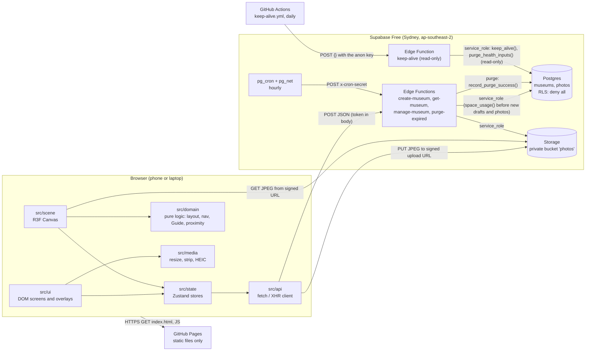
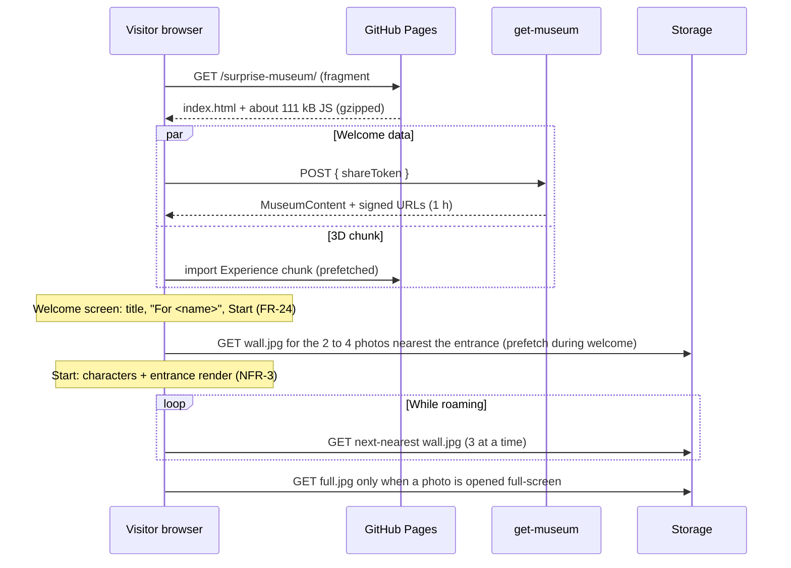

# Architecture: Surprise Museum

Version 1.7 | 26/11/2026 | Owner: architect | Based on requirements v0.8.1 and user stories v0.8.1

Version 1.1 synced this document with what was built in the build phase and integration round 1. Version 1.2 adds the QA phase 6 changes (ADRs 0018 and 0019). Version 1.3 adds change request CR-1, the per-character gender option and facial hair for both characters (ADR 0020). Version 1.4 adds face shape, outfit pattern and six more outfit styles from the user's CR-4 feedback (requirements v0.5, ADR 0021). Version 1.5 records the split of the shared 3D chunk into `three-*` and `scene-shared-*` with a combined NFR-27 guard, and the NFR-27 triangle sign-off at 6,000 (requirements v0.6.1, ADR 0021 amendment). Version 1.6 is iteration 4: published museums last 7 days from first publish with purge within 24 hours and no backups (NFR-16 v0.7, ADR 0010 amendment), free-tier hosting with a daily keep-alive (NFR-32, ADR 0022), and the publish-screen end date (FR-105). Version 1.6.1 is a documentation sync after the iteration 4 approvals (A2 19/11/2026, A3 23/11/2026) and the phase 6 release work (REV-3); it changes no contract. Version 1.7 is iteration 5 (design, Proposed until A2): the purge records its own success and the keep-alive returns one `purgeHealthy` flag that turns its run red (NFR-33, NFR-34, ADR 0023); the app refuses new drafts, photos and unstored publishes at 80% of storage or database size with a `space_full` error (FR-104, FR-106, FR-107, ADR 0024); egress cannot be read by the app (Q-37); and the contract notes for the visual fixes (FR-108, FR-111). Changes are listed in section 17.

## 1. Summary

| Concern | Decision | ADR |
|---|---|---|
| Frontend | Vite + React + TypeScript + React Three Fiber + drei + Zustand (default stack, no deviation) | 0001 |
| Hosting | Free tiers only (NFR-32): static site on GitHub Pages from the public repository at `https://patlu29.github.io/surprise-museum/`, Vite `base: '/surprise-museum/'`; Supabase Free plan | 0002, 0022 |
| Deep links | **Hash routing** (`/#/m/<token>`), using `wouter` | 0002 |
| Backend | Supabase in Sydney (ap-southeast-2): Postgres, one private Storage bucket, five Edge Functions, pg_cron | 0003 (amended by 0022) |
| Keep-alive | A daily GitHub Actions workflow calls the read-only `keep-alive` Edge Function with the public anon key; it runs two read-only service-role queries and writes nothing. Its answer is `{ ok, checkedAt, purgeHealthy }`; the run is red when the purge is unhealthy (iteration 5). Usage figures are never in a public response; the owner checks them in the Supabase dashboard | 0022 (amended), 0023 |
| Purge health (iteration 5) | `purge-expired` writes a one-row heartbeat at the end of each successful run; the keep-alive reads it, the purge queue's oldest entry and the oldest overdue expiry, and a pure function turns them into one boolean (any condition over 3 hours is unhealthy) | 0023 |
| Space full (iteration 5) | `create-museum`, `reserve-photo` and a publish with an unstored photo measure storage (sum of object sizes in `photos`) and database size in SQL on each call, and refuse with 409 `space_full` at 800 MB or 400 MB (configurable). Egress cannot be read by the app | 0024 |
| Access control | Edge Functions are the only gateway. RLS on, no policies, privileges revoked from `anon`. Tokens stored as SHA-256 hashes | 0003 |
| Photo processing | In the browser before upload: decode (HEIC via a lazy decoder), resize, re-encode JPEG (strips all metadata). The server verifies | 0004 |
| Photo delivery | Three renditions (2048 px full, 1024 px wall, 24 px inline placeholder), signed URLs, loaded nearest-first | 0005 |
| Live-readiness (NFR-25) | `CharacterStateSource` abstraction and a pure `src/domain` layer | 0006 |
| Guide navigation | Waypoint graph with A* and 2D circle-versus-box collision. No physics engine, no navmesh | 0007 |
| Avatars | Procedural stylised figure built in code: one skinned body mesh and one skinned hair mesh with rigid weights. The domain produces animation timing; the kit's `applyPose` turns it into joints | 0008 (amended) |
| Avatar gender (CR-1) | Optional `gender` on each `AvatarConfig` (`feminine`, `masculine`, `neutral`); missing means Neutral, read through `avatarGender()`; no version bump. Gender reshapes the same meshes, adding no triangles. Facial hair for both characters | 0020 |
| Face shape, outfit pattern and styles (v0.5) | Optional flat `faceShape` (5, default `oval`) and `outfitPattern` (4, default `plain`), read through `avatarFaceShape()` and `avatarOutfitPattern()`; `outfitStyle` gains six appended ids (12 in total). No version or draft key change. Face shape reshapes the existing head vertices; patterns are a procedural shader on the existing body material; each style replaces the garment, so the budget is set by the worst style | 0021 |
| Museum layout | Deterministic linear chain: entrance hall (7.5 m), 1 to 5 gallery rooms (4 photos each), finale room. 65.5 m at most | 0009 (amended) |
| Camera | Composition from screen-space targets (design spec 3.4); partition walls fade to 0.25 opacity instead of shortening the boom | 0014 |
| Graphics tier | Automatic: `low` on phones and weak GPUs, `high` otherwise; the Visitor's setting wins | 0016 |
| Retention | Published museums last 7 days from first publish (`LIMITS.retentionDays`), drafts 7 days from creation; re-publishing never extends it. Hourly pg_cron job calls the `purge-expired` Edge Function through pg_net, so content leaves live storage within 24 hours. A successful run records a heartbeat (iteration 5). No backups (Free plan) | 0010 (amended 18/11/2026 and 26/11/2026) |
| Name labels | DOM labels (drei `Html`) hidden by a cheap 2D line-of-sight test | 0011 |
| Browser API client | Thin `fetch`/`XMLHttpRequest` client, no `supabase-js` in the bundle | 0012 |
| API mode | `VITE_API_MODE`: production builds are live unless `mock` is explicit; `VITE_API_MODE=live` builds fail without a usable Supabase configuration; the demo mock persists in IndexedDB | 0015 |
| Scene entry points | The UI loads the scene only through two lazy imports: `@/scene/Experience` and `@/scene/preview/AvatarPreview` | 0017 |
| Package registry | Project `.npmrc` pins the public npm registry | 0013 |

## 2. Stack and versions

Installed on 27/10/2026. Versions are pinned exactly (`save-exact`). Node 22.12 or later is required (built locally on Node 26.7).

| Package | Version | Role | Why |
|---|---|---|---|
| `react`, `react-dom` | 19.3.1 | UI | Default. R3F 9.8 supports React `>=19 <19.4`; do not upgrade React past 19.3 until R3F widens its range |
| `three` | 0.186.1 | Renderer | Default |
| `@react-three/fiber` | 9.8.2 | React renderer for three.js | Default. Latest stable on 29/10/2026. It still creates a `THREE.Clock`, so three 0.186 logs a deprecation warning in every build; accepted, not patched (ADR 0018) |
| `@react-three/drei` | 10.7.9 | Helpers (`Html` for the museum name labels) | Default. Import named helpers only, for tree shaking |
| `zustand` | 5.0.16 | Stores shared by UI and scene | Default |
| `wouter` | 3.13.0 | Hash router (about 2 kB) | ADR 0002. Smaller than React Router; has a built-in hash location hook |
| `heic-to` | 1.6.6 | HEIC decoder (libheif WASM), lazily loaded, `heic-to/csp` build | ADR 0004. Maintained (release 10/2026). **LGPL-3.0**, needs legal sign-off |
| `vite` | 8.3.5 | Build | Default |
| `@vitejs/plugin-react` | 6.1.2 | JSX and Fast Refresh | Default |
| `typescript` | **6.0.3** | Types (`strict`) | TS 7.0 is current, but `typescript-eslint` 8.72 supports only `<6.1`. Move to 7 when it does |
| `vitest` | 5.0.5 | Unit tests | Default |
| `@playwright/test` | 1.64.1 | End-to-end tests | Default |
| `@axe-core/playwright` | 4.14.0 | Automated WCAG checks in the e2e suite (NFR-12, US-32) | Added 29/10/2026 at QA's request. Dev only, never bundled. Maintained by Deque (release 10/2026); brings `axe-core` 4.14.0 |
| `eslint` 10.13.0, `typescript-eslint` 8.72.1, `eslint-plugin-react-hooks` 7.1.1, `eslint-plugin-react-refresh` 0.5.7, `eslint-config-prettier` 10.1.8, `globals` 17.13.0 | | Lint | Default |
| `prettier` | 3.9.10 | Format | Default |

**Deliberately not added:**

| Package | Reason |
|---|---|
| `@react-three/rapier` | Collision needs are 2D circles against boxes (ADR 0007). Rapier adds about 1.5 MB of WASM to the first view |
| `@react-three/postprocessing` | No effect in the MVP needs it, and it costs fill rate on phones |
| `@supabase/supabase-js` | ADR 0012. It adds about 45 kB gzipped and offers no upload progress |
| `leva`, `r3f-perf` | Use drei `StatsGl` in development. Add these later, with a note in this file, if needed |
| `three-pathfinding`, `recast-navigation` | Overkill for a known, axis-aligned layout (ADR 0007) |

No dependency was added during the build phase; `@axe-core/playwright` (dev only) was added in QA phase 6. The Fraunces font files (`@fontsource/fraunces` 5.3.0, OFL) are copied into `src/ui/fonts/` rather than installed as a package. The museum look and the avatars are generated in code, so `public/models/` and `public/env/` are empty. Iteration 5 adds no dependency: the table above matched `npm ls --depth=0` on 26/11/2026, and the purge health and space guard use only Postgres, the existing `supabase-js` in the Edge Functions and the existing browser client.

Measured on 28/10/2026 (gzipped JS): home first view 95 kB, Visit welcome screen 111 kB, builder 112 kB, the lazy 3D chunks 288 kB on top of the welcome screen. Since the CR-4 chunk split (03/11/2026) the shared 3D code is two named chunks, `three-*` (244.8 kB gzipped) and `scene-shared-*` (24.5 kB), plus `Experience` (38.6 kB). Section 12 has the budgets.

## 3. System diagram



The browser never talks to Postgres. It talks to the Edge Functions, and to Storage only through URLs that an Edge Function has signed. The keep-alive is not part of the app: only the scheduled workflow calls it (ADR 0022). From iteration 5 the purge writes a heartbeat that the keep-alive reads (ADR 0023), and `create-museum` and `manage-museum` read the space figures before they take new work (ADR 0024).

## 4. Source layout and module boundaries

```text
surprise/
├── docs/                       architecture, ADRs, handoffs, requirements
├── public/                     .nojekyll, favicon; models/ textures/ env/ (technical-artist)
├── src/
│   ├── main.tsx, App.tsx       entry and hash routes
│   ├── config/env.ts           VITE_ variables
│   ├── api/                    MuseumApi: live Edge Function client and persistent demo mock (no React)
│   ├── media/                  image pipeline, JPEG metadata stripper and worker (no React)
│   ├── lib/                    small UI helpers, and the MuseumApi port (apiPort.ts)
│   ├── domain/                 pure TypeScript, no React, three or stores
│   │   ├── characters/         CharacterState, sources (NFR-25), animation timing, avatar options
│   │   ├── layout/             generateLayout(photos) -> MuseumLayout; constants.ts holds every dimension
│   │   ├── navigation/         waypoint graph, A*, collision, line of sight
│   │   ├── presentation/       PresentationDirector (FR-26 to FR-29), FinaleSignal
│   │   ├── guide/              Guide state machine (FR-30, FR-31); simulation.ts for soak tests
│   │   ├── camera/             composition targets, camera pose, boom occlusion (ADR 0014)
│   │   └── photos/             photo load queue (priority, retries, URL refresh)
│   ├── state/                  Zustand stores, transient input state, AvatarPreviewProps contract
│   ├── hooks/                  shared React hooks
│   ├── scene/
│   │   ├── Experience.tsx      the museum Canvas (lazy entry point 1)
│   │   ├── preview/            AvatarPreview.tsx, the builder's canvas (lazy entry point 2, ADR 0017)
│   │   ├── seams.ts            the one place the scene meets the technical-artist's kit
│   │   ├── runtime/            per-museum runtime, reduced motion, graphics tier (ADR 0016)
│   │   ├── objects/            museum geometry, frames, partitions and their fade, podium, plaques
│   │   ├── characters/         CharacterView, NameLabel, AvatarRig; kit/ = technical-artist
│   │   ├── photos/             PhotoTextures (decode and upload)
│   │   ├── controllers/        SceneDriver, commands, hint, projection, test hooks
│   │   ├── cameras/            FollowCameraRig
│   │   ├── materials/          technical-artist (palette, materials, lighting, quality tiers)
│   │   └── shaders/            technical-artist (glow decal, light cone, dust motes)
│   ├── ui/
│   │   ├── screens/            Home, Create, Preview, Visit, Edit, NotFound, Loading
│   │   ├── builder/            builder steps and customiser
│   │   ├── overlays/           HUD, joystick, caption panel, viewer, finale panel
│   │   └── components/         shared controls
│   └── styles/                 tokens.css, base.css (ux-ui-designer)
├── supabase/
│   ├── config.toml
│   ├── migrations/             schema, RLS, bucket, cron
│   ├── functions/              _shared/contract.ts + one folder per function
│   └── scripts/                check-live-config.mjs (deploy guard), smoke-test.mjs
└── tests/                      unit/ and e2e/ (qa-engineer)
```

### Import rules (enforced by `eslint.config.js`)

| Layer | May import | Must not import |
|---|---|---|
| `src/domain` | `@contract`, other `src/domain` files | React, three, Zustand, `@/state`, `@/api`, `@/scene`, `@/ui` |
| `src/api` | `@contract`, `@/config` | React, three, stores, scene, UI |
| `src/media` | `@contract` | React, three, stores, scene, UI |
| `src/state` | `@/domain`, `@/api`, `@/media`, `@contract`, Zustand | three, `@/scene`, `@/ui` |
| `src/scene` | `@/domain`, `@/state`, `@contract`, three, R3F, drei | `@/ui`, `@/api`, `@/media` |
| `src/ui`, `src/hooks`, `App.tsx`, `main.tsx` | `@/state`, `@/domain`, `@/api`, `@/media`, `@/lib`, `@contract` | three, R3F; `@/scene` only by `lazy(() => import('@/scene/Experience'))` or `lazy(() => import('@/scene/preview/AvatarPreview'))` (ADR 0017). Other dynamic scene imports, relative paths into `src/scene` and `import.meta.glob` over scene files are lint errors |

Aliases: `@/` is `src/`, and `@contract` is `supabase/functions/_shared/contract.ts`. Both are configured in `tsconfig.app.json` and `vite.config.ts`.

**Naming:** code identifiers use US spelling (`color`, `hairColor`) to match three.js, CSS and the DOM. All copy and documents use Australian English.

## 5. Data flow

### 5.1 Visitor session



Inside the scene, once per frame:

```text
input (joystick/keys) -> LocalVisitorController.tick -> visitor CharacterState
visitor state + layout -> PresentationDirector.update -> presentation intent
intent + visitor + camera -> AutonomousGuideSource.tick -> guide CharacterState
CharacterRegistry: on presentation change -> sessionStore (UI caption panel, viewed count)
renderers (CharacterView, NameLabel, photo load queue priority) read CharacterState; never write it
visitor position -> FinaleSignal -> sessionStore.finaleReached (edge-triggered)
camera + visitor -> partition fade (ADR 0014); hint request -> sessionStore.hint
```

### 5.2 Creator: build, upload, publish

```mermaid
sequenceDiagram
  participant C as Creator browser
  participant W as media worker
  participant EF as Edge Functions
  participant S as Storage
  C->>W: add file(s)
  W-->>C: full.jpg, wall.jpg, lqip, width, height (metadata gone)
  C->>EF: create-museum (first photo only)
  Note over EF: space check (ADR 0024): 409 space_full at 800 MB storage or 400 MB database
  EF-->>C: editToken (draft, expires in 7 days)
  loop each photo (3 in parallel)
    C->>EF: manage-museum reserve-photo
    Note over EF: same space check before reserving
    EF-->>C: photoId + two signed upload URLs (2 h)
    C->>S: PUT full.jpg, PUT wall.jpg (XHR with progress, FR-4)
    C->>EF: manage-museum confirm-photo { width, height, lqip }
    EF->>S: download and verify both objects
    EF-->>C: ready (or invalid_image and objects deleted)
  end
  Note over C: captions, names, avatars stay local until publish; preview uses local blobs
  C->>EF: manage-museum publish { document }
  EF-->>C: shareToken, publishedAt, expiresAt (first publish + 7 days)
  Note over C: Publish screen: "available for 7 days", ends DD/MM/YYYY HH:mm local (FR-105), from expiresAt
```

Uploading starts as soon as each photo is processed, not at publish, so publishing a 20-photo museum is one small request (NFR-18). A failed upload is retried alone with `renew-upload` (FR-4).

Space full (iteration 5, ADR 0024): because the first photo starts the draft, a Creator meets a refusal at `create-museum` or `reserve-photo`, normally at the first photo (FR-104 (h)). `renew-upload` and `confirm-photo` are never refused, so a photo reserved before the threshold still finishes (FR-104 (c)). `publish` is refused only if it lists a photo that is not stored; a publish of stored photos, including a re-publish, goes through (Q-39 (a)). The builder shows the FR-106 message and keeps everything in the open page (section 8.2).

The end date the Creator sees always comes from the server's `expiresAt`, never from the browser clock plus 7 days, so it is right after a re-publish (which keeps the first `expiresAt`) and on a device with a wrong clock (FR-105, US-71 AC-2 and AC-3).

### 5.3 Preview equals published

Preview (`#/create/preview`) builds a `MuseumContent` from the local draft, using `blob:` URLs for the same `wall.jpg` and `full.jpg` files that are uploaded. Layout, avatars and Guide behaviour come from the same deterministic functions, so preview and published are identical (US-8) without any server round trip. Preview works without a backend, which also makes local development possible before Supabase exists.

## 6. 3D scene

### 6.1 Conventions

| Item | Value |
|---|---|
| Units | Metres. A medium-height character is 1.70 m |
| Axes | +Y up. The route runs from the entrance at `z = 0` towards `-Z`. +X is the Visitor's right on entry |
| Heading | Radians about +Y. 0 faces +Z |
| Single canvas | `src/scene/Experience.tsx`. The builder's avatar preview (`src/scene/preview/AvatarPreview.tsx`) is a second, separate small canvas, mounted only on the builder's Characters step. Never mount both at once (iOS WebGL context limits). These are the only two scene entry points (ADR 0017) |

### 6.2 Procedural museum layout (ADR 0009)

`generateLayout(photos: { id, width, height }[]): MuseumLayout` lives in `src/domain/layout`. It is pure and deterministic, and unit-tested for 1 to 20 photos. Every dimension is in `src/domain/layout/constants.ts` (`LAYOUT`), which the technical-artist also reads; nothing else may duplicate them.

```text
 z=0  ┌────────────┐  Entrance hall 8 m wide x 7.5 m deep. Spawn: Visitor (0, -4.9) facing -Z, Guide (1.0, -4.5)
      │  ENTRANCE  │  Title plaque on the left wall
      └────┐  ┌────┘  Doorway 2.4 m wide, centred
      ┌────┘  └────┐
      │ 1        2 │  Gallery room k: 8 m wide; 10 m deep (3 or 4 photos) or 6 m deep (1 or 2)
      │            │  Slot order in a room: left-near, right-near, left-far, right-far
      │ 3        4 │  Near/far slots at 2.5 m and 7.5 m into a 10 m room; 3 m into a 6 m room
      └────┐  ┌────┘
          ...           rooms = ceil(n / 4), 1 to 5
      ┌────┘  └────┐
      │   FINALE   │  Finale room 8 x 8 m. Podium disc r = 1.5 m at room centre + 1 m;
      │    (◎)     │  trigger zone r = 1.8 m; lectern (solid, 0.6 x 0.4 m) at the far edge
      └────────────┘  Closed end: the museum has no exits (FR-34)
```

| Parameter | Value | Requirement |
|---|---|---|
| Wall height and thickness | 3.2 m, 0.2 m | |
| Photo display box | Fits within 1.6 m wide by 1.4 m high, keeping aspect ratio; centre 1.55 m above the floor; frame border 0.06 m | FR-39 (no crop or distortion) |
| Left and right walls | 8 m apart, so a Visitor in the middle is 4 m from both photos and outside both 3 m zones | FR-26 |
| Presentation zone | Front-centre point 0.3 m off the wall; enter at 3 m after 1 s, exit at 4.5 m. "Same side" is measured from the **wall surface** (the picture's position), not the zone point: `dot(wallNormal, visitor - picturePosition) > 0.2 m`, and the 2D line of sight from the Visitor to the zone point must be clear (ADR 0009 amendment) | FR-26 to FR-28 |
| Entrance hall | 7.5 m deep (was 6 m), so the phone camera boom of about 4.8 m fits behind the spawn (ADR 0014) | |
| Length | 7.5 m + rooms + 8 m. 65.5 m at most for 20 photos (about 41 s of walking) | |

`MuseumLayout` contains: `rooms`, `colliders` (axis-aligned boxes at true size; navigation inflates them by the character radius), `partitions` (the internal walls between rooms, with their colliders), `hardColliders` (everything except partitions; used by the camera), `slots` (photo id, position, normal, size, zone), `finale` (centre, radius), `spawn` (visitor and guide), `navGraph` (nodes and edges) and `bounds`. The podium sits 1 m past the finale room's centre, away from the doorway.

### 6.3 Navigation and collision (ADR 0007)

| Part | Approach |
|---|---|
| Collision | Characters are circles (r = 0.3 m) against static axis-aligned boxes. Move, then push out along the shortest axis, two passes, so characters slide along walls. The Visitor and Guide do not collide with each other (A-18) |
| Line of sight | 2D segment against boxes inflated by 0.35 m, with rounded corners. Used by the Guide, the presentation director and the name-label occlusion (ADR 0011) |
| Camera occlusion | Outer walls shorten the boom (to 1.2 m at least). **Partition walls do not**: one that stands between the camera and the Visitor fades to 0.25 opacity and returns to 1 when clear (instant under reduced motion). Collision, navigation and the director treat a faded wall exactly as a solid one (ADR 0014) |
| Graph | Generated with the layout: nodes on the centreline every 2.5 m, at each doorway, at each photo standing spot, at spawn and at the finale. Edges join nodes with line of sight. About 60 to 120 nodes |
| Path | A* with a Euclidean heuristic, then string-pulling (skip any node that has line of sight to a later one). Re-plan only when the target moves more than 1 m or every 0.5 s |
| Cost | Under 0.2 ms per frame on the reference phone. Runs in the main thread; no worker needed |

### 6.4 Presentation director (FR-26 to FR-29, FR-71, A-17, A-19)

`src/domain/presentation/PresentationDirector` is a pure state machine updated once per frame with the Visitor's position and `dt`. It outputs an **intent**: `none`, `photo(id)` or `finale`.

| Rule | Behaviour |
|---|---|
| Candidates | Zones with distance 3 m or less, on the same side (measured from the wall surface, 0.2 m margin) and with a clear line of sight to the zone point |
| Dwell | The nearest candidate must stay nearest for 1 s. The timer resets when the nearest candidate changes or disappears |
| Exit | The active photo ends past 4.5 m or on the other side |
| Switch | During a presentation, a different nearest candidate that completes its dwell replaces the current one. Nothing is queued |
| Dismiss | Ends the presentation and suppresses that photo until the Visitor goes beyond 4.5 m, after which it can present again (A-19) |
| Finale | Entering the finale zone starts the finale intent immediately. Leaving to more than r + 1 m (2.8 m) ends it. Keep exploring dismisses it with the same suppression rule. Separately, `FinaleSignal` writes `sessionStore.finaleReached`, edge-triggered: true on entering the zone, false on leaving; after Keep exploring it stays false until she has left and entered again. Replay and jump reset it |
| Viewed | A photo is viewed when its presentation starts, or when opened full-screen (A-17). Stored in `sessionStore` |
| No caption | The intent and the Guide behaviour are unchanged; the UI shows no panel (FR-71) |

The UI shows the caption panel when the Guide's `presentation` changes. The Guide sets it on arrival, or 1.5 s after the intent at the latest, so the panel never waits on a long walk. Both delays are tuning constants (A-16).

### 6.5 Guide AI (FR-30, FR-31, FR-62, NFR-26)

`AutonomousGuideSource` (in `src/domain/guide`) implements `CharacterStateSource`. It is constructed with the layout, the navigation API and the director.

| State | Behaviour | Leaves when |
|---|---|---|
| `follow` | Target: 2.5 m behind the Visitor and 0.8 m to the side away from the camera's line to the Visitor. Idle while within 2 to 5 m and the Visitor is still. Walks at 1.25 times the Visitor's speed to catch up | Intent set: `approach`. More than 8 m away, or stuck (under 0.6 m of net movement in 3 s while trying to move): `relocate` |
| `approach` | Path to the presentation spot: 1.1 m beside the Visitor, perpendicular to the photo's normal, on the side with clearance, and never closer to the photo than the Visitor (so it never stands between them). With reduced motion, go straight to `relocate` and fade in at the spot | Arrived: `present`. Intent cleared: `follow` |
| `present` | Face half-way between the photo and the Visitor; set `presentation`; play `present` gesture once (Should); hold still | Intent cleared or changed: `follow` or `approach` |
| `relocate` | Fade out over 0.25 s, teleport to the best spot 2 to 4 m from the Visitor that is outside the camera frustum and has line of sight to the Visitor (otherwise just beside the Visitor), then fade in over 0.25 s | Done: previous goal |
| Yield (any state) | If the Visitor's position 1 s ahead is within 0.6 m of the Guide, or the Guide is inside the camera-to-Visitor corridor (0.5 m wide), sidestep at right angles. If it cannot, fade to 35% opacity until clear | |

NFR-26 is a unit test: because `src/domain` is pure, a 30-minute random-roaming soak test runs in Vitest at a fixed 1/30 s step in a few seconds of CPU. It asserts the Guide is never stuck for more than 10 s, never inside a collider and never in the Visitor's path.

### 6.6 Character-state abstraction (NFR-25, ADR 0006)

Defined in `src/domain/characters/characterState.ts` (architect; unchanged in the build). Implemented by `LocalVisitorController`, `AutonomousGuideSource`, `ScriptedCharacterSource` and `CharacterRegistryImpl` in `src/domain`.

```text
             ┌──────────────────────────┐
 input  ───▶ │ LocalVisitorController   │──┐
             └──────────────────────────┘  │   CharacterRegistry      ┌─────────────┐
             ┌──────────────────────────┐  ├─▶ (visitor, guide)  ───▶ │ CharacterView│
 director ─▶ │ AutonomousGuideSource    │──┤   tickAll(dt, world)     │ <NameLabel>  │
             └──────────────────────────┘  │   onPresentationChange   │ caption via  │
             ┌──────────────────────────┐  │          │               │ sessionStore │
 test    ──▶ │ ScriptedCharacterSource  │──┤          ▼               └─────────────┘
             └──────────────────────────┘  │   sessionStore (UI)
             ┌──────────────────────────┐  │
 future  ──▶ │ NetworkCharacterSource   │──┘
             └──────────────────────────┘
```

| Element | Contract |
|---|---|
| `CharacterState` | `position`, `heading`, `speed`, `locomotion` (`idle`, `walk`), `gesture`, `presentation` (`none`, `photo`, `finale`, `greeting`), `opacity`, `teleportSeq`, `timestamp` |
| `CharacterStateSource` | `kind`, `tick(dt, world)`, `read()`, optional `teleport()` and `dispose()` |
| `CharacterRegistry` | Holds one source per role, ticks visitor then guide, and emits presentation changes once per change |
| Renderers | `CharacterView` and `NameLabel` (`src/scene/characters/`) read `registry.getSource(role).read()` in `useFrame`. They never know the source kind. Animation is derived from `locomotion`, `speed` and `gesture` only (section 6.7) |
| Per-frame data | Lives in the sources, not in Zustand, so nothing re-renders per frame. Only discrete changes (presentation, viewed) go to stores |

**Future live mode (FR-66, not built):** a `NetworkCharacterSource` fed by a Supabase Realtime Broadcast channel named after the museum id, with a 100 ms interpolation buffer keyed on `timestamp` and a snap when `teleportSeq` changes. The Visitor's client publishes its local state at 10 to 15 Hz. In live mode the Creator's client owns the Guide, and presentation is set by the Creator's input instead of the director. No renderer, label or panel code changes. The NFR-25 test drives a character with `ScriptedCharacterSource` and asserts that the avatar transform, animation and label follow it.

### 6.7 Avatars (ADR 0008)

| Topic | Approach |
|---|---|
| Construction | A hierarchy of groups (hips, spine, neck, head, upper and lower arms and legs, hands, feet) made of shared primitive geometries (capsules, spheres, rounded boxes, lathes). Stylised, friendly proportions |
| Options | `AvatarConfig` in the contract: gender (3, optional, ADR 0020), skin tone (10), hair style (12), hair colour (11), outfit style (12 from v0.5: the six v1.0 styles plus six appended, ADR 0021) with colour (12) and pattern (4, optional, ADR 0021), face shape (5, optional, ADR 0021), body type (4), height (3), facial hair (5, both characters from v0.3), glasses and hat (Release 2). Gender sets the base shape and face first (design spec 9.1); body type multiplies on top and scales torso and hip widths; height scales the rig uniformly (0.91, 1.00, 1.09) |
| Gender (ADR 0020) | Read only through `avatarGender(config)` from `@contract`: missing or unknown is `neutral`. Neutral is today's shape, bit for bit. Gender changes ring radii, joint positions, the head ellipsoid's jaw and cheek displacement, and the brow, eye and mouth parameters of existing parts. **Same topology for all three genders**: no new mesh, part or segment, so triangle and draw-call counts do not depend on gender. A gender change rebuilds the body and hair meshes and the bind pose of the active character only. The builder's 250 ms morph (design spec 9.5) is preview-only; the visit builds the final shape once |
| Face shape, pattern, styles (ADR 0021) | Readers use `avatarFaceShape(config)` and `avatarOutfitPattern(config)` (or `withAvatarDefaults`); missing or unknown means `oval` and `plain`, today's look bit for bit. **Face shape** extends the existing head warp (`PartBuilder.warp`) below the eye line and composes with the gender jaw, adding 0 triangles. **Pattern** is an `onBeforeCompile` patch of the body `MeshLambertMaterial`: one `outfitMask` vertex attribute, a `uOutfitPattern` uniform per rig and a constant program cache key, so 0 draw calls, 0 textures and at most 1 new program. Ink is a tint of the outfit colour (no second colour). **Styles**: each is one `Garment` that replaces the previous one, so a character costs body(worst style) + hair(worst style) + shadow. NFR-27 stays at 6,000 per character: the provisional 6,500 ceiling (ADR 0021, 7.3a) lapsed on 03/11/2026, when the measured worst came to 5,862 (ADR 0021 amendment). The new style ids follow design spec v2.0, 12.8.2 G: `sweater`, `overalls`, `coat`, `tracksuit`, `cardigan`, `tunic`. The kit builds all twelve, and the builder offers all twelve |
| Parts kit | `src/scene/characters/kit/`: one function per hair style, facial-hair style and outfit that returns primitive parts per bone, and a palette that maps option ids to colours. Owner: technical-artist |
| Construction (as built) | The kit builds one skinned body mesh and one skinned hair mesh with **rigid weights** on 13 bones (hips, spine, neck, head, hairBack, both arms and forearms, both legs and shins), plus a blob shadow. Hair is designed back-first; `hairBack` lets long hair swing (ADR 0008 amendment) |
| Animation | **Driven by the kit.** `src/domain/characters/animation.ts` (scene-developer, pure) turns `locomotion`, `speed` and `gesture` into timing only: walk phase, walk blend, idle clock and present level. The kit's `applyPose` (technical-artist) turns that into joint rotations. The scene never drives bones itself. The presenting arm is the character's anatomical right arm (-X in rig space) |
| Reduced motion | The walk cycle stays (it shows the movement the user asked for, FR-18); idle sway, breathing and the present gesture are off |
| Rig interface | `AvatarRig` (`src/scene/characters/avatarRig.ts`): `root`, `height`, `labelHeight`, `scale`, `applyPose`, `setOpacity`, `dispose`. Built through `src/scene/seams.ts`; used by `CharacterView` and the builder preview |
| Option labels | `src/domain/characters/avatarOptions.ts`: labels, defaults and `describeAvatar`, re-exported by the kit and `src/lib/avatars.ts` (one source of truth) |
| Budget per character | 6,000 triangles or fewer; 10 draw calls or fewer (NFR-27, signed off 03/11/2026, `docs/performance.md` A.4). As built: worst **5,862** triangles (`curly-short` hair, `full-beard`, `suit`, Guide, `skin-10`), on Low and High alike, and 3 draw calls in every configuration. Defaults: Guide 4,602, Visitor 4,436. Headroom is 138 triangles (88 under the design spec's 5,950 art hard stop). Gender, body type, face shape and pattern add none. Worst body per style: suit 4,200, tracksuit 4,088, overalls 4,056, shirt-trousers 4,040, sweater 4,008, hoodie 3,996, cardigan 3,976, jumpsuit 3,968, tunic 3,952, dress 3,940, coat 3,920, tee-jeans 3,896; worst hair 1,660 (`curly-short` with `full-beard`). The kit tests enforce `TRIANGLE_BUDGET = 6000` |
| Update speed | Option changes rebuild only the affected part, well within 1 s (FR-15) |
| Swappable | `AvatarRig` is the stable interface. A modular glTF kit with a shared skeleton can replace the internals later without touching sources, labels or UI |

### 6.8 Name labels (FR-17, ADR 0011)

A drei `<Html>` element anchored 0.35 m above each head (scaled with height), facing the camera by nature of DOM. It is hidden when the 2D line of sight from the camera to the head is blocked by a wall, but stays visible through a faded partition (ADR 0014). The builder preview uses plain DOM labels positioned over its canvas instead of drei `<Html>` (two `Html` roots mounting together raised a React 19 warning and dropped a label). DOM text renders accents and emoji exactly as typed (US-4) and gets contrast from a solid CSS backing (4.5:1, NFR-12). Labels are `aria-hidden`; names are announced by the UI instead.

### 6.9 Camera and input

| Topic | Approach |
|---|---|
| Camera | Third person (A-4), `src/domain/camera/composition.ts` and `src/scene/cameras/FollowCameraRig.ts`. The v1.0 numbers (boom 3.5 m, height 2.2 m) are replaced by the screen-space targets in design spec 3.4 (ADR 0014): phone portrait 30% of the viewport height with the feet at 72% from the top and FOV 60; phone landscape 46%, 80%, FOV 52; wide (tablet and desktop) 40%, 82%, FOV 52. The boom is derived (about 4.8, 3.7 and 4.2 m, clamped to 2.5 to 6 m), default pitch 14 degrees, pivot 0.9 m above the feet, and a constant `setViewOffset` places her vertically. The user orbits by dragging; it never moves on its own beyond following the Visitor (FR-62) |
| Occlusion | Outer walls shorten the boom (minimum 1.2 m). Partition walls fade to 0.25 opacity instead (section 6.3) |
| Input ownership | The UI owns keyboard, drag-to-look and wheel (`useCanvasKeyboard`, `useLookControls`). The scene's own `CanvasInput` is off by default (`<Experience canvasInput />`) so orbit input is never applied twice |
| Touch | Virtual joystick (DOM overlay in `src/ui/overlays`, 44 px minimum targets) in the lower left; drag elsewhere to orbit |
| Keyboard | W A S D and arrow keys move; Q and E or Shift with arrows orbit; Enter or Space dismisses the panel; Escape closes the viewer (FR-61) |
| Arrow buttons | On-screen walk and turn buttons (WCAG 2.5.7), a Settings option. They write `setMoveSource('arrows', x, y)` into `inputState`, so the scene needs no change |
| Transient input | `src/state/inputState.ts`: a plain mutable object holding a `MoveIntent` and orbit deltas. Written by the UI, read by `LocalVisitorController`. Not a Zustand store |
| Picking | R3F `onClick` on photo meshes opens the full-screen viewer (FR-35) |

### 6.10 Photo loading: nearest first (NFR-3, NFR-5, FR-58)

| Step | Behaviour |
|---|---|
| Placeholder | Each frame first shows the inline 24 px LQIP (in the API response, so it is never blank) |
| Queue | `src/domain/photos/loadQueue.ts` (pure, tested): a priority queue with 3 concurrent downloads. Priority is walking distance from the Visitor to the slot, re-ranked every 0.5 s and whenever a download finishes. `src/scene/photos/PhotoTextures.ts` does the fetching, decoding and texture upload |
| Prefetch | The scene mounts behind the welcome screen, so the slots nearest the spawn start downloading while she reads. `sceneReady` is set once the entrance has rendered and the 3 nearest pictures have loaded or failed, or after 6 s |
| Decode | `fetch` the blob, then `createImageBitmap(blob, { imageOrientation: 'flipY' })`, upload to a `THREE.Texture` (sRGB, mipmaps, anisotropy 4 on desktop and 2 on phones). Close the bitmap after upload |
| Failure | One try plus three retries after 1 s, 3 s and 9 s, then `failed` with a retry control (FR-58). A 400 or 403 asks `museumStore.refreshUrls()` once; waiting photos restart with the new URLs |
| Full size | `full.jpg` is never a texture. It loads in an `` in the full-screen viewer only |
| Memory | 20 wall textures at 1024 px are about 80 MB of GPU memory at worst. Textures are not evicted today. If NFR-6 testing shows pressure, the performance optimiser may evict textures beyond the 12 nearest back to the LQIP, in `PhotoTextures` |
| Status | `photoStatus` in `museumStore` (`placeholder`, `loading`, `loaded`, `failed`) so the UI can show retry |

### 6.11 Rendering

Photos use an unlit material (`MeshBasicMaterial`, `toneMapped: false`) so they are always evenly lit, with no glare or shadow (FR-40). The look is generated in code by the technical-artist (`src/scene/materials/`, `src/scene/shaders/`): Neutral tone mapping, a warm hemisphere light and one warm key light, no shadow maps, a blob shadow under each character, and procedural textures, so nothing is downloaded for it.

| Tier (ADR 0016) | Chosen when | What it changes |
|---|---|---|
| `high` | Automatic on everything that is not `low` | Standard materials on floors and brass, a generated environment map, the finale light cone and dust motes, full-size procedural textures |
| `low` | Automatic on phones (coarse pointer, short side under 700 px), weak or software GPUs, and devices with 2 GB or 2 cores or fewer; or the Visitor's "lower graphics" setting | Lambert materials, half-size textures, no environment map, no cone or motes |

The tier is published as `<html data-graphics-quality>`. Rendering is capped at 30 FPS on touch devices and in `low` (NFR-7), and pauses while the full-screen viewer is open. Device pixel ratio is capped at 1.5 on touch devices, and at 1 (`low`) or 2 (`high`) otherwise. WebGL context loss sets `sessionStore.contextLost` and the UI offers a reload (NFR-11).

## 7. Backend: data model and API

### 7.1 Tables (`supabase/migrations/20261027000100_initial_schema.sql`)

**`museums`**

| Column | Type | Notes |
|---|---|---|
| `id` | uuid PK | Internal only. Never authorises anything |
| `edit_token_hash` | bytea(32), unique | SHA-256 of the edit token |
| `share_token_hash` | bytea(32), unique | SHA-256 of the share token |
| `status` | enum `draft`, `published` | |
| `title` | text, up to 60 | Empty means the default title |
| `visitor_name`, `guide_name` | text, 1 to 24 | Required when published |
| `opening_greeting` | text, up to 500 | Release 2 |
| `closing_message` | text, up to 1,000 | |
| `theme` | text | `default` |
| `visitor_avatar`, `guide_avatar` | jsonb | `AvatarConfig`, validated in the Edge Function. Rows published before v0.3 have no `gender`, and rows published before v0.5 have no `faceShape` or `outfitPattern`. Responses fill the defaults through `withAvatarDefaults` and the row is not rewritten (ADR 0020, ADR 0021) |
| `content_version` | smallint | Contract version |
| `photo_reservations` | smallint, 0 to 100 | Abuse cap |
| `created_at`, `updated_at`, `published_at` | timestamptz | |
| `expires_at` | timestamptz | Draft: created + 7 days. Published: first publish + 7 days (`LIMITS.retentionDays`, passed to `publish_museum` as `p_retention_days`); never extended |

**`photos`**

| Column | Type | Notes |
|---|---|---|
| `id` | uuid PK | Part of the storage key |
| `museum_id` | uuid FK, cascade delete | |
| `status` | enum `pending`, `ready` | `ready` after `confirm-photo` |
| `position` | smallint 0 to 19, unique per museum | Set on publish |
| `caption` | text, up to 280 | Set on publish |
| `width`, `height` | smallint, up to 2048 | Of `full.jpg` |
| `lqip` | text, up to 4,096 | `data:image/jpeg;base64,...` only |
| `created_at`, `confirmed_at` | timestamptz | |

Support tables: `storage_purge_queue` (museum ids whose storage still needs deleting), `rate_limits` (fixed windows keyed by a salted IP hash) and, from iteration 5, `purge_heartbeat` (one row, `last_success_at`, written only by the purge; ADR 0023). Functions: `rate_limit_hit`, `rate_limit_blocked`, `reserve_photo` (atomic limit of 20 live photos and 100 reservations), `publish_museum` (sets `expires_at` on the first publish only), `delete_museum_rows` (delete and queue in one transaction), `expire_museums` (used by the purge), from iteration 4 `keep_alive` (returns `now()`, writes nothing; migration `20261118000100_keep_alive.sql`, ADR 0022), and from iteration 5 `record_purge_success` (the purge's last step), `purge_health_inputs` (`stable`, four timestamps for the keep-alive) and `space_usage` (`stable`, `security definer`, storage bytes in `photos` and database bytes) (ADRs 0023, 0024). All are `service_role` only.

**Storage:** bucket `photos`, private, 2 MiB per object, `image/jpeg` only. Keys are `<museum_id>/<photo_id>/full.jpg` and `.../wall.jpg`. Uploads set `cache-control: private, max-age=3600`.

### 7.2 Row-level security

| Object | `anon`, `authenticated` | `service_role` (Edge Functions only) |
|---|---|---|
| `museums`, `photos`, `storage_purge_queue`, `rate_limits` | RLS enabled, **no policies**, all privileges revoked: no select, insert, update or delete through REST or GraphQL | Full access (bypasses RLS) |
| Functions in `public` | Execute revoked | Execute granted |
| `storage.objects` in bucket `photos` | No policies: cannot list, read, write or delete | Full access; issues signed URLs |
| Future tables and functions in `public` | Default privileges revoked for the `postgres` role | |

Why not token-checking RLS policies? Policies that read a token from request headers work for tables but not cleanly for Storage, and they spread the security logic across SQL and two APIs. One gateway is easier to review and test. RLS remains as a deny-all backstop, so a bug in the client cannot open a hole.

### 7.3 Edge Function API

**`docs/api.md` (backend-developer) is the contract.** This section is a summary; where they differ, `docs/api.md` wins. Types are in `supabase/functions/_shared/contract.ts`.

All calls: `POST {VITE_SUPABASE_URL}/functions/v1/<name>` with headers `Content-Type: application/json` (anything else is 415), `apikey: <VITE_SUPABASE_ANON_KEY>` and `x-region: ap-southeast-2`. Tokens travel only in the body. Bodies are at most 64 KiB, unknown fields are rejected, and text lengths count code points. Responses carry `Cache-Control: no-store`. CORS answers only the origins in `ALLOWED_ORIGINS`; any other origin gets 403.

| Function | Who | Request | Success | Rate limit (per salted client-address hash; IPv6 by /64) |
|---|---|---|---|---|
| `create-museum` | Anyone (builder) | `{}` | **201** `{ editToken, draftExpiresAt }`; 409 `space_full` when space is full (iteration 5) | 10 per hour |
| `get-museum` | Share-token holder | `{ shareToken }` | 200 `{ museum: MuseumContent, urlsExpireAt }` | 60 per minute, and 20 misses per 10 minutes (then every lookup is 429 until the window ends) |
| `manage-museum` | Edit-token holder | `{ action, editToken, ... }` (below) | Per action | 120 per minute per client, 600 per hour per museum, and the same 20 misses per 10 minutes |
| `purge-expired` | pg_cron only | `{}` with `x-cron-secret` header | 200 `{ purged, retried, failed }` | Secret check (constant-time); a wrong secret gets the uniform 404 |
| `keep-alive` (iteration 4, ADR 0022; amended iteration 5, ADR 0023) | The scheduled keep-alive workflow only; no CORS | `{}` with the anon key | 200 `{ ok: true, checkedAt, purgeHealthy }` (`checkedAt` is Postgres `now()`; `purgeHealthy` a boolean, `false` also when the check fails) | **None by design**: it writes nothing, so it writes no rate-limit row and counts no miss |

`manage-museum` actions:

| Action | Body | Effect | Success |
|---|---|---|---|
| `get` | — | Read for the edit screen | 200 `ManageGetResponse` (share token derived from the edit token) |
| `reserve-photo` | — | Space check first (409 `space_full`, nothing reserved; ADR 0024), then `reserve_photo()`; signs two upload URLs (2 h) | **201** `PhotoUploadTicket` |
| `renew-upload` | `photoId` | New upload URLs for a `pending` photo (retry, FR-4) | 200 `PhotoUploadTicket` |
| `confirm-photo` | `photoId, width, height, lqip` | Checks the `lqip` (JPEG data URL, at most 32 px), then downloads both objects and verifies them (section 10.3). Repeating on a `ready` photo is safe | 200 `{ photoId, status: "ready" }` |
| `remove-photo` | `photoId` | Deletes the objects and the row. A photo in the published museum cannot be removed this way (409 `conflict`) | 200 `{ photoId, removed: true }` (also when already gone) |
| `publish` | `document: MuseumDocument` | Validates all fields and avatars (`gender`, `faceShape` and `outfitPattern` optional, each absent stored as its default, unknown rejected with `document.<avatar>.<key>`; facial hair allowed for both characters; 12 outfit styles; ADR 0020, ADR 0021); requires 1 to 20 `ready` photos of this museum (if one is not ready: 409 `space_full` when space is full, otherwise 409 `conflict`; ADR 0024); sets positions and captions in one transaction; deletes photos not in the document; sets `published`, `published_at` (first time only) and `expires_at` | 200 `{ shareToken, publishedAt, expiresAt }` |
| `delete` | — | `delete_museum_rows()`, then removes the storage prefix; on storage failure the queue retries hourly | 200 `{ deleted: true }` |

Errors use `ApiError { error, message, field? }`; `field` is a JSON path and appears on `bad_request`, `conflict` and `invalid_image`.

| `error` | Status | When |
|---|---|---|
| `bad_request` | 400; also 403 (origin not allowed), 405, 413, 415 | Malformed or invalid request |
| `not_found` | 404 | Any bad, unknown, draft (for `get-museum`), expired or deleted token. Always the identical body. Access problems never return 401 or 403 |
| `conflict` | 409 | Valid request, wrong state (photo not uploaded or not ready, removing a published photo) |
| `photo_limit`, `upload_quota` | 409 | 20 live photos, or 100 lifetime reservations, used |
| `space_full` (iteration 5) | 409 | Storage in use at or above 800 MB, or database size at or above 400 MB, on `create-museum`, `reserve-photo`, or a `publish` that lists a photo not yet stored. No `field`, no figures, no hint of which limit (FR-104 (g), ADR 0024) |
| `invalid_image` | 422 | `confirm-photo` refused a file; both objects are deleted and the photo stays reserved for a retry |
| `rate_limited` | 429 | With `Retry-After` |
| `server_error` | 500 | Unexpected; no detail. (The demo mock also uses it with status 413 when its storage is full) |

**Mock mode** (ADR 0015): `src/api` also contains a mock that follows every rule above except rate limits, and persists in the browser (IndexedDB, then `localStorage`, then memory). Which implementation runs is set by `VITE_API_MODE` (section 13 and `docs/api.md` section 12).

### 7.4 Retention (NFR-16 v0.7, ADR 0010 as amended 18/11/2026)

| Event | Effect |
|---|---|
| First publish | `expires_at = published_at + 7 days` (168 hours; `LIMITS.retentionDays = 7`). Re-publishing an edited museum (Release 2) does not extend it, and the first `expiresAt` is what every later response returns |
| Draft never published | Purged 7 days after creation (`LIMITS.draftRetentionDays`). A draft published on day 6 then lasts 7 days from that publish |
| `expires_at` passes | Share and edit links return the uniform 404 at once, before any purge (lookups filter `expires_at > now()`). The screen is the shared not-found screen with wording that covers deletion and the end of the 7 days (Q-33 (a), the user's decision at A2, 19/11/2026) |
| Creator deletes | Rows gone at once (share link returns not found, FR-52). Objects removed in the same request; if that fails, the hourly job retries |
| Hourly job | `pg_cron` at minute 17 calls `purge-expired` through `pg_net` with the Vault `cron_secret`. It deletes expired museums and drains `storage_purge_queue`, up to 100 of each per run. From iteration 5, a run that reaches the end calls `record_purge_success()` (ADR 0010 amendment, ADR 0023) |
| Out of live storage | Within 24 hours of the end or the delete (NFR-16(e)): normally at the first run after it (at most about 60 minutes), with 23 hourly retries for storage failures |
| Backups | **None.** The Supabase Free plan has no backups, so nothing is held outside live storage (NFR-16(f)). If backups are ever enabled, NFR-16 must be revised first |
| Creator-set expiry (FR-54, Should) | Not built. When built it may only lower `expires_at`, to between now + 1 hour and first publish + 7 days (ADR 0010 amendment) |
| Project paused | pg_cron stops, so the purge stops. The keep-alive (7.5) prevents the pause |

The published retention is the one constant `LIMITS.retentionDays` in `contract.ts`; no SQL default or migration hard-codes it (ADR 0010 amendment lists every file that mentions the old 90 days). Nothing was deployed before the 7-day change, so no stored row has a 90-day `expires_at` and **no data migration is needed** (first deploy 24/11/2026, with 7 days).

### 7.5 Keep-alive (NFR-32 (b), ADR 0022)

| Item | Decision |
|---|---|
| Why | Supabase pauses Free projects after 7 days without activity. A paused project takes the app offline and stops the purge |
| Caller | `.github/workflows/keep-alive.yml` (devops-engineer, built in phase 6, commit cbbd7e4): daily at 20:37 UTC plus manual runs (`workflow_dispatch`); `permissions: {}`; skipped (grey) while the repository variable `VITE_SUPABASE_URL` is empty. First run 24/11/2026 (manual run 45385818352, green) |
| Request | `POST {VITE_SUPABASE_URL}/functions/v1/keep-alive`, `Content-Type: application/json`, `apikey: <anon key>`, body `{}`. Both values are existing public repository variables; no secret |
| What it reaches | The API gateway (with the project key), an Edge Function, PostgREST and Postgres (`select public.keep_alive()`, which returns `now()`; from iteration 5 also `select * from public.purge_health_inputs()`, read-only, ADR 0023) |
| What it never does | Creates or changes nothing; no rate-limit row, no IP hash; never calls purge; returns no museum, count, size, age or time other than `checkedAt` (the health query reads timestamps and returns only the boolean) |
| Response | 200 `{ "ok": true, "checkedAt": "<ISO 8601 from Postgres>", "purgeHealthy": <boolean> }`, exactly these three keys (iteration 5, NFR-33, section 7.7). Errors as in `docs/api.md`: 400, 405, 413, 415 (`bad_request`), 500 (`server_error`, only when `keep_alive()` fails; a failed health check is `purgeHealthy: false`, not an error) |
| Failure signal | Once `VITE_SUPABASE_URL` is set, the run is red on any failure: a missing `VITE_SUPABASE_ANON_KEY`, a URL that does not start with `https://`, or a non-200, wrong body or timeout after 3 retries. From iteration 5 it is also red, at a second step, when `purgeHealthy` is not `true` (section 7.7). GitHub e-mails the user who last changed the `cron` line. The workflow masks the anon key before anything can print it |
| Usage check | Figures only in the dashboard (storage, database and egress); never in the keep-alive or any public response. The space guard reads storage and database size internally and answers only with a refusal code (section 7.8) |
| 60-day rule | GitHub switches off scheduled workflows in a public repository after 60 days without repository activity. The guide gives the user a 50-day check and the re-enable steps; no automatic workaround |

### 7.6 Iteration 4 requirement coverage

| Requirement | Delivered by | Verified by |
|---|---|---|
| NFR-16 (a) 7 days from first publish | `LIMITS.retentionDays = 7`, `publish_museum` (7.4) | Deno `flow_test.ts`, `purge_test.ts`; `mockClient.test.ts`; e2e with a fixed clock (US-68) |
| NFR-16 (b) re-publish does not extend | `publish_museum` keeps the first `expires_at` | Same tests |
| NFR-16 (c) drafts 7 days | Column default and `LIMITS.draftRetentionDays` | Same tests |
| NFR-16 (d) no content after the end | Lookups filter `expires_at > now()`; uniform 404; not-found wording (Q-33 (a)) | Deno tests; e2e US-68 AC-2 |
| NFR-16 (e) out of live storage within 24 hours | Hourly purge with 23 retries (ADR 0010) | Deno purge tests; on the live project, the job history checks in the deployment guide (US-68 AC-5, AC-6) |
| NFR-16 (f) no backups | Free plan; nothing copies content | Dashboard check by the user (Q-34) |
| NFR-16 (g), NFR-32 (b) no idle pause | `keep-alive` function and daily workflow (7.5, ADR 0022) | Deno tests (nothing created); workflow run history (US-69) |
| NFR-32 (a) zero cost | GitHub Pages from the public repository, Supabase Free, public-repo Actions | Manual check (US-69 AC-1) |
| NFR-32 (c) to (f) guide, limits, capacity, limit behaviour | `docs/deployment.md` free-tier section (devops-engineer), section 13.1 here | Manual review (US-70) |
| FR-105 end-date notice (Must: Q-35 (a), A2 19/11/2026) | The pure formatter `formatEndDateTime` (`src/lib/format.ts`) and the shared `AvailabilityNotice` (`src/ui/components/`), shown on `PublishedScreen` from `builderStore.publish.expiresAt` and on `EditScreen` from `ManageGetResponse.expiresAt` (8.1, 9) | Unit tests of the formatter and `AvailabilityNotice`; e2e US-71 |

### 7.7 Purge health (iteration 5: NFR-33, NFR-34, ADR 0023)

| Item | Decision |
|---|---|
| Success signal | `purge-expired` calls `record_purge_success()` as its last step; it upserts the one row of `purge_heartbeat` with Postgres `now()`. A run that throws writes nothing and answers 500 as today. A run with `failed > 0` storage deletes still counts as successful; failed deletes are caught by the queue-age condition. pg_cron's own status is not used (A-41) |
| Inputs | `purge_health_inputs()` (`stable`, `select` only) returns `checked_at` (`now()`), `last_success_at` (null if never), `oldest_queued_at` (oldest `storage_purge_queue.enqueued_at`, null if empty) and `oldest_expired_at` (oldest `museums.expires_at <= now()`, null if none) |
| Rule | Pure `isPurgeHealthy(inputs, maxAgeMs = PURGE_HEALTH_MAX_AGE_MS)` in `supabase/functions/_shared/purgeHealth.ts`. `PURGE_HEALTH_MAX_AGE_MS` is 3 hours (Q-40 (a)). Healthy only when `last_success_at` is at most 3 hours old **and** neither other timestamp is more than 3 hours old. A null `last_success_at` or any timestamp that does not parse is unhealthy |
| Keep-alive order | 1. `keep_alive()` (failure is a 500). 2. `purge_health_inputs()` with a 5 s timeout, inside a `try`; any error gives `false` and logs the error name only. 3. Answer exactly `{ ok: true, checkedAt, purgeHealthy }` |
| Workflow | Step 1 as today, plus `keep-alive: ok` in the summary. Step 2 "Purge health": green only when `jq -e '.purgeHealthy == true'` matches; otherwise `purge: unhealthy` in the summary, one `::error` annotation, exit 1. No body, count, age or key is printed. `permissions: {}` unchanged (ADR 0023 section 4) |
| Deploy order | Migrations, then functions (`deploy-supabase.yml` does both in that order); wait for the next minute-17 purge and confirm `purge: healthy` with the smoke test; only then push the workflow change and run it once by hand (ADR 0023 section 5) |
| Write-free from the caller's side | The heartbeat is written by the purge only. The keep-alive's two functions are `stable` selects; no rate-limit row, no IP hash, no storage call, no purge call, no secret (US-69 AC-4 unchanged) |

### 7.8 Space full (iteration 5: FR-104, FR-106, FR-107, ADR 0024)

| Item | Decision |
|---|---|
| Measured | `space_usage()`: storage bytes is `sum(metadata->>'size')` over `storage.objects` in bucket `photos`; database bytes is `pg_database_size(current_database())`. `security definer`, empty `search_path`, `service_role` only |
| How often | On every gated request, no cache, so figures are 0 minutes old (FR-104 (a), (d)). Cost: one round trip inside the region, well under 1 ms of the 2 s CPU limit, no extra invocation (estimate, not measured) |
| Threshold | Refuse when storage is **800,000,000 bytes or more** or database is **400,000,000 bytes or more** (Q-36, 80%). Optional function variables `SPACE_FULL_STORAGE_BYTES` and `SPACE_FULL_DATABASE_BYTES` override the defaults; an invalid value is a configuration error (500) |
| Gated | `create-museum`; `manage-museum` `reserve-photo`; `manage-museum` `publish` only when a listed photo is not `ready` |
| Not gated | `renew-upload`, `confirm-photo` (finish earlier reservations, FR-104 (c)), `get`, `remove-photo`, `delete`, `get-museum`, `keep-alive`, `purge-expired` (FR-107) |
| Error | 409 `{ "error": "space_full", "message": "Surprise Museum is full for now. Please try again later." }`. No `field`, no figures, no `Retry-After` |
| Measurement fails | Fail open: the request proceeds as if space were free, and the function logs `space check unavailable (<error name>)` (ADR 0024 section 5) |
| Egress (Q-37) | **The app cannot read it.** Egress is metered per organisation outside Postgres; the Management API has no egress endpoint, and its usage endpoints need a personal access token. It is "a limit the app cannot detect"; the dashboard check is its only control (ADR 0024) |
| Mock | `setSpaceFull(full)` on the mock, reached through `window.__APP_TEST__.setMockSpaceFull` in development and test builds (section 8.2) |

### 7.9 Iteration 5 requirement coverage

No Must is added; the Must count stays at 90 (A1, 26/11/2026).

| Requirement | Delivered by | Verified by |
|---|---|---|
| NFR-33 (a), (b) unhealthy conditions, success written by the purge | `purge_heartbeat`, `record_purge_success()`, `purge_health_inputs()`, `isPurgeHealthy` (7.7, ADR 0023) | Deno tests with the in-memory backend and a fake clock (US-72 AC-1 to AC-4); pgTAP grants |
| NFR-33 (c), (d), (e) three keys, unknown means unhealthy, read-only | Keep-alive handler order (7.7) | Deno tests: exact keys, `false` on a failing or slow check, nothing created (US-72 AC-5, AC-6; US-69 AC-4) |
| NFR-34 red run, wording, counts for US-69 AC-3 | Two-step workflow (7.7, ADR 0023 section 4; devops-engineer) | Static check of the step on saved responses (US-73 AC-1 to AC-4); the first real red run for the e-mail (AC-6, Not verifiable before one happens) |
| FR-104 measure, threshold, gated actions, egress | `space_usage()`, `isSpaceFull`, guard in `create-museum` and `manage-museum` (7.8, ADR 0024) | Deno tests at 799,999,999 and 800,000,000 bytes and the database equivalents (US-74); US-74 AC-6 by reading this section and the guide |
| FR-106 message, keep everything, Try again | `builderStore.spaceFull`, `errorKind: 'space-full'`, `retrySpaceFull()` (8.2); copy and layout in the design spec | e2e in the mock build with `setMockSpaceFull` (US-75, US-76) |
| FR-107 reads and removals unaffected | Ungated actions (7.8) | Deno tests while full; e2e US-77 in the mock build |
| FR-108 finale dock from the viewport only | Finale card placement from a pure viewport function, `data-dock` attribute (8.2) | e2e US-79 |
| FR-109, FR-111 label margins and head cover | Scene label solver; `headBoxes()` scene test hook (8.2) | e2e US-80 |
| FR-110 HUD pills | Frontend CSS (design spec) | e2e US-81 |
| NFR-35 test stability | No contract change beyond FR-108 and the head-box hook | QA (US-78) |

## 8. State stores (`src/state`, owner: frontend-developer)

| Store | Holds | Written by | Read by | Persisted |
|---|---|---|---|---|
| `builderStore` | Draft text, avatars, photo list (`localId`, `photoId`, status, progress, error, caption, size, LQIP, blobs and object URLs), `editToken`, consent, publish state and result, and from iteration 5 the space-full state `spaceFull` (8.2) | Builder UI, upload queue, `publishDraft()` | Builder UI, preview | Text, characters and step: `localStorage` (US-6 AC-3). Photos, `editToken`, `publish` and `spaceFull`: memory only. Photo restore is Release 2 (US-29) |
| `museumStore` | `status` (`idle`, `loading`, `ready`, `not-found`, `error`), `content: MuseumContent`, `source` (`published` or `preview`), `urlsExpireAt`, `photoStatus` per photo | Visit and preview screens, scene photo loading (status, `refreshUrls()`) | Scene, UI | No |
| `sessionStore` | Scene to UI: `sceneReady`, `sceneProgress`, `presentation` (mirror of the Guide's), `viewed` set, `viewerPhotoId`, `contextLost`, `area`, `cameraOffDefault`, `hint`, `nearFailedPhotoId`, `finaleReached`. UI to scene: `phase` (`welcome`, `roaming`) and the command counters `dismissSeq`, `replaySeq`, `resetViewSeq`, `hintSeq` and `jump` | CharacterRegistry callback, scene, UI actions | UI, scene | No |
| `settingsStore` | `motion` (system, reduce, full), `quality` (auto, low; the scene also accepts high, ADR 0016), `muted`, `captionSize`, `controls` (auto, joystick, arrows), `joystickSide` | Settings UI | Scene, UI | `localStorage` |
| `inputState` (not Zustand) | Merged `move` from joystick, keyboard and arrow buttons; `orbitRate`; orbit and zoom deltas | Joystick, keyboard hook, look controls, arrow buttons | `LocalVisitorController`, camera rig | No |
| `screenRects` (not Zustand) | Screen rectangles of the picture, Visitor and Guide during a presentation, about every 100 ms | Scene | Caption placement | No |

Rules: the scene reads stores with `useStore.getState()` inside `useFrame` or with narrow selectors, never by subscribing to whole stores. Per-frame data never goes into a store. The full field-by-field contract is in `docs/handoffs/frontend-developer.md` (Store API).

### 8.1 Contracts: iteration 4 changes (NFR-16, NFR-32, FR-105)

**Store contract: no new field.** FR-105 reads a field that already exists:

| Field | Type | Written by | Read by | Change |
|---|---|---|---|---|
| `builderStore.publish.expiresAt` | `string \| null`, ISO 8601 UTC | `publishDraft()` in `src/state/publish.ts`, from `PublishResponse.expiresAt` | `PublishedScreen` (the 7-day notice, through `AvailabilityNotice`); QA through the test hook | None to the store. It is already set on success and cleared by `reset()` |

The edit page (`#/edit/:editToken`) shows the same end date from `ManageGetResponse.expiresAt`, which it already holds in its component state, through the same `AvailabilityNotice` (`context="edit"`), when the museum has a share link and content. Built in iteration 4 (US-71 AC-3); it needs no store field.

**Date formatting (frontend-developer).** One pure function in `src/lib/format.ts`, as built `formatEndDateTime(iso: string | null | undefined): string | null`:
- Parse with `new Date(iso)` (which parses as `Date.parse` does); return `null` for a missing or empty value, or when the time is not a number. The live client does not validate response shapes (ADR 0012), so the value is treated as untrusted.
- Return `DD/MM/YYYY HH:mm` in the device's local time zone, built from `getDate()`, `getMonth() + 1`, `getFullYear()`, `getHours()` and `getMinutes()`, zero-padded, 24-hour. Do not use `toLocaleString`, whose output differs between engines and is 12-hour for `en-AU`.
- The notice takes the number of days from `LIMITS.retentionDays`, never a literal 7, and puts the date in `<time dateTime={expiresAt}>`, so tests can read the exact instant. When the formatter returns `null`, the notice still says the museum is available for 7 days and omits the date. The wording and placement come from design spec v2.1, 5.18.
- Never compute the end date as "now + 7 days" in the browser.

**Test hook: no change.** `window.__APP_TEST__` (development and test builds, `src/main.tsx`) is a flat object that already exposes `useBuilderStore`, so QA reads `window.__APP_TEST__.useBuilderStore.getState().publish.expiresAt` and compares it with the `<time datetime>` attribute and the rendered text. No test-mode URL parameter is added. In mock mode the end date comes from the mock's clock (`Date.now()`), so Playwright's `page.clock` and a fixed `timezoneId` make US-71 deterministic.

**Asset manifest: no change** (iteration 4 adds no model, texture or environment map).

**API contract** (`docs/api.md` wins; the backend-developer updates it):

| Item | Change |
|---|---|
| `LIMITS.retentionDays` | 90 to **7**. `CONTRACT_VERSION` stays 1 |
| `PublishResponse.expiresAt`, `ManageGetResponse.expiresAt` | Already returned; now first publish + 7 days. Nothing new for FR-105 |
| `GetMuseumResponse` | Unchanged. The Visitor view does not show the end date and gets no `expiresAt` |
| Expired links | Unchanged: the uniform `not_found` (Q-33 (a)). Only the screen's wording changes |
| `keep-alive` | New function: `FUNCTION_NAMES.keepAlive`, `KeepAliveRequest`, `KeepAliveResponse { ok: true; checkedAt: string }` (7.5, ADR 0022) |

### 8.2 Contracts: iteration 5 changes (FR-104, FR-106 to FR-111, NFR-33 to NFR-35)

The keep-alive and space-full API shapes are in 7.7, 7.8 and the API table below. This section is what the frontend, scene, QA and the designer build against.

**Store contract** (`src/state/builderStore.ts` and `src/state/draft.ts`, frontend-developer):

| Field or action | Type | Written by | Read by | Notes |
|---|---|---|---|---|
| `spaceFull` | `SpaceFullState \| null`, with `type SpaceFullAction = 'photo' \| 'publish'` and `interface SpaceFullState { action: SpaceFullAction }` | The upload queue (`'photo'`) when `createMuseum` or `reservePhoto` rejects with `space_full`; `publishDraft()` (`'publish'`) when `publish` does | The builder's FR-106 message (open while non-null); QA through the test hook | Starts `null`. Memory only, never saved; `reset()` clears it. Holds no figure and no reason |
| `setSpaceFull(state: SpaceFullState \| null): void` | Action | Upload queue, `publishDraft()`, the message's Back to my museum (`null`) | | Back to my museum only closes the message; nothing else changes (FR-106 (c)) |
| `PhotoErrorKind` | Gains `'space-full'` | Upload queue | `PhotoRow` (row wording from the design spec), `validateDraft` | A photo refused for space is `status: 'failed'`, `errorKind: 'space-full'`, `photoId: null` (nothing was reserved) |
| `validateDraft(input, 'publish')` | New issue id `photos-space-full` when any photo has `errorKind: 'space-full'`; it takes the place of `photos-failed` for those photos | | Builder (Still to do, Publish) | The designer decides how choosing Publish presents it; recommended: open the same FR-106 message with `action: 'photo'` |

Behaviour, in `src/state/uploadQueue.ts` and `src/state/publish.ts`:

1. **First refusal.** The photo whose `createMuseum` or `reservePhoto` call returned `space_full` becomes `failed` / `'space-full'`. Every photo still waiting in the upload queue (not yet started) becomes `failed` / `'space-full'` too, without a request. Processing carries on, so thumbnails still appear. Uploads already started finish, because they were reserved before the threshold. `spaceFull` becomes `{ action: 'photo' }`.
2. **Publish refused.** `publishDraft()` sets `spaceFull` to `{ action: 'publish' }`, puts `publish.phase` back to `'idle'` with `publish.error` `null`, and does not show the generic publish failure. Publish is not refused for space while every photo is stored. In practice the client never sends a publish with an unstored photo (`validateDraft` stops it), so this path is a safety net.
3. **Try again** is `retrySpaceFull(): void` (new export of `uploadQueue.ts`). It clears `spaceFull`, then repeats the refused action once. For `'photo'` it queues every photo with `errorKind: 'space-full'` from its processed blobs: no file is chosen again, `ready` photos are not sent again, and a draft is created first if there is no edit token. For `'publish'` it calls `publishDraft()`. If space is still full, the first refusal sets `spaceFull` again, and the message returns within a few seconds (FR-106 (d), 10 s limit).
4. **Helpers** (`src/lib/apiPort.ts`, frontend-developer): `isSpaceFull(error: unknown): error is ApiRequestError` (`isApiError(error) && error.code === 'space_full'`), and a `space_full` case in `describeApiError` that returns the designer's heading text, used only where the FR-106 message is not shown.

**Test hook** (`window.__APP_TEST__`, development and test builds only, `src/main.tsx`; still a flat object):

| Entry | Type | Present when | Use |
|---|---|---|---|
| `useBuilderStore` (existing) | Zustand hook | Always in these builds | Read `getState().spaceFull` and the photos' `errorKind` |
| `setMockSpaceFull` (new) | `((full: boolean) => void) \| undefined` | `getApiMode() === 'mock'`; `undefined` in live mode | Turns the mock's space-full switch on or off for this page (ADR 0024 section 7). Set it again after each `page.goto` or new page; it is not stored |

`main.tsx` imports `setDemoSpaceFull` from `@/api` and uses it only inside the existing `import.meta.env.DEV || import.meta.env.MODE === 'test'` block, so a production build drops it with the hook. The release check searches `dist/` for both `__APP_TEST__` and `setMockSpaceFull`.

**Test-mode URL parameters:** none added. The space-full switch is never reachable from a URL.

**Scene test hook** (`window.__surpriseMuseum`, scene-developer), for FR-111: add `headBoxes(): { visitor: ScreenRect | null; guide: ScreenRect | null }`. Each is the character's projected head box in CSS pixels and viewport coordinates, the same box the label solver keeps the lower label off; `null` when the head is off screen. `ScreenRect` is the type in `@/state/screenRects`. FR-109 label boxes and FR-110 pill boxes are read from the DOM and need no hook.

**Finale dock** (FR-108, Q-43 (a), frontend-developer): the finale card's placement comes from one pure function of the viewport, for example `finaleDockFor(viewport: { width: number; height: number }): Dock` in `src/ui/overlays/`. It takes no screen rectangles, timing, camera or character input, and is unit-tested. The dock is chosen when the card opens and does not change while it is open, unless the viewport itself changes size or orientation (designer to confirm, see the handoff). `data-dock` on the finale card stays the test contract. The dock for each reference viewport (A-23) comes from the design spec; at 1280 by 720 it is the right. Caption cards for photos keep `chooseCaptionDock`.

**Asset manifest: no change** (iteration 5 adds no model, texture or environment map).

**API contract** (`docs/api.md` wins once the backend-developer has written it from this):

| Item | Change |
|---|---|
| `KeepAliveResponse` | `{ ok: true; checkedAt: string; purgeHealthy: boolean }`, exactly these keys. `CONTRACT_VERSION` stays 1 |
| `ApiErrorCode` | Adds `'space_full'`, status 409; `STATUS_BY_CODE` in `http.ts` and `STATUS` in `mockClient.ts` gain it |
| `create-museum` | Adds 409 `space_full` |
| `manage-museum` `reserve-photo` | Adds 409 `space_full` (nothing reserved) |
| `manage-museum` `publish` | Adds 409 `space_full` when a listed photo is not ready and space is full; otherwise unchanged (`conflict` for an unready photo when space is free) |
| Every other action and function | Unchanged, and never `space_full` |
| `src/api/liveClient.ts` | `KNOWN_CODES` adds `space_full`; without it the code would read as `server_error` |
| `src/api/mockClient.ts`, `src/api/index.ts` | `MockMuseumApi.setSpaceFull(full: boolean): void`; `MockApiOptions.spaceFull?: boolean` (initial value, default `false`); `setDemoSpaceFull(full: boolean): void` beside `clearDemoData()` |
| Store port (`ports.ts`) | `recordPurgeSuccess(): Promise<void>`, `purgeHealthInputs(): Promise<PurgeHealthInputs>`, `spaceUsage(): Promise<{ storageBytes: number; databaseBytes: number }>`, in the Supabase backend and both in-memory backends |
| Function configuration | Optional `SPACE_FULL_STORAGE_BYTES` (default 800000000) and `SPACE_FULL_DATABASE_BYTES` (default 400000000) |

## 9. Routes (hash routing, ADR 0002)

| Route | Screen | Purpose | Loads 3D |
|---|---|---|---|
| `#/` | `HomeScreen` | Landing and "Create a museum" | No |
| `#/create` | `CreateScreen` | Builder: photos, names and messages, characters, review and publish | Avatar preview canvas only |
| `#/create/preview` | `PreviewScreen` | The full Visitor experience from the local draft, with an Exit preview bar | Yes |
| `#/m/:shareToken` | `VisitScreen` | Welcome, then the museum | Yes, after the welcome screen appears |
| `#/edit/:editToken` | `EditScreen` | MVP: view, copy share link, delete. Iteration 4 (built): the same 7-day end date as the publish screen, from `ManageGetResponse.expiresAt`, through `AvailabilityNotice` (8.1). Release 2: full edit using the builder | Thumbnails only |
| `#/privacy`, `#/terms` | Static pages | Linked from the builder and welcome screen (NFR-13) | No |
| anything else | `NotFoundScreen` | Friendly, reveals nothing (FR-55) | No |

Share link: `https://patlu29.github.io/surprise-museum/#/m/<24 chars>`. Edit link: `https://patlu29.github.io/surprise-museum/#/edit/<43 chars>`. After publishing, the builder must not put the edit token in `localStorage`; it shows it once with the "save this" warning (FR-50).

## 10. Security and privacy

### 10.1 Tokens

| Token | Generation | Bits | Stored |
|---|---|---|---|
| Edit | 32 bytes from `crypto.getRandomValues` in `create-museum`, base64url | 256 | SHA-256 only |
| Share | `base64url(SHA-256("surprise-museum/share/v1:" + editToken))`, first 24 characters | 144 | SHA-256 only |

Deriving the share token from the edit token means the edit screen can show the share link without the database storing any token, and the share token reveals nothing about the edit token. Requests with a token of the wrong format return `not_found` before any database query.

### 10.2 Threat model

| Threat | Control |
|---|---|
| Someone uses the public anon key against REST, GraphQL or Storage | RLS on with no policies; privileges revoked; private bucket with no policies |
| Guessing a share link | 144-bit tokens; uniform 404; per-IP not-found rate limit (US-23) |
| Listing museums or photos | No list endpoint exists; Storage list is denied; object keys contain random UUIDs |
| Token leak through logs or referrers | Tokens live in the URL fragment (never sent to GitHub Pages) and in POST bodies (not logged); `referrer` meta is `no-referrer`; functions never log bodies |
| Database read leak | Only token hashes are stored |
| Photo location leak | Client re-encoding drops all metadata; `confirm-photo` rejects files with EXIF, XMP or IPTC segments (FR-10) |
| Malicious upload | Bucket allows `image/jpeg` up to 2 MiB; `confirm-photo` checks magic bytes, segment structure and dimensions (NFR-15) |
| Free-hosting abuse | Private bucket, 20 live photos and 100 reservations per museum, 10 drafts per hour per IP, drafts and published museums purged 7 days after creation or first publish. From iteration 5 the app refuses new drafts and photos at 80% of storage or database size (ADR 0024), so a fill through the app stops at 80% plus photos already reserved (each reservation can still upload two objects of up to 2 MiB within 2 hours). Egress and invocations are not guarded; the dashboard check covers them |
| Space-full signal (iteration 5) | A `space_full` refusal tells any caller of `create-museum` one bit, above or below 80%; never a figure or which limit. `space_usage()` is `security definer` with an empty `search_path`, takes no parameters and is executable by `service_role` only |
| Keep-alive endpoint misuse | `keep-alive` is public and unthrottled but read-only: it writes nothing and returns only `ok`, the database time and, from iteration 5, `purgeHealthy`. Knowing the purge is behind opens no content: expired museums already return 404 and the bucket is private. Spamming it costs function invocations and two cheap reads, as spamming any endpoint does (ADR 0022, ADR 0023) |
| Cross-site scripting stealing tokens | React escapes all text; CSP meta in the build (`script-src 'self'`); no `dangerouslySetInnerHTML` |
| Indexing | `robots` meta `noindex, nofollow, noarchive` on the whole site (FR-49); link previews see only generic Open Graph tags |
| Account creation | Supabase Auth sign-ups disabled, so nobody can obtain the `authenticated` role |

### 10.3 Photo pipeline (ADR 0004)

Client (`src/media`, in a Web Worker where `OffscreenCanvas` exists, otherwise the main thread):

1. Check type by content: JPEG, PNG, WebP or HEIC/HEIF (`ftyp` brands `heic`, `heix`, `hevc`, `hevx`, `mif1`, `msf1`). Reject anything else or over 15 MB with the file name and reason (FR-3).
2. Decode with `createImageBitmap(file, { imageOrientation: 'from-image' })`, which applies EXIF rotation. If that fails and the file is HEIC, load `heic-to/csp` lazily and convert to JPEG first. Safari decodes HEIC natively.
3. Resize with high-quality smoothing. **Never allocate a canvas larger than 4096 px on the long edge** (iOS limits canvas area to about 16.7 million pixels, and 24 and 48 MP iPhone photos exceed it): draw the source straight into the target-size canvas, using at most one intermediate step.
4. Encode JPEG: `full` at 2048 px, starting at quality 0.85 and stepping down to meet 600 KB; `wall` at 1024 px, quality 0.8; `lqip` at 24 px, quality 0.5, as a data URL. Re-encoding through a canvas writes a fresh file, so the camera's EXIF, GPS, XMP, IPTC and maker notes are gone.
5. **Strip what the encoder adds** (`src/media/jpeg.ts`). Safari and every WebKit browser write an APP1 `Exif` segment and an APP13 `Photoshop 3.0` segment into canvas JPEGs, even from a clean canvas. The client removes APP1, APP3 to APP13, APP15 and COM, and keeps APP0, APP2 and APP14 and the structural segments.
6. Process one photo at a time and close every bitmap, to stay within phone memory.

Server (`confirm-photo`): each object exists, is 2 MiB or smaller, starts with `FF D8 FF`, is well formed and ends at EOI with nothing after it, and has a frame header no larger than 2048 px (1024 px for `wall`) that matches the declared size, with `wall` in the same proportions as `full`. Application segments are an allow-list: JFIF (APP0, up to 14 bytes), ICC profile (APP2) and Adobe (APP14, up to 12 bytes). APP1 (EXIF, XMP), APP13 (IPTC, Photoshop), every other APPn and COM are rejected. The check reads bytes only; no image decoding runs on the server. A Safari-shaped fixture tests both sides (`src/api/__tests__/clientCompat.test.ts` and a Deno test), so client and server cannot drift.

Why client-side: Supabase Edge Functions have tight CPU and memory limits that cannot decode and resize 15 MB HEIC files; Supabase image transformations need a paid plan and do not guarantee metadata removal at rest; and uploading 600 KB instead of up to 15 MB is about 25 times faster on 4G (NFR-18). The server check means a modified client still cannot store metadata.

### 10.4 Content Security Policy

GitHub Pages cannot set headers, so `vite.config.ts` injects a CSP `<meta>` into the production build only:
`default-src 'self'; script-src 'self' 'wasm-unsafe-eval'; style-src 'self' 'unsafe-inline'; img-src 'self' data: blob: <supabase>; connect-src 'self' <supabase>; worker-src 'self' blob:; media-src 'self' blob:; font-src 'self'; object-src 'none'; base-uri 'self'; form-action 'self'`.
A meta CSP cannot set `frame-ancestors`, so the app should refuse to run inside a frame (`window.top !== window.self`) on the edit route (frontend-developer). If any loader needs a CDN (for example drei's default Draco decoder path), host the files under `public/` instead.
Builder and preview photos are `blob:` URLs, which `img-src` allows; this was checked under the production CSP in Chromium, and still needs a check in Firefox and Safari (qa-engineer). In mock mode, demo photos are also `blob:` URLs.

## 11. Testing strategy

| Level | Tool | Scope | Owner |
|---|---|---|---|
| Unit, domain | Vitest (Node) | Layout for 1 to 20 photos; nav graph and A*; collision; director edge cases (US-12, US-13); Guide state machine; NFR-26 30-minute soak | scene-developer writes alongside code (`src/**/*.test.ts`); QA reviews |
| Unit, contract and media | Vitest | Validators, JPEG segment scanner, size targets | backend-developer, frontend-developer |
| NFR-25 | Vitest with `@react-three/test-renderer` (QA to add) | Drive an avatar with `ScriptedCharacterSource`; assert transform, animation and label follow | qa-engineer |
| Edge Functions | `deno test` | Token handling, actions, uniform 404, rate limits, 7-day retention with a moved clock, `keep-alive` (200 shape, nothing created, no rate-limit row, errors). Iteration 5: `isPurgeHealthy` boundaries and the keep-alive's three keys and fail-to-`false` (US-72); the purge heartbeat; `isSpaceFull` boundaries, every gated and ungated action while full, fail-open and the two optional variables (US-74, US-77) | backend-developer |
| Database | pgTAP (`supabase test db`, needs Docker; not in CI) | `anon` cannot read or write any table or list Storage, and cannot execute `keep_alive()`. Iteration 5: nor `purge_heartbeat`, `record_purge_success()`, `purge_health_inputs()` or `space_usage()`; the two read functions are `stable` | backend-developer |
| Live retention and keep-alive | Manual, after deploy | Purge history (`cron.job_run_details`, `net._http_response`), row and object counts 24 hours after an end (US-68 AC-5, AC-6); keep-alive run history (US-69); from iteration 5 `purge: healthy` in the smoke test and the workflow summary, and the first real red run's e-mail (US-73 AC-6) | devops-engineer writes the steps; the user or tech lead runs them |
| End to end | Playwright (desktop Chromium, iPhone WebKit, Pixel Chromium) and `@axe-core/playwright`. Type-checked by `npm run typecheck` through `tsconfig.e2e.json`, not by `npm run build` (ADR 0019) | Builder against the demo mock (`VITE_API_MODE=mock` build) or mocked `/functions/v1/*`, preview, visit, not found, keyboard-only path, reduced motion, both graphics tiers. Iteration 5: space full through `__APP_TEST__.setMockSpaceFull` (US-74 to US-77); the keep-alive workflow's purge step on saved responses (US-73). Scene hooks: `window.__surpriseMuseum` (with `__SURPRISE_E2E__`); app hooks: `window.__APP_TEST__` (dev and test builds) | qa-engineer |
| Deploy guard | Vitest and a real `vite build` | `check-live-config.mjs` rules; live build fails without variables; mock and ordinary builds pass | backend-developer |
| Performance | Manual on reference devices, plus Lighthouse on 4G throttling | NFR-1 to NFR-6 | performance-optimiser |

## 12. Performance budgets

| Budget | Target | Now (28/10/2026 unless dated) |
|---|---|---|
| First-view JS, home screen | 120 kB gzipped or less | 95 kB |
| First-view JS, Visit welcome screen | 120 kB gzipped or less | **111 kB** (93% of budget) |
| Builder JS (before the preview canvas) | 120 kB gzipped or less | 112 kB |
| 3D chunks, gzipped (`three-*`, `scene-shared-*` and `Experience`) | 350 kB gzipped or less | 308 kB (03/11/2026: 244.8 + 24.5 + 38.6, Vite's gzip figures) |
| three.js chunk, minified (NFR-27): `three-*` plus `scene-shared-*` combined | Under 1,000 kB combined; `three-*` alone 985 kB or less (team guard) | **987.6 kB** combined (921.4 + 66.2), 12.4 kB headroom (03/11/2026, commit 1659eb8) |
| HEIC decoder (`heic-to`, lazy, only when a HEIC file fails native decoding) | Not in any first view; 3,500 kB minified ceiling | 3,151 kB minified, 792 kB gzipped |
| First view total, excluding photos (NFR-4) | 1.5 MB or less (requirement: under 10 MB) | about 0.45 MB gzipped: Visit JS, 3D chunks, CSS and both font files |
| Photos, 20-picture museum | About 3.5 MB of wall renditions | |
| Draw calls | 120 or fewer | 18 to 21 for the museum shell and dressing, plus 3 or fewer per character (headless Chromium) |
| Triangles | 150,000 or fewer | About 40,000 for a 20-picture museum; 12,000 measured for 9 pictures with both characters |
| Triangles per character | 6,000 or fewer, identical across the three genders, five face shapes and four patterns; set by the worst outfit style (NFR-27, signed off 03/11/2026; the provisional 6,500 in ADR 0021 7.3a has lapsed) | Worst **5,862** on Low and High (03/11/2026, `docs/performance.md` A.4: every style, body type, gender, role, skin extreme, face shape, pattern, hair and facial hair, plus 1,500 random configurations) |
| GPU texture memory | 100 MB or less | |
| Frame time | 16.7 ms on the reference laptop, 33 ms on the reference phone (NFR-1) | Not yet measured on real devices |

**Named 3D chunks (03/11/2026, commit 1659eb8).** Both lazy scene entry points (`scene/Experience` and `scene/preview/AvatarPreview`, ADR 0017) share three.js and some of our scene code. The bundler used to put all of it in one chunk named after whichever module it picked (`NameLabel-*`, then `finale-*`), so the size guard's target moved. `vite.config.ts` now names two groups through `build.rolldownOptions.output.codeSplitting.groups` (`THREE_CHUNK_GROUPS`):

| Chunk | Contents | Minified (gzip), 03/11/2026 |
|---|---|---|
| `three-*.js` | `node_modules` only: `three`, `@react-three/fiber`, `@react-three/drei`, `its-fine`, `react-use-measure`, `suspend-react`. Its hash changes only on a dependency upgrade, so returning visitors keep it cached across deploys | 921.4 kB (244.8 kB) |
| `scene-shared-*.js` | Our `src/scene/` modules that both entry points import (`minShareCount: 2`): the avatar kit, look materials and shaders. Code that only one entry point uses stays in that route's own chunk | 66.2 kB (24.5 kB) |

The split moves code; it does not remove any. The visit route downloads the same bytes as before, in two parallel requests, and a 1.4 kB `extends-*` helper chunk appears. **NFR-27's "three.js chunk" is the two chunks combined** (tech-lead decision, 03/11/2026, requirements v0.6.1): 987.6 of 1,000 kB, so the real headroom is 12.4 kB. The 63.6 kB under the vendor chunk's own guard is not available to our code, because anything added to `scene-shared` still counts against the combined figure.

**Chunk size guards.** `chunkSizeBudgets()` in `vite.config.ts` warns when:
- any chunk is over 1,000 kB minified, except the `heic-to` chunk, which gets a 3,500 kB ceiling only while it stays a lazy chunk that no other chunk imports statically (a larger decoder, or the decoder pulled into a normal chunk, still warns)
- `three-*` is over 985 kB (the team guard)
- `three-*` plus `scene-shared-*` is over 1,000 kB (NFR-27)
- no `three-*` chunk is emitted (the group no longer matches)

Vite's own global warning is raised to the `heic-to` ceiling as a backstop. The CI script `.github/scripts/check-bundle-size.mjs` (devops-engineer) applies the same limits and **fails** the build: it prints every chunk against its limit, reports every breach and exits 1, and exits 2 if either 3D chunk is missing (commit 2243e66), so a rename cannot switch the guard off silently. A three.js upgrade, a new drei helper or more shared scene code can trip the combined guard; the performance-optimiser reviews it rather than raising the limit. The first source of real headroom is a slimmer look-material factory for the builder preview, which today builds the finale cone, dust motes, floor textures and glow-decal shader it never shows (about 8 to 12 kB from `scene-shared`; scene-developer and technical-artist, `docs/performance.md` A.3). It is a follow-up, not a release blocker.

## 13. Build, environment and deployment

| Item | Value |
|---|---|
| Scripts | `dev`, `build` (`tsc -b tsconfig.app.json tsconfig.node.json && vite build`, ADR 0019), `typecheck` (`tsc -b`, all three projects including e2e), `check:live` (`node supabase/scripts/check-live-config.mjs`, ADR 0015), `preview`, `lint`, `typecheck`, `test`, `test:watch`, `test:e2e`, `format`, `format:check`. CI runs `format:check` from iteration 4 (phase 6) |
| Formatting | Prettier with `.prettierrc.json`. `.prettierignore` skips generated and binary folders, `*.md` and `src/styles/tokens.css`: two unit tests (`look.test.ts`, `palette.test.ts`) read its token values one per line, and Prettier would split them (tech-lead decision, 23/11/2026). The repository was formatted once in a26a8b8 |
| TypeScript projects | `tsconfig.app.json` (`src`, `tests/unit`, the shared contract), `tsconfig.node.json` (`vite.config.ts`), `tsconfig.e2e.json` (`playwright.config.ts`, `tests/e2e`, with DOM types). The root `tsconfig.json` references all three (ADR 0019) |
| Registry | Project `.npmrc` pins `https://registry.npmjs.org/` (plus `save-exact` and `engine-strict`) so the lockfile works in GitHub Actions (ADR 0013). Deno ignores the root file and reads only the `.npmrc` beside the `deno.json` it is given, otherwise `~/.npmrc`, so `supabase/functions/` and each function folder with a `deno.json` carry their own one-line `.npmrc` (ADR 0013 amendment, 18/11/2026). A `"tarball"` key in a `deno.lock` means it was resolved from another registry |
| Output | `dist/` with assets under `/surprise-museum/assets/`; `public/.nojekyll` stops Jekyll processing |
| Vite plugins (`vite.config.ts`) | `react()`; `requireLiveBackend()` from `supabase/scripts/check-live-config.mjs` (build only; enforces only when `VITE_API_MODE=live`); `contentSecurityPolicy()` (build only; CSP meta and Supabase preconnect); `chunkSizeBudgets()` (section 12). `build.rolldownOptions.output.codeSplitting.groups` names the `three` and `scene-shared` chunks (section 12) |
| Viewport meta (`index.html`) | `width=device-width, initial-scale=1, viewport-fit=cover, interactive-widget=resizes-content`. The last part makes the on-screen keyboard shrink the layout viewport and `dvh` on Chromium and Firefox for Android, so builder fields and sticky actions stay above it (design spec request). iOS Safari ignores it. A keyboard rarely opens on the Visit screen; if it does, the canvas resizes once |

**Build modes** (ADR 0015):

| Command | API | Use |
|---|---|---|
| `npm run dev` | Live if both Supabase variables are set, otherwise the demo mock | Local development |
| `npm run build` | Always live; with no Supabase variables every call fails with `unconfigured` | Ordinary local check of the production bundle |
| `VITE_API_MODE=mock npm run build` | Demo mock | QA and Playwright preview builds |
| `VITE_API_MODE=live npm run build` | Live; **the build fails** unless the Supabase URL and anon key are usable | GitHub Pages deploy |

Environment variables:

| Name | Where | Secret? | Purpose |
|---|---|---|---|
| `VITE_SUPABASE_URL` | `.env.local`; GitHub Actions **variable** | No (public) | Supabase project URL |
| `VITE_SUPABASE_ANON_KEY` | `.env.local`; GitHub Actions **variable** | No (public by design) | Legacy anon key or new publishable key |
| `VITE_SUPABASE_FUNCTIONS_REGION` | Optional | No | Defaults to `ap-southeast-2` |
| `VITE_API_MODE` | `.env.local`; deploy workflow sets `live`; QA builds set `mock` | No | `mock`, `live` or blank (ADR 0015) |
| `ALLOWED_ORIGINS` | `supabase secrets set` | No | CORS allow-list: `https://patlu29.github.io`, localhost ports |
| `CRON_SECRET` | `supabase secrets set` and Vault `cron_secret` | **Yes** | Authorises `purge-expired` |
| `RATE_LIMIT_SALT` | `supabase secrets set` | **Yes** | Salts IP hashes |
| `SPACE_FULL_STORAGE_BYTES`, `SPACE_FULL_DATABASE_BYTES` (iteration 5) | Optional, `supabase secrets set` | No | Override the space-full thresholds; defaults 800000000 and 400000000 bytes (ADR 0024). An invalid value fails start-up with the usual 500 |
| `SUPABASE_URL`, `SUPABASE_SERVICE_ROLE_KEY` | Injected by Supabase into functions | **Yes** (service role) | Never in GitHub variables or any `VITE_` name |
| `SUPABASE_ACCESS_TOKEN`, `SUPABASE_PROJECT_REF`, `SUPABASE_DB_PASSWORD` | GitHub Actions **secrets** | **Yes** | CI deploy of migrations and functions (devops-engineer) |
| Vault `project_url`, `cron_secret` | Supabase SQL editor | `cron_secret` yes | Used by the pg_cron job |

Deployment (devops-engineer, `docs/deployment.md` is the detail): CI runs on pull requests and pushes to `main`. The Pages deploy is a manual workflow that re-runs CI, then `npm run check:live` and `npm run build` with `VITE_API_MODE=live` and `VITE_SUPABASE_URL` and `VITE_SUPABASE_ANON_KEY` from repository variables, and publishes `dist/` with `actions/upload-pages-artifact` and `actions/deploy-pages`. CI also runs `deno test`, `deno lint` and `deno check` with `--config supabase/functions/deno.json`. CI also runs `npm run format:check`. A second, manual workflow, `deploy-supabase.yml`, runs the migrations first (`supabase db push --dry-run`, then `supabase db push`; on by default, and required on the first deploy, because `keep-alive` answers 500 until migration `20261118000100_keep_alive.sql` has created `keep_alive()`), then `supabase functions deploy --no-verify-jwt`, which deploys all five function folders, `keep-alive` included. It does not run the smoke test: its summary reminds the user to run `node supabase/scripts/smoke-test.mjs` and then the keep-alive workflow once by hand. Run it before the Pages deploy. From iteration 4 a third, scheduled workflow, `keep-alive.yml`, keeps the Supabase project active (7.5, 13.1).

**Iteration 5 release order** (ADR 0023 section 5, ADR 0024 section 8): 1. `deploy-supabase.yml` with migrations on (heartbeat and space functions first, then all five functions). 2. After the next minute-17 purge, run the smoke test and expect `purge: healthy`. 3. The Pages deploy (any time after step 1; the frontend change is safe in either order). 4. Only then push the `keep-alive.yml` change and run it once by hand. The workflow change must not reach `main` before step 2, because a workflow that expects `purgeHealthy` turns red against the old function. Deployed 24/11/2026 with the user's approval: Deploy Supabase run 45385362605 and Deploy to GitHub Pages run 45385807054, both green (`docs/project-status.md`). Step-by-step Supabase setup is in `supabase/README.md`; the ready-to-paste workflow steps are in `docs/api.md` section 12.

### 13.1 Hosting on free tiers (NFR-32, ADR 0022)

User decision 18/11/2026: free tiers only. No paid plan, add-on or service is needed to run the app.

| Part | Service | Free-tier condition |
|---|---|---|
| Frontend | GitHub Pages, project site from the **public** repository (ADR 0002) | Public repository |
| CI, deploys, keep-alive | GitHub Actions on standard runners | Free for public repositories |
| Backend | Supabase **Free** plan, Sydney | Pauses after 7 days without activity, so the daily keep-alive (7.5) |

Expected free-plan limits and capacity (third-party figures checked 18/11/2026; **confirm on supabase.com/pricing**, Q-34):

| Limit | Figure | What uses it | Expected first limit? |
|---|---|---|---|
| File storage | 1 GB | Photos: per photo about 600 KB `full` (the encoder steps quality down to `LIMITS.fullTargetBytes`) plus about 200 KB `wall` (target `LIMITS.wallTargetBytes`; 20 wall renditions measured at about 3.5 MB, section 12). About 16 MB a full museum, so about 60 full museums live at once with the 7-day life | **Yes** |
| Database | 500 MB | Text rows, LQIPs (at most 4 KB a photo), rate-limit windows (pruned hourly), cron history | No |
| Egress | About 5 GB a month | Signed photo downloads (about 16 MB a full visit) and function responses. About 300 full visits a month | Possibly, in a busy month |

These confirm A-35 against the code (`LIMITS`) and the section 12 measurement; no live storage has been measured (Partly verified). A wall rendition is not stepped down to a size target, so an unusual photo can store more than 200 KB (the bucket cap is 2 MiB an object).

**When a limit is reached** (changed in iteration 5, FR-104, ADR 0024):

| Limit | App behaviour |
|---|---|
| File storage, database size | At 80% (800 MB, 400 MB) the app refuses new drafts, new photos and publishes with an unstored photo, and shows the FR-106 message. Visitors, the edit page, delete, the keep-alive and the purge carry on (FR-107). It resumes by itself once both figures are below the line. About 50 full museums fit before refusals start |
| Egress | **Not detectable by the app** (Q-37, ADR 0024). At the limit the existing messages appear (upload or publish failure, photo retry). The owner's dashboard check is the only control |
| Edge Function invocations | Not covered (FR-104 (f), backlog CR-16) |

The deployment guide says what happens on each limit and what to do (devops-engineer; the platform's exact behaviour at each limit is not verified). Its "act now" line should sit below 80%, so the owner hears before Creators are refused (product-manager request, 26/11/2026).

**Usage check**: figures in the dashboard only, never in a public response (ADR 0022 section 3). The guide lists the dashboard pages and two read-only SQL-editor queries. The space guard runs the same two measurements inside the functions (ADR 0024).

**GitHub's 60-day rule**: scheduled workflows in a public repository are switched off after 60 days without repository activity. The guide gives a 50-day calendar check and the re-enable steps (ADR 0022 section 5).

No new secret: the keep-alive workflow reads the existing repository variables `VITE_SUPABASE_URL` and `VITE_SUPABASE_ANON_KEY`. Iteration 5 adds only the two optional, non-secret threshold variables above.

## 14. Ownership map

| Path | Owner | Notes |
|---|---|---|
| `docs/architecture.md`, `docs/decisions/`, root config (`package.json`, `.npmrc`, `tsconfig*.json`, `vite.config.ts`, `eslint.config.js`, `.prettierrc.json`, `.prettierignore`, `.gitignore`, `.env.example`, `index.html`) | architect | |
| `src/domain/characters/characterState.ts` | architect (interfaces) | Changes need an ADR 0006 update |
| `src/domain/**` (everything else), `src/scene/**` except below | scene-developer | Layout, navigation, director, Guide, sources, registry, animation timing, avatar options, camera composition, photo load queue, `seams.ts`, the preview canvas |
| `src/scene/materials/`, `src/scene/shaders/`, `src/scene/characters/kit/`, `public/models/`, `public/textures/`, `public/env/` | technical-artist | Avatar parts and palette, museum theme look |
| `src/App.tsx`, `src/main.tsx`, `src/ui/`, `src/state/`, `src/hooks/`, `src/media/`, `src/lib/`, `src/config/` | frontend-developer | Builder, overlays, stores, image pipeline |
| `src/styles/`, `docs/design-spec.md` | ux-ui-designer | |
| `supabase/**` (including `supabase/scripts/`), `src/api/`, `docs/api.md` | backend-developer | `supabase/` replaces `server/` in this project. `vite.config.ts` imports `requireLiveBackend()` from `supabase/scripts/check-live-config.mjs`; keep its export and `.d.mts` types stable |
| `tests/`, `playwright.config.ts`, `docs/qa-report.md` | qa-engineer | Starter `playwright.config.ts` created by the architect |
| `.github/`, `docs/deployment.md` | devops-engineer | |
| `docs/performance.md` | performance-optimiser | |

## 15. Risks

| Risk | Impact | Mitigation |
|---|---|---|
| Supabase's idle-pause rule is not documented here, so the keep-alive call might not count as activity | The project pauses: the app goes offline and the purge stops, breaking NFR-16(e) | The call reaches the gateway, an Edge Function, PostgREST and Postgres (ADR 0022). Watch the first 7 or more days after launch. If Supabase warns of a pause while the keep-alive is green, use the PostgREST fallback in ADR 0022 (needs an ADR 0003 exception and the user's approval) |
| GitHub switches off the scheduled keep-alive after 60 days without repository activity | No more keep-alive runs and no failure e-mail; the project pauses about 7 days later | 50-day calendar check and re-enable steps in the deployment guide (ADR 0022). Any push resets the 60 days |
| Keep-alive failure e-mails go to whoever last changed the `cron` line, and only if their Actions notifications are on | A failing keep-alive goes unnoticed | The guide asks the user to check their GitHub notification setting once; the tech lead commits with the user's account |
| A free limit is reached (most likely the 1 GB storage, or a deliberate fill) | Uploads, publishes or photo downloads fail | From iteration 5, storage and database are guarded at 80% (ADR 0024). Egress and invocations are not; the dashboard check covers them (13.1) |
| The space guard's measurement breaks (for example Supabase changes access to `storage.objects`) | The guard fails open: refusals stop and the platform limit becomes the only backstop. Only the function logs show `space check unavailable` | Accepted (ADR 0024 section 5): creating museums is Must, the guard is Should. pgTAP and a local `supabase start` check `space_usage()`; the owner's dashboard check remains |
| Pre-issued upload URLs overshoot the 80% line | Storage passes 800 MB by what was reserved before the line | Bounded per museum (20 photos x 2 objects x 2 MiB) and per address by the rate limits; 200 MB of headroom (FR-104 (c)) |
| The `keep-alive.yml` change reaches `main` before the new function | Every keep-alive run is red ("no purgeHealthy flag") until the function is deployed | Release order in 13 and ADR 0023 section 5. The annotation names the cause. The keep-alive itself still runs, so the project stays awake |
| A storage delete keeps failing for more than 23 hours, or the purge stops running | Photos stay in live storage past NFR-16(e)'s 24 hours | Hourly retries. From iteration 5 the daily keep-alive turns red when any purge condition is more than 3 hours old (ADR 0023), seen in time in about 21 of 24 cases (A-42). The guide shows the checks to make |
| A 3-hour storage hiccup that has cleared still turns one daily run red | One unneeded e-mail and a look at the purge checks | Accepted with Q-40 (a) |
| Signed URLs issued just before a museum's end stay valid for up to 1 hour | A Visitor who already had the museum open can load a photo for up to about an hour after the end (until the purge deletes the objects). Opening the link after the end shows nothing | Accepted for now; capping the URL lifetime at `expires_at` is a backlog candidate (tech lead, iteration 4) |
| No backups on the Free plan | A mistaken delete, a bad migration or a platform fault loses museums for good | Accepted by the user with the free-tier decision (NFR-16(f)). Migrations are idempotent and roll forward only |
| 24 and 48 MP iPhone photos exceed iOS canvas limits | Builder crashes on the most common phones | 4096 px intermediate cap; sequential processing; test on a real iPhone early |
| `heic-to` is LGPL-3.0 | Licence obligation | Lazy separate chunk keeps it replaceable; legal review (NFR-14) |
| Edge Function cold start on 4G | Welcome screen slower (NFR-2) | Preconnect to Supabase, `x-region` pin, LQIP in the first response, 3D chunks fetched in parallel |
| Signed URLs may be cached by the Storage CDN after deletion | Photos visible for up to an hour to someone already holding a URL | 1 h signed-URL lifetime, `private` cache-control, objects deleted at once |
| R3F caps React at `<19.4` | Automated upgrades break the build | Pin exact versions; dependency bot must respect peer ranges |
| In-app browsers (Instagram, Messenger) have WebGL and memory quirks | Visitor cannot open the gift | NFR-9 detection and an "Open in browser" hint; test early |
| Procedural avatars may not look enough like the person | Emotional payoff weaker | Strong palette and hair kit; `Avatar` interface lets a glTF kit replace it |
| Edit link sits in browser history | Someone on a shared device could delete the museum | Warn on the publish screen; Release 2 could add a passcode |
| A deploy build without `VITE_API_MODE=live` and without Supabase variables builds successfully | The published site fails every call with `unconfigured` | `check:live` and `VITE_API_MODE=live` in the deploy workflow (devops-engineer, ADR 0015) |
| The 3D code is at 987.6 of 1,000 kB (`three-*` 921.4 plus `scene-shared-*` 66.2, combined as NFR-27 reads it); 12.4 kB of headroom | A three.js or drei upgrade, a new drei helper, or more kit, material or shader code breaks NFR-27 | Named chunks keep the guard's target fixed. `vite.config.ts` warns, and the CI bundle check fails, when `three-*` is over 985 kB, the two together are over 1,000 kB, or either chunk is missing (section 12). New look work uses parameters, materials and textures rather than code or libraries (NFR-27). Slimming the builder preview's unused materials (8 to 12 kB, scene-developer and technical-artist) is the first source of headroom |
| Avatar triangle headroom is 138 (worst 5,862 of 6,000) and 88 under the design spec's 5,950 art hard stop | A new face part, garment detail or hair style pushes a character over NFR-27 | Gender, body type, face shape and pattern share one topology and add no triangles (ADRs 0020, 0021). Styles replace the garment, so only the worst style counts. The kit budget tests (`kit`, `gender` and `cr4` in `src/scene/characters/kit/`) hold `TRIANGLE_BUDGET = 6000` across styles, hair, facial hair, genders, body types, roles and skin extremes, and check that face shape and pattern leave the count unchanged |
| A later outfit style needs more body triangles than the suit | A character exceeds 6,000 triangles | Body ceiling with today's worst hair (1,660) is 6,000 − 1,660 − 2 = 4,338 (4,288 under the 5,950 hard stop); the suit is 4,200. Reuse the tubes and prefer colour bands to extras (ADR 0021, 7.3). The provisional 6,500 lapsed on 03/11/2026 (ADR 0021 amendment); any raise needs a new tech-lead decision and an NFR-27 change |
| A new app bundle reaches Pages before the v0.5 Edge Functions | Live publish fails: the old validator rejects `faceShape`, `outfitPattern` and the new style ids | Deploy the functions first (ADR 0021, section 6, devops-engineer) |
| A new app bundle reaches GitHub Pages before the new Edge Functions (CR-1) | Live publish fails: the old validator rejects `gender` and a Visitor beard | Run the manual functions deploy before merging the frontend change (ADR 0020, devops-engineer) |
| Visit welcome JS is at 111 of 120 kB gzipped | A few more UI features will break NFR-2's budget | Performance-optimiser to review the shared `index` chunk (82 kB) before Release 2 |
| The automatic graphics tier relies on screen size and renderer-name heuristics | A capable device gets the plain look, or a weak one the full look | Real-device checks of thresholds; Visitor override (ADR 0016) |
| R3F 9.8.2 constructs the deprecated `THREE.Clock` | One deprecation warning in the production console | Accepted (ADR 0018); e2e allowlists only that message; upgrade when a stable R3F uses `THREE.Timer` |
| Fading partitions reveal the next room for a moment | Slight loss of the "surprise" of each room | Accepted trade for keeping the Visitor visible (ADR 0014) |

## 16. Decision records

| ADR | Title |
|---|---|
| [0001](decisions/0001-default-3d-web-stack.md) | Default 3D web stack, TypeScript 6 pin |
| [0002](decisions/0002-github-pages-hash-routing.md) | GitHub Pages with hash routing |
| [0003](decisions/0003-supabase-edge-function-gateway.md) | Supabase with Edge Functions as the only data gateway |
| [0004](decisions/0004-client-side-photo-processing.md) | Client-side photo processing with server verification |
| [0005](decisions/0005-photo-renditions-and-loading.md) | Photo renditions, signed URLs and nearest-first loading |
| [0006](decisions/0006-character-state-abstraction.md) | Character-state abstraction and pure domain layer |
| [0007](decisions/0007-waypoint-navigation-no-physics.md) | Waypoint navigation and 2D collision, no physics engine |
| [0008](decisions/0008-procedural-stylised-avatars.md) | Procedural stylised avatars |
| [0009](decisions/0009-linear-procedural-layout.md) | Linear procedural museum layout |
| [0010](decisions/0010-retention-with-pg-cron.md) | Retention with pg_cron and a purge function |
| [0011](decisions/0011-dom-name-labels.md) | DOM name labels with line-of-sight hiding |
| [0012](decisions/0012-thin-api-client.md) | Thin API client instead of supabase-js |
| [0013](decisions/0013-public-npm-registry.md) | Public npm registry for this project, including an `.npmrc` beside each Deno config (amended 18/11/2026) |
| [0014](decisions/0014-camera-composition-and-fading-partitions.md) | Camera composition from screen-space targets, and partition walls that fade |
| [0015](decisions/0015-api-mode-and-persistent-demo-mock.md) | API mode selection, a live-only production build, and a persistent demo mock |
| [0016](decisions/0016-automatic-graphics-tier.md) | Automatic graphics tier, low on phones and weak GPUs |
| [0017](decisions/0017-builder-preview-scene-entry-point.md) | The builder's avatar preview is the second lazy scene entry point |
| [0018](decisions/0018-accept-three-clock-deprecation-warning.md) | Accept the `THREE.Clock` deprecation warning from react-three-fiber |
| [0019](decisions/0019-separate-e2e-typescript-project.md) | End-to-end tests are a separate TypeScript project, outside the production build |
| [0020](decisions/0020-avatar-gender-field.md) | Avatar gender is an optional field with a read-time default, and facial hair is open to both characters |
| [0021](decisions/0021-avatar-face-shape-and-outfit-fields.md) | Avatar face shape and outfit fields: optional `faceShape` and `outfitPattern`, six appended outfit styles, and how the kit fits them in budget |
| [0022](decisions/0022-free-tier-hosting-and-keep-alive.md) | Free-tier hosting and a daily keep-alive: a read-only `keep-alive` Edge Function called by a scheduled workflow, usage checked in the dashboard (Accepted 19/11/2026 at A2; release-review clarifications 20/11/2026; workflow built in phase 6; amended 26/11/2026, Proposed: one `purgeHealthy` boolean, space guard) |
| [0023](decisions/0023-purge-health-in-the-keep-alive.md) | Purge health: a heartbeat written by the purge, one flag in the keep-alive, a red workflow run, and the deploy order (Proposed 26/11/2026) |
| [0024](decisions/0024-space-full-guard.md) | Space-full guard: storage and database size measured in SQL on each gated call, 409 `space_full` at 80%, fail open, a mock switch through the test hook; egress cannot be read by the app (Proposed 26/11/2026) |

ADRs 0008 and 0009 carry dated amendments (28/10/2026). ADR 0021 carries dated amendments (03/11/2026): builder keys and description words, and the lapse of the provisional 6,500 triangle ceiling. ADR 0010 carries dated amendments (18/11/2026): 7-day retention from first publish, purge within 24 hours, no backups, and the list of every place that changes; (26/11/2026, Proposed): the purge records its own success (ADR 0023). ADR 0022 carries a dated amendment (26/11/2026, Proposed) for iteration 5. ADR 0003's status notes the fifth function from ADR 0022.

## 17. Change log

| Version | Date | Changes |
|---|---|---|
| 1.0 | 27/10/2026 | First approved architecture |
| 1.1 | 28/10/2026 | Synced with the build phase and integration round 1, all deviations accepted by the tech lead. Entrance hall 7.5 m, spawn (0, -4.9), 65.5 m for 20 photos, same-side test from the wall surface (6.2, 6.4, ADR 0009). Camera composition from design spec 3.4 and fading partitions, collision unchanged (6.3, 6.9, ADR 0014). Skinned rigid rig and kit-driven animation (6.7, ADR 0008). Graphics tiers (6.11, ADR 0016). Photo load queue in the domain (6.10). Section 7.3 summarised from `docs/api.md`. Stores (8). Client-side stripping of Safari's APP1 and APP13 and the server's allow-list (10.3). `VITE_API_MODE`, `check:live`, the live build guard and the persistent mock (13, ADR 0015). Two scene entry points enforced by lint (4, ADR 0017). `interactive-widget=resizes-content` (13). Per-chunk size budgets (12) |
| 1.2 | 29/10/2026 | QA phase 6. BUG-5 `THREE.Clock` warning accepted, no stable R3F or drei release removes it (2, 15, ADR 0018). `@axe-core/playwright` 4.14.0 added as a devDependency (2, 11). `tsconfig.e2e.json`; `build` no longer type-checks e2e tests, `typecheck` still does (11, 13, ADR 0019) |
| 1.3 | 29/10/2026 | Change request CR-1 (requirements v0.3). Optional `gender` on `AvatarConfig` (`feminine`, `masculine`, `neutral`), `AVATAR_GENDERS`, `DEFAULT_AVATAR_GENDER`, `isAvatarGender` and `avatarGender` added to the contract; no `v`, contract or draft version bump; facial hair for both characters (1, 6.7, 7.1, 7.3, ADR 0020). Character triangle worst case re-measured at 5,878 (6.7, 12). Two new risks (15) |
| 1.4 | 02/11/2026 | User feedback on CR-4 (requirements v0.5, FR-96 to FR-102, Q-30, Q-31). Optional `faceShape` and `outfitPattern` with accessors, `AVATAR_OPTIONAL_OPTIONS`, `AVATAR_OPTIONAL_DEFAULTS` and `withAvatarDefaults` in the contract; six outfit style ids appended; no `v`, contract or draft version bump. The validator, draft restore, response fill-in and `avatarsEqual` loop over the optional-key table (1, 6.7, 7.1, 7.3, ADR 0021). Per-style triangle counts and the 4,518 body ceiling, 6,500 accepted as a provisional ceiling, pending measurement and sign-off. Style ids from design spec v2.0 12.8.2 G (6.7, 12). Two new risks (15) |
| 1.5 | 03/11/2026 | CR-4 performance sign-off (requirements v0.6.1, `docs/performance.md` part A, commit 1659eb8). The shared 3D chunk is now two named chunks, `three-*` (921.4 kB) and `scene-shared-*` (66.2 kB); NFR-27's "three.js chunk" is the two combined (987.6 of 1,000 kB, tech-lead decision); guards on `three-*` at 985 kB, the combined figure at 1,000 kB and a missing chunk (2, 12, 13). NFR-27 triangles signed off at 6,000, worst character 5,862; the provisional 6,500 lapsed (6.7, 12, ADR 0021 amendment). Two risks rewritten, one replaced (15). ADR 0021 amendments listed (16) |
| 1.6 | 18/11/2026 | Iteration 4 (requirements and stories v0.7). Published museums last 7 days from first publish, drafts 7 days, re-publishing never extends, purge within 24 hours, no backups; no data migration (nothing deployed) (1, 5.2, 7.1, 7.4, ADR 0010 amendment). Free-tier hosting and the daily keep-alive: new read-only `keep-alive` Edge Function and `keep_alive()` SQL function, dashboard-only usage check, 60-day rule (1, 3, 7.3, 7.5, 13, 13.1, ADR 0022; ADR 0003 status note). Iteration 4 coverage table (7.6). Contract changes: no new store field or test-hook change; FR-105 reads `builderStore.publish.expiresAt` through a pure formatter; `retentionDays` 7; keep-alive types (8.1). Edit-page end date recommended (9). Threat model (10.2), testing (11) and risks (15) updated. Deno `.npmrc` files beside each `supabase/functions` config after the first CI run failed on mirror tarball URLs (13, ADR 0013 amendment) |
| 1.6.1 | 23/11/2026 | Documentation sync, no contract change (REV-3). A2 (19/11/2026): ADR 0022 Accepted (16); Q-33 (a) shared not-found screen, no longer "provisional" (7.4; ADR 0010 amendment table); Q-35 (a) FR-105 is Must. The edit-page end date is recorded as built, through the shared `AvailabilityNotice` (7.6, 8.1, 9); formatter signature and parsing as built (8.1). Phase 6: `keep-alive.yml` built (daily 20:37 UTC and manual, skipped until `VITE_SUPABASE_URL` is set, red on any failure after that) (7.5); `deploy-supabase.yml` runs migrations first, then all five functions, and only reminds the user to run the smoke test (13); `format:check` in CI and `src/styles/tokens.css` in `.prettierignore` (13); `.prettierignore` added to the architect's root config (14). A3 approved 23/11/2026; nothing deployed |
| 1.7 | 26/11/2026 | Iteration 5 design (requirements and stories v0.8.1; Proposed until A2). Purge health: `purge_heartbeat` and `record_purge_success()` written by the purge, `purge_health_inputs()` and the pure `isPurgeHealthy` read by the keep-alive, response `{ ok, checkedAt, purgeHealthy }`, two-step red workflow, deploy order (1, 3, 7.1, 7.3, 7.4, 7.5, 7.7, 13, ADR 0023, ADR 0010 and ADR 0022 amendments). Space full: `space_usage()` on each gated call, 409 `space_full` at 800 MB or 400 MB with optional threshold variables, fail open, egress not detectable (Q-37) (1, 3, 5.2, 7.1, 7.3, 7.8, 13, 13.1, ADR 0024). Contracts: `builderStore.spaceFull`, `errorKind: 'space-full'`, `retrySpaceFull()`, `__APP_TEST__.setMockSpaceFull`, scene hook `headBoxes()`, viewport-only finale dock; no asset or URL-parameter change (8, 8.2). Iteration 5 coverage (7.9). Threat model (10.2), testing (11) and risks (15) updated. No dependency change (2) |
