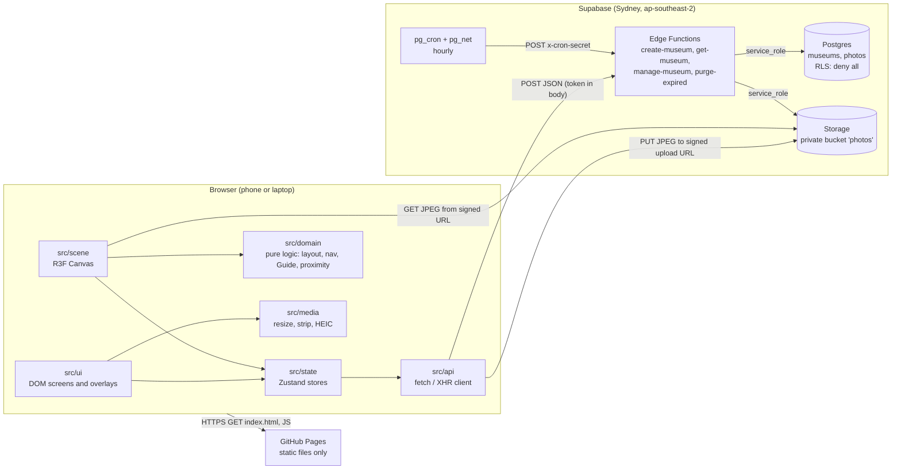
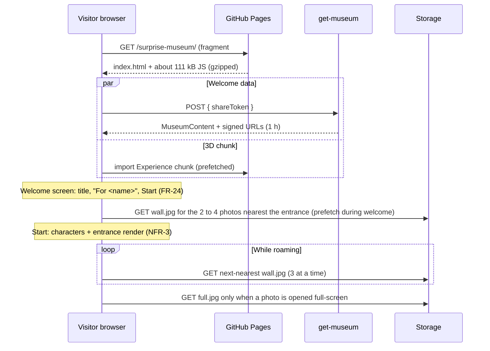

# Architecture: Surprise Museum

Version 1.2 | 29/10/2026 | Owner: architect | Based on requirements v0.2 and user stories v0.2

Version 1.1 synced this document with what was built in the build phase and integration round 1. Version 1.2 adds the QA phase 6 changes (ADRs 0018 and 0019). Changes are listed in section 17.

## 1. Summary

| Concern | Decision | ADR |
|---|---|---|
| Frontend | Vite + React + TypeScript + React Three Fiber + drei + Zustand (default stack, no deviation) | 0001 |
| Hosting | Static site on GitHub Pages at `https://patlu29.github.io/surprise-museum/`, Vite `base: '/surprise-museum/'` | 0002 |
| Deep links | **Hash routing** (`/#/m/<token>`), using `wouter` | 0002 |
| Backend | Supabase in Sydney (ap-southeast-2): Postgres, one private Storage bucket, four Edge Functions, pg_cron | 0003 |
| Access control | Edge Functions are the only gateway. RLS on, no policies, privileges revoked from `anon`. Tokens stored as SHA-256 hashes | 0003 |
| Photo processing | In the browser before upload: decode (HEIC via a lazy decoder), resize, re-encode JPEG (strips all metadata). The server verifies | 0004 |
| Photo delivery | Three renditions (2048 px full, 1024 px wall, 24 px inline placeholder), signed URLs, loaded nearest-first | 0005 |
| Live-readiness (NFR-25) | `CharacterStateSource` abstraction and a pure `src/domain` layer | 0006 |
| Guide navigation | Waypoint graph with A* and 2D circle-versus-box collision. No physics engine, no navmesh | 0007 |
| Avatars | Procedural stylised figure built in code: one skinned body mesh and one skinned hair mesh with rigid weights. The domain produces animation timing; the kit's `applyPose` turns it into joints | 0008 (amended) |
| Museum layout | Deterministic linear chain: entrance hall (7.5 m), 1 to 5 gallery rooms (4 photos each), finale room. 65.5 m at most | 0009 (amended) |
| Camera | Composition from screen-space targets (design spec 3.4); partition walls fade to 0.25 opacity instead of shortening the boom | 0014 |
| Graphics tier | Automatic: `low` on phones and weak GPUs, `high` otherwise; the Visitor's setting wins | 0016 |
| Retention | Hourly pg_cron job calls the `purge-expired` Edge Function through pg_net | 0010 |
| Name labels | DOM labels (drei `Html`) hidden by a cheap 2D line-of-sight test | 0011 |
| Browser API client | Thin `fetch`/`XMLHttpRequest` client, no `supabase-js` in the bundle | 0012 |
| API mode | `VITE_API_MODE`: production builds are live unless `mock` is explicit; `VITE_API_MODE=live` builds fail without a usable Supabase configuration; the demo mock persists in IndexedDB | 0015 |
| Scene entry points | The UI loads the scene only through two lazy imports: `@/scene/Experience` and `@/scene/preview/AvatarPreview` | 0017 |
| Package registry | Project `.npmrc` pins the public npm registry | 0013 |

## 2. Stack and versions

Installed on 27/10/2026. Versions are pinned exactly (`save-exact`). Node 22.12 or later is required (built locally on Node 26.7).

| Package | Version | Role | Why |
|---|---|---|---|
| `react`, `react-dom` | 19.3.1 | UI | Default. R3F 9.8 supports React `>=19 <19.4`; do not upgrade React past 19.3 until R3F widens its range |
| `three` | 0.186.1 | Renderer | Default |
| `@react-three/fiber` | 9.8.2 | React renderer for three.js | Default. Latest stable on 29/10/2026. It still creates a `THREE.Clock`, so three 0.186 logs a deprecation warning in every build; accepted, not patched (ADR 0018) |
| `@react-three/drei` | 10.7.9 | Helpers (`Html` for the museum name labels) | Default. Import named helpers only, for tree shaking |
| `zustand` | 5.0.16 | Stores shared by UI and scene | Default |
| `wouter` | 3.13.0 | Hash router (about 2 kB) | ADR 0002. Smaller than React Router; has a built-in hash location hook |
| `heic-to` | 1.6.6 | HEIC decoder (libheif WASM), lazily loaded, `heic-to/csp` build | ADR 0004. Maintained (release 10/2026). **LGPL-3.0**, needs legal sign-off |
| `vite` | 8.3.5 | Build | Default |
| `@vitejs/plugin-react` | 6.1.2 | JSX and Fast Refresh | Default |
| `typescript` | **6.0.3** | Types (`strict`) | TS 7.0 is current, but `typescript-eslint` 8.72 supports only `<6.1`. Move to 7 when it does |
| `vitest` | 5.0.5 | Unit tests | Default |
| `@playwright/test` | 1.64.1 | End-to-end tests | Default |
| `@axe-core/playwright` | 4.14.0 | Automated WCAG checks in the e2e suite (NFR-12, US-32) | Added 29/10/2026 at QA's request. Dev only, never bundled. Maintained by Deque (release 10/2026); brings `axe-core` 4.14.0 |
| `eslint` 10.13.0, `typescript-eslint` 8.72.1, `eslint-plugin-react-hooks` 7.1.1, `eslint-plugin-react-refresh` 0.5.7, `eslint-config-prettier` 10.1.8, `globals` 17.13.0 | | Lint | Default |
| `prettier` | 3.9.10 | Format | Default |

**Deliberately not added:**

| Package | Reason |
|---|---|
| `@react-three/rapier` | Collision needs are 2D circles against boxes (ADR 0007). Rapier adds about 1.5 MB of WASM to the first view |
| `@react-three/postprocessing` | No effect in the MVP needs it, and it costs fill rate on phones |
| `@supabase/supabase-js` | ADR 0012. It adds about 45 kB gzipped and offers no upload progress |
| `leva`, `r3f-perf` | Use drei `StatsGl` in development. Add these later, with a note in this file, if needed |
| `three-pathfinding`, `recast-navigation` | Overkill for a known, axis-aligned layout (ADR 0007) |

No dependency was added during the build phase; `@axe-core/playwright` (dev only) was added in QA phase 6. The Fraunces font files (`@fontsource/fraunces` 5.3.0, OFL) are copied into `src/ui/fonts/` rather than installed as a package. The museum look and the avatars are generated in code, so `public/models/` and `public/env/` are empty.

Measured on 28/10/2026 (gzipped JS): home first view 95 kB, Visit welcome screen 111 kB, builder 112 kB, the lazy 3D chunks 288 kB on top of the welcome screen. Section 12 has the budgets.

## 3. System diagram



The browser never talks to Postgres. It talks to the Edge Functions, and to Storage only through URLs that an Edge Function has signed.

## 4. Source layout and module boundaries

```text
surprise/
├── docs/                       architecture, ADRs, handoffs, requirements
├── public/                     .nojekyll, favicon; models/ textures/ env/ (technical-artist)
├── src/
│   ├── main.tsx, App.tsx       entry and hash routes
│   ├── config/env.ts           VITE_ variables
│   ├── api/                    MuseumApi: live Edge Function client and persistent demo mock (no React)
│   ├── media/                  image pipeline, JPEG metadata stripper and worker (no React)
│   ├── lib/                    small UI helpers, and the MuseumApi port (apiPort.ts)
│   ├── domain/                 pure TypeScript, no React, three or stores
│   │   ├── characters/         CharacterState, sources (NFR-25), animation timing, avatar options
│   │   ├── layout/             generateLayout(photos) -> MuseumLayout; constants.ts holds every dimension
│   │   ├── navigation/         waypoint graph, A*, collision, line of sight
│   │   ├── presentation/       PresentationDirector (FR-26 to FR-29), FinaleSignal
│   │   ├── guide/              Guide state machine (FR-30, FR-31); simulation.ts for soak tests
│   │   ├── camera/             composition targets, camera pose, boom occlusion (ADR 0014)
│   │   └── photos/             photo load queue (priority, retries, URL refresh)
│   ├── state/                  Zustand stores, transient input state, AvatarPreviewProps contract
│   ├── hooks/                  shared React hooks
│   ├── scene/
│   │   ├── Experience.tsx      the museum Canvas (lazy entry point 1)
│   │   ├── preview/            AvatarPreview.tsx, the builder's canvas (lazy entry point 2, ADR 0017)
│   │   ├── seams.ts            the one place the scene meets the technical-artist's kit
│   │   ├── runtime/            per-museum runtime, reduced motion, graphics tier (ADR 0016)
│   │   ├── objects/            museum geometry, frames, partitions and their fade, podium, plaques
│   │   ├── characters/         CharacterView, NameLabel, AvatarRig; kit/ = technical-artist
│   │   ├── photos/             PhotoTextures (decode and upload)
│   │   ├── controllers/        SceneDriver, commands, hint, projection, test hooks
│   │   ├── cameras/            FollowCameraRig
│   │   ├── materials/          technical-artist (palette, materials, lighting, quality tiers)
│   │   └── shaders/            technical-artist (glow decal, light cone, dust motes)
│   ├── ui/
│   │   ├── screens/            Home, Create, Preview, Visit, Edit, NotFound, Loading
│   │   ├── builder/            builder steps and customiser
│   │   ├── overlays/           HUD, joystick, caption panel, viewer, finale panel
│   │   └── components/         shared controls
│   └── styles/                 tokens.css, base.css (ux-ui-designer)
├── supabase/
│   ├── config.toml
│   ├── migrations/             schema, RLS, bucket, cron
│   ├── functions/              _shared/contract.ts + one folder per function
│   └── scripts/                check-live-config.mjs (deploy guard), smoke-test.mjs
└── tests/                      unit/ and e2e/ (qa-engineer)
```

### Import rules (enforced by `eslint.config.js`)

| Layer | May import | Must not import |
|---|---|---|
| `src/domain` | `@contract`, other `src/domain` files | React, three, Zustand, `@/state`, `@/api`, `@/scene`, `@/ui` |
| `src/api` | `@contract`, `@/config` | React, three, stores, scene, UI |
| `src/media` | `@contract` | React, three, stores, scene, UI |
| `src/state` | `@/domain`, `@/api`, `@/media`, `@contract`, Zustand | three, `@/scene`, `@/ui` |
| `src/scene` | `@/domain`, `@/state`, `@contract`, three, R3F, drei | `@/ui`, `@/api`, `@/media` |
| `src/ui`, `src/hooks`, `App.tsx`, `main.tsx` | `@/state`, `@/domain`, `@/api`, `@/media`, `@/lib`, `@contract` | three, R3F; `@/scene` only by `lazy(() => import('@/scene/Experience'))` or `lazy(() => import('@/scene/preview/AvatarPreview'))` (ADR 0017). Other dynamic scene imports, relative paths into `src/scene` and `import.meta.glob` over scene files are lint errors |

Aliases: `@/` is `src/`, and `@contract` is `supabase/functions/_shared/contract.ts`. Both are configured in `tsconfig.app.json` and `vite.config.ts`.

**Naming:** code identifiers use US spelling (`color`, `hairColor`) to match three.js, CSS and the DOM. All copy and documents use Australian English.

## 5. Data flow

### 5.1 Visitor session



Inside the scene, once per frame:

```text
input (joystick/keys) -> LocalVisitorController.tick -> visitor CharacterState
visitor state + layout -> PresentationDirector.update -> presentation intent
intent + visitor + camera -> AutonomousGuideSource.tick -> guide CharacterState
CharacterRegistry: on presentation change -> sessionStore (UI caption panel, viewed count)
renderers (CharacterView, NameLabel, photo load queue priority) read CharacterState; never write it
visitor position -> FinaleSignal -> sessionStore.finaleReached (edge-triggered)
camera + visitor -> partition fade (ADR 0014); hint request -> sessionStore.hint
```

### 5.2 Creator: build, upload, publish

```mermaid
sequenceDiagram
  participant C as Creator browser
  participant W as media worker
  participant EF as Edge Functions
  participant S as Storage
  C->>W: add file(s)
  W-->>C: full.jpg, wall.jpg, lqip, width, height (metadata gone)
  C->>EF: create-museum (first photo only)
  EF-->>C: editToken (draft, expires in 7 days)
  loop each photo (3 in parallel)
    C->>EF: manage-museum reserve-photo
    EF-->>C: photoId + two signed upload URLs (2 h)
    C->>S: PUT full.jpg, PUT wall.jpg (XHR with progress, FR-4)
    C->>EF: manage-museum confirm-photo { width, height, lqip }
    EF->>S: download and verify both objects
    EF-->>C: ready (or invalid_image and objects deleted)
  end
  Note over C: captions, names, avatars stay local until publish; preview uses local blobs
  C->>EF: manage-museum publish { document }
  EF-->>C: shareToken, expiresAt (90 days)
```

Uploading starts as soon as each photo is processed, not at publish, so publishing a 20-photo museum is one small request (NFR-18). A failed upload is retried alone with `renew-upload` (FR-4).

### 5.3 Preview equals published

Preview (`#/create/preview`) builds a `MuseumContent` from the local draft, using `blob:` URLs for the same `wall.jpg` and `full.jpg` files that are uploaded. Layout, avatars and Guide behaviour come from the same deterministic functions, so preview and published are identical (US-8) without any server round trip. Preview works without a backend, which also makes local development possible before Supabase exists.

## 6. 3D scene

### 6.1 Conventions

| Item | Value |
|---|---|
| Units | Metres. A medium-height character is 1.70 m |
| Axes | +Y up. The route runs from the entrance at `z = 0` towards `-Z`. +X is the Visitor's right on entry |
| Heading | Radians about +Y. 0 faces +Z |
| Single canvas | `src/scene/Experience.tsx`. The builder's avatar preview (`src/scene/preview/AvatarPreview.tsx`) is a second, separate small canvas, mounted only on the builder's Characters step. Never mount both at once (iOS WebGL context limits). These are the only two scene entry points (ADR 0017) |

### 6.2 Procedural museum layout (ADR 0009)

`generateLayout(photos: { id, width, height }[]): MuseumLayout` lives in `src/domain/layout`. It is pure and deterministic, and unit-tested for 1 to 20 photos. Every dimension is in `src/domain/layout/constants.ts` (`LAYOUT`), which the technical-artist also reads; nothing else may duplicate them.

```text
 z=0  ┌────────────┐  Entrance hall 8 m wide x 7.5 m deep. Spawn: Visitor (0, -4.9) facing -Z, Guide (1.0, -4.5)
      │  ENTRANCE  │  Title plaque on the left wall
      └────┐  ┌────┘  Doorway 2.4 m wide, centred
      ┌────┘  └────┐
      │ 1        2 │  Gallery room k: 8 m wide; 10 m deep (3 or 4 photos) or 6 m deep (1 or 2)
      │            │  Slot order in a room: left-near, right-near, left-far, right-far
      │ 3        4 │  Near/far slots at 2.5 m and 7.5 m into a 10 m room; 3 m into a 6 m room
      └────┐  ┌────┘
          ...           rooms = ceil(n / 4), 1 to 5
      ┌────┘  └────┐
      │   FINALE   │  Finale room 8 x 8 m. Podium disc r = 1.5 m at room centre + 1 m;
      │    (◎)     │  trigger zone r = 1.8 m; lectern (solid, 0.6 x 0.4 m) at the far edge
      └────────────┘  Closed end: the museum has no exits (FR-34)
```

| Parameter | Value | Requirement |
|---|---|---|
| Wall height and thickness | 3.2 m, 0.2 m | |
| Photo display box | Fits within 1.6 m wide by 1.4 m high, keeping aspect ratio; centre 1.55 m above the floor; frame border 0.06 m | FR-39 (no crop or distortion) |
| Left and right walls | 8 m apart, so a Visitor in the middle is 4 m from both photos and outside both 3 m zones | FR-26 |
| Presentation zone | Front-centre point 0.3 m off the wall; enter at 3 m after 1 s, exit at 4.5 m. "Same side" is measured from the **wall surface** (the picture's position), not the zone point: `dot(wallNormal, visitor - picturePosition) > 0.2 m`, and the 2D line of sight from the Visitor to the zone point must be clear (ADR 0009 amendment) | FR-26 to FR-28 |
| Entrance hall | 7.5 m deep (was 6 m), so the phone camera boom of about 4.8 m fits behind the spawn (ADR 0014) | |
| Length | 7.5 m + rooms + 8 m. 65.5 m at most for 20 photos (about 41 s of walking) | |

`MuseumLayout` contains: `rooms`, `colliders` (axis-aligned boxes at true size; navigation inflates them by the character radius), `partitions` (the internal walls between rooms, with their colliders), `hardColliders` (everything except partitions; used by the camera), `slots` (photo id, position, normal, size, zone), `finale` (centre, radius), `spawn` (visitor and guide), `navGraph` (nodes and edges) and `bounds`. The podium sits 1 m past the finale room's centre, away from the doorway.

### 6.3 Navigation and collision (ADR 0007)

| Part | Approach |
|---|---|
| Collision | Characters are circles (r = 0.3 m) against static axis-aligned boxes. Move, then push out along the shortest axis, two passes, so characters slide along walls. The Visitor and Guide do not collide with each other (A-18) |
| Line of sight | 2D segment against boxes inflated by 0.35 m, with rounded corners. Used by the Guide, the presentation director and the name-label occlusion (ADR 0011) |
| Camera occlusion | Outer walls shorten the boom (to 1.2 m at least). **Partition walls do not**: one that stands between the camera and the Visitor fades to 0.25 opacity and returns to 1 when clear (instant under reduced motion). Collision, navigation and the director treat a faded wall exactly as a solid one (ADR 0014) |
| Graph | Generated with the layout: nodes on the centreline every 2.5 m, at each doorway, at each photo standing spot, at spawn and at the finale. Edges join nodes with line of sight. About 60 to 120 nodes |
| Path | A* with a Euclidean heuristic, then string-pulling (skip any node that has line of sight to a later one). Re-plan only when the target moves more than 1 m or every 0.5 s |
| Cost | Under 0.2 ms per frame on the reference phone. Runs in the main thread; no worker needed |

### 6.4 Presentation director (FR-26 to FR-29, FR-71, A-17, A-19)

`src/domain/presentation/PresentationDirector` is a pure state machine updated once per frame with the Visitor's position and `dt`. It outputs an **intent**: `none`, `photo(id)` or `finale`.

| Rule | Behaviour |
|---|---|
| Candidates | Zones with distance 3 m or less, on the same side (measured from the wall surface, 0.2 m margin) and with a clear line of sight to the zone point |
| Dwell | The nearest candidate must stay nearest for 1 s. The timer resets when the nearest candidate changes or disappears |
| Exit | The active photo ends past 4.5 m or on the other side |
| Switch | During a presentation, a different nearest candidate that completes its dwell replaces the current one. Nothing is queued |
| Dismiss | Ends the presentation and suppresses that photo until the Visitor goes beyond 4.5 m, after which it can present again (A-19) |
| Finale | Entering the finale zone starts the finale intent immediately. Leaving to more than r + 1 m (2.8 m) ends it. Keep exploring dismisses it with the same suppression rule. Separately, `FinaleSignal` writes `sessionStore.finaleReached`, edge-triggered: true on entering the zone, false on leaving; after Keep exploring it stays false until she has left and entered again. Replay and jump reset it |
| Viewed | A photo is viewed when its presentation starts, or when opened full-screen (A-17). Stored in `sessionStore` |
| No caption | The intent and the Guide behaviour are unchanged; the UI shows no panel (FR-71) |

The UI shows the caption panel when the Guide's `presentation` changes. The Guide sets it on arrival, or 1.5 s after the intent at the latest, so the panel never waits on a long walk. Both delays are tuning constants (A-16).

### 6.5 Guide AI (FR-30, FR-31, FR-62, NFR-26)

`AutonomousGuideSource` (in `src/domain/guide`) implements `CharacterStateSource`. It is constructed with the layout, the navigation API and the director.

| State | Behaviour | Leaves when |
|---|---|---|
| `follow` | Target: 2.5 m behind the Visitor and 0.8 m to the side away from the camera's line to the Visitor. Idle while within 2 to 5 m and the Visitor is still. Walks at 1.25 times the Visitor's speed to catch up | Intent set: `approach`. More than 8 m away, or stuck (under 0.6 m of net movement in 3 s while trying to move): `relocate` |
| `approach` | Path to the presentation spot: 1.1 m beside the Visitor, perpendicular to the photo's normal, on the side with clearance, and never closer to the photo than the Visitor (so it never stands between them). With reduced motion, go straight to `relocate` and fade in at the spot | Arrived: `present`. Intent cleared: `follow` |
| `present` | Face half-way between the photo and the Visitor; set `presentation`; play `present` gesture once (Should); hold still | Intent cleared or changed: `follow` or `approach` |
| `relocate` | Fade out over 0.25 s, teleport to the best spot 2 to 4 m from the Visitor that is outside the camera frustum and has line of sight to the Visitor (otherwise just beside the Visitor), then fade in over 0.25 s | Done: previous goal |
| Yield (any state) | If the Visitor's position 1 s ahead is within 0.6 m of the Guide, or the Guide is inside the camera-to-Visitor corridor (0.5 m wide), sidestep at right angles. If it cannot, fade to 35% opacity until clear | |

NFR-26 is a unit test: because `src/domain` is pure, a 30-minute random-roaming soak test runs in Vitest at a fixed 1/30 s step in a few seconds of CPU. It asserts the Guide is never stuck for more than 10 s, never inside a collider and never in the Visitor's path.

### 6.6 Character-state abstraction (NFR-25, ADR 0006)

Defined in `src/domain/characters/characterState.ts` (architect; unchanged in the build). Implemented by `LocalVisitorController`, `AutonomousGuideSource`, `ScriptedCharacterSource` and `CharacterRegistryImpl` in `src/domain`.

```text
             ┌──────────────────────────┐
 input  ───▶ │ LocalVisitorController   │──┐
             └──────────────────────────┘  │   CharacterRegistry      ┌─────────────┐
             ┌──────────────────────────┐  ├─▶ (visitor, guide)  ───▶ │ CharacterView│
 director ─▶ │ AutonomousGuideSource    │──┤   tickAll(dt, world)     │ <NameLabel>  │
             └──────────────────────────┘  │   onPresentationChange   │ caption via  │
             ┌──────────────────────────┐  │          │               │ sessionStore │
 test    ──▶ │ ScriptedCharacterSource  │──┤          ▼               └─────────────┘
             └──────────────────────────┘  │   sessionStore (UI)
             ┌──────────────────────────┐  │
 future  ──▶ │ NetworkCharacterSource   │──┘
             └──────────────────────────┘
```

| Element | Contract |
|---|---|
| `CharacterState` | `position`, `heading`, `speed`, `locomotion` (`idle`, `walk`), `gesture`, `presentation` (`none`, `photo`, `finale`, `greeting`), `opacity`, `teleportSeq`, `timestamp` |
| `CharacterStateSource` | `kind`, `tick(dt, world)`, `read()`, optional `teleport()` and `dispose()` |
| `CharacterRegistry` | Holds one source per role, ticks visitor then guide, and emits presentation changes once per change |
| Renderers | `CharacterView` and `NameLabel` (`src/scene/characters/`) read `registry.getSource(role).read()` in `useFrame`. They never know the source kind. Animation is derived from `locomotion`, `speed` and `gesture` only (section 6.7) |
| Per-frame data | Lives in the sources, not in Zustand, so nothing re-renders per frame. Only discrete changes (presentation, viewed) go to stores |

**Future live mode (FR-66, not built):** a `NetworkCharacterSource` fed by a Supabase Realtime Broadcast channel named after the museum id, with a 100 ms interpolation buffer keyed on `timestamp` and a snap when `teleportSeq` changes. The Visitor's client publishes its local state at 10 to 15 Hz. In live mode the Creator's client owns the Guide, and presentation is set by the Creator's input instead of the director. No renderer, label or panel code changes. The NFR-25 test drives a character with `ScriptedCharacterSource` and asserts that the avatar transform, animation and label follow it.

### 6.7 Avatars (ADR 0008)

| Topic | Approach |
|---|---|
| Construction | A hierarchy of groups (hips, spine, neck, head, upper and lower arms and legs, hands, feet) made of shared primitive geometries (capsules, spheres, rounded boxes, lathes). Stylised, friendly proportions |
| Options | `AvatarConfig` in the contract: skin tone (10), hair style (12), hair colour (11), outfit style (6) with colour (12), body type (4), height (3), facial hair (5, Guide only), glasses and hat (Release 2). Body type scales torso and hip widths; height scales the rig uniformly (0.91, 1.00, 1.09) |
| Parts kit | `src/scene/characters/kit/`: one function per hair style, facial-hair style and outfit that returns primitive parts per bone, and a palette that maps option ids to colours. Owner: technical-artist |
| Construction (as built) | The kit builds one skinned body mesh and one skinned hair mesh with **rigid weights** on 13 bones (hips, spine, neck, head, hairBack, both arms and forearms, both legs and shins), plus a blob shadow. Hair is designed back-first; `hairBack` lets long hair swing (ADR 0008 amendment) |
| Animation | **Driven by the kit.** `src/domain/characters/animation.ts` (scene-developer, pure) turns `locomotion`, `speed` and `gesture` into timing only: walk phase, walk blend, idle clock and present level. The kit's `applyPose` (technical-artist) turns that into joint rotations. The scene never drives bones itself. The presenting arm is the character's anatomical right arm (-X in rig space) |
| Reduced motion | The walk cycle stays (it shows the movement the user asked for, FR-18); idle sway, breathing and the present gesture are off |
| Rig interface | `AvatarRig` (`src/scene/characters/avatarRig.ts`): `root`, `height`, `labelHeight`, `scale`, `applyPose`, `setOpacity`, `dispose`. Built through `src/scene/seams.ts`; used by `CharacterView` and the builder preview |
| Option labels | `src/domain/characters/avatarOptions.ts`: labels, defaults and `describeAvatar`, re-exported by the kit and `src/lib/avatars.ts` (one source of truth) |
| Budget per character | 6,000 triangles or fewer; 10 draw calls or fewer. As built: 4,274 to 5,750 triangles and at most 3 draw calls |
| Update speed | Option changes rebuild only the affected part, well within 1 s (FR-15) |
| Swappable | `AvatarRig` is the stable interface. A modular glTF kit with a shared skeleton can replace the internals later without touching sources, labels or UI |

### 6.8 Name labels (FR-17, ADR 0011)

A drei `<Html>` element anchored 0.35 m above each head (scaled with height), facing the camera by nature of DOM. It is hidden when the 2D line of sight from the camera to the head is blocked by a wall, but stays visible through a faded partition (ADR 0014). The builder preview uses plain DOM labels positioned over its canvas instead of drei `<Html>` (two `Html` roots mounting together raised a React 19 warning and dropped a label). DOM text renders accents and emoji exactly as typed (US-4) and gets contrast from a solid CSS backing (4.5:1, NFR-12). Labels are `aria-hidden`; names are announced by the UI instead.

### 6.9 Camera and input

| Topic | Approach |
|---|---|
| Camera | Third person (A-4), `src/domain/camera/composition.ts` and `src/scene/cameras/FollowCameraRig.ts`. The v1.0 numbers (boom 3.5 m, height 2.2 m) are replaced by the screen-space targets in design spec 3.4 (ADR 0014): phone portrait 30% of the viewport height with the feet at 72% from the top and FOV 60; phone landscape 46%, 80%, FOV 52; wide (tablet and desktop) 40%, 82%, FOV 52. The boom is derived (about 4.8, 3.7 and 4.2 m, clamped to 2.5 to 6 m), default pitch 14 degrees, pivot 0.9 m above the feet, and a constant `setViewOffset` places her vertically. The user orbits by dragging; it never moves on its own beyond following the Visitor (FR-62) |
| Occlusion | Outer walls shorten the boom (minimum 1.2 m). Partition walls fade to 0.25 opacity instead (section 6.3) |
| Input ownership | The UI owns keyboard, drag-to-look and wheel (`useCanvasKeyboard`, `useLookControls`). The scene's own `CanvasInput` is off by default (`<Experience canvasInput />`) so orbit input is never applied twice |
| Touch | Virtual joystick (DOM overlay in `src/ui/overlays`, 44 px minimum targets) in the lower left; drag elsewhere to orbit |
| Keyboard | W A S D and arrow keys move; Q and E or Shift with arrows orbit; Enter or Space dismisses the panel; Escape closes the viewer (FR-61) |
| Arrow buttons | On-screen walk and turn buttons (WCAG 2.5.7), a Settings option. They write `setMoveSource('arrows', x, y)` into `inputState`, so the scene needs no change |
| Transient input | `src/state/inputState.ts`: a plain mutable object holding a `MoveIntent` and orbit deltas. Written by the UI, read by `LocalVisitorController`. Not a Zustand store |
| Picking | R3F `onClick` on photo meshes opens the full-screen viewer (FR-35) |

### 6.10 Photo loading: nearest first (NFR-3, NFR-5, FR-58)

| Step | Behaviour |
|---|---|
| Placeholder | Each frame first shows the inline 24 px LQIP (in the API response, so it is never blank) |
| Queue | `src/domain/photos/loadQueue.ts` (pure, tested): a priority queue with 3 concurrent downloads. Priority is walking distance from the Visitor to the slot, re-ranked every 0.5 s and whenever a download finishes. `src/scene/photos/PhotoTextures.ts` does the fetching, decoding and texture upload |
| Prefetch | The scene mounts behind the welcome screen, so the slots nearest the spawn start downloading while she reads. `sceneReady` is set once the entrance has rendered and the 3 nearest pictures have loaded or failed, or after 6 s |
| Decode | `fetch` the blob, then `createImageBitmap(blob, { imageOrientation: 'flipY' })`, upload to a `THREE.Texture` (sRGB, mipmaps, anisotropy 4 on desktop and 2 on phones). Close the bitmap after upload |
| Failure | One try plus three retries after 1 s, 3 s and 9 s, then `failed` with a retry control (FR-58). A 400 or 403 asks `museumStore.refreshUrls()` once; waiting photos restart with the new URLs |
| Full size | `full.jpg` is never a texture. It loads in an `` in the full-screen viewer only |
| Memory | 20 wall textures at 1024 px are about 80 MB of GPU memory at worst. Textures are not evicted today. If NFR-6 testing shows pressure, the performance optimiser may evict textures beyond the 12 nearest back to the LQIP, in `PhotoTextures` |
| Status | `photoStatus` in `museumStore` (`placeholder`, `loading`, `loaded`, `failed`) so the UI can show retry |

### 6.11 Rendering

Photos use an unlit material (`MeshBasicMaterial`, `toneMapped: false`) so they are always evenly lit, with no glare or shadow (FR-40). The look is generated in code by the technical-artist (`src/scene/materials/`, `src/scene/shaders/`): Neutral tone mapping, a warm hemisphere light and one warm key light, no shadow maps, a blob shadow under each character, and procedural textures, so nothing is downloaded for it.

| Tier (ADR 0016) | Chosen when | What it changes |
|---|---|---|
| `high` | Automatic on everything that is not `low` | Standard materials on floors and brass, a generated environment map, the finale light cone and dust motes, full-size procedural textures |
| `low` | Automatic on phones (coarse pointer, short side under 700 px), weak or software GPUs, and devices with 2 GB or 2 cores or fewer; or the Visitor's "lower graphics" setting | Lambert materials, half-size textures, no environment map, no cone or motes |

The tier is published as `<html data-graphics-quality>`. Rendering is capped at 30 FPS on touch devices and in `low` (NFR-7), and pauses while the full-screen viewer is open. Device pixel ratio is capped at 1.5 on touch devices, and at 1 (`low`) or 2 (`high`) otherwise. WebGL context loss sets `sessionStore.contextLost` and the UI offers a reload (NFR-11).

## 7. Backend: data model and API

### 7.1 Tables (`supabase/migrations/20261027000100_initial_schema.sql`)

**`museums`**

| Column | Type | Notes |
|---|---|---|
| `id` | uuid PK | Internal only. Never authorises anything |
| `edit_token_hash` | bytea(32), unique | SHA-256 of the edit token |
| `share_token_hash` | bytea(32), unique | SHA-256 of the share token |
| `status` | enum `draft`, `published` | |
| `title` | text, up to 60 | Empty means the default title |
| `visitor_name`, `guide_name` | text, 1 to 24 | Required when published |
| `opening_greeting` | text, up to 500 | Release 2 |
| `closing_message` | text, up to 1,000 | |
| `theme` | text | `default` |
| `visitor_avatar`, `guide_avatar` | jsonb | `AvatarConfig`, validated in the Edge Function |
| `content_version` | smallint | Contract version |
| `photo_reservations` | smallint, 0 to 100 | Abuse cap |
| `created_at`, `updated_at`, `published_at` | timestamptz | |
| `expires_at` | timestamptz | Draft: created + 7 days. Published: first publish + 90 days |

**`photos`**

| Column | Type | Notes |
|---|---|---|
| `id` | uuid PK | Part of the storage key |
| `museum_id` | uuid FK, cascade delete | |
| `status` | enum `pending`, `ready` | `ready` after `confirm-photo` |
| `position` | smallint 0 to 19, unique per museum | Set on publish |
| `caption` | text, up to 280 | Set on publish |
| `width`, `height` | smallint, up to 2048 | Of `full.jpg` |
| `lqip` | text, up to 4,096 | `data:image/jpeg;base64,...` only |
| `created_at`, `confirmed_at` | timestamptz | |

Support tables: `storage_purge_queue` (museum ids whose storage still needs deleting) and `rate_limits` (fixed windows keyed by a salted IP hash). Functions: `rate_limit_hit`, `reserve_photo` (atomic limit of 20 live photos and 100 reservations) and `delete_museum_rows` (delete and queue in one transaction). All are `service_role` only.

**Storage:** bucket `photos`, private, 2 MiB per object, `image/jpeg` only. Keys are `<museum_id>/<photo_id>/full.jpg` and `.../wall.jpg`. Uploads set `cache-control: private, max-age=3600`.

### 7.2 Row-level security

| Object | `anon`, `authenticated` | `service_role` (Edge Functions only) |
|---|---|---|
| `museums`, `photos`, `storage_purge_queue`, `rate_limits` | RLS enabled, **no policies**, all privileges revoked: no select, insert, update or delete through REST or GraphQL | Full access (bypasses RLS) |
| Functions in `public` | Execute revoked | Execute granted |
| `storage.objects` in bucket `photos` | No policies: cannot list, read, write or delete | Full access; issues signed URLs |
| Future tables and functions in `public` | Default privileges revoked for the `postgres` role | |

Why not token-checking RLS policies? Policies that read a token from request headers work for tables but not cleanly for Storage, and they spread the security logic across SQL and two APIs. One gateway is easier to review and test. RLS remains as a deny-all backstop, so a bug in the client cannot open a hole.

### 7.3 Edge Function API

**`docs/api.md` (backend-developer) is the contract.** This section is a summary; where they differ, `docs/api.md` wins. Types are in `supabase/functions/_shared/contract.ts`.

All calls: `POST {VITE_SUPABASE_URL}/functions/v1/<name>` with headers `Content-Type: application/json` (anything else is 415), `apikey: <VITE_SUPABASE_ANON_KEY>` and `x-region: ap-southeast-2`. Tokens travel only in the body. Bodies are at most 64 KiB, unknown fields are rejected, and text lengths count code points. Responses carry `Cache-Control: no-store`. CORS answers only the origins in `ALLOWED_ORIGINS`; any other origin gets 403.

| Function | Who | Request | Success | Rate limit (per salted client-address hash; IPv6 by /64) |
|---|---|---|---|---|
| `create-museum` | Anyone (builder) | `{}` | **201** `{ editToken, draftExpiresAt }` | 10 per hour |
| `get-museum` | Share-token holder | `{ shareToken }` | 200 `{ museum: MuseumContent, urlsExpireAt }` | 60 per minute, and 20 misses per 10 minutes (then every lookup is 429 until the window ends) |
| `manage-museum` | Edit-token holder | `{ action, editToken, ... }` (below) | Per action | 120 per minute per client, 600 per hour per museum, and the same 20 misses per 10 minutes |
| `purge-expired` | pg_cron only | `{}` with `x-cron-secret` header | 200 `{ purged, retried, failed }` | Secret check (constant-time); a wrong secret gets the uniform 404 |

`manage-museum` actions:

| Action | Body | Effect | Success |
|---|---|---|---|
| `get` | — | Read for the edit screen | 200 `ManageGetResponse` (share token derived from the edit token) |
| `reserve-photo` | — | `reserve_photo()`; signs two upload URLs (2 h) | **201** `PhotoUploadTicket` |
| `renew-upload` | `photoId` | New upload URLs for a `pending` photo (retry, FR-4) | 200 `PhotoUploadTicket` |
| `confirm-photo` | `photoId, width, height, lqip` | Checks the `lqip` (JPEG data URL, at most 32 px), then downloads both objects and verifies them (section 10.3). Repeating on a `ready` photo is safe | 200 `{ photoId, status: "ready" }` |
| `remove-photo` | `photoId` | Deletes the objects and the row. A photo in the published museum cannot be removed this way (409 `conflict`) | 200 `{ photoId, removed: true }` (also when already gone) |
| `publish` | `document: MuseumDocument` | Validates all fields and avatars (`visitorAvatar.facialHair` must be `none`); requires 1 to 20 `ready` photos of this museum; sets positions and captions in one transaction; deletes photos not in the document; sets `published`, `published_at` (first time only) and `expires_at` | 200 `{ shareToken, publishedAt, expiresAt }` |
| `delete` | — | `delete_museum_rows()`, then removes the storage prefix; on storage failure the queue retries hourly | 200 `{ deleted: true }` |

Errors use `ApiError { error, message, field? }`; `field` is a JSON path and appears on `bad_request`, `conflict` and `invalid_image`.

| `error` | Status | When |
|---|---|---|
| `bad_request` | 400; also 403 (origin not allowed), 405, 413, 415 | Malformed or invalid request |
| `not_found` | 404 | Any bad, unknown, draft (for `get-museum`), expired or deleted token. Always the identical body. Access problems never return 401 or 403 |
| `conflict` | 409 | Valid request, wrong state (photo not uploaded or not ready, removing a published photo) |
| `photo_limit`, `upload_quota` | 409 | 20 live photos, or 100 lifetime reservations, used |
| `invalid_image` | 422 | `confirm-photo` refused a file; both objects are deleted and the photo stays reserved for a retry |
| `rate_limited` | 429 | With `Retry-After` |
| `server_error` | 500 | Unexpected; no detail. (The demo mock also uses it with status 413 when its storage is full) |

**Mock mode** (ADR 0015): `src/api` also contains a mock that follows every rule above except rate limits, and persists in the browser (IndexedDB, then `localStorage`, then memory). Which implementation runs is set by `VITE_API_MODE` (section 13 and `docs/api.md` section 12).

### 7.4 Retention (NFR-16, ADR 0010)

| Event | Effect |
|---|---|
| Publish | `expires_at = published_at + 90 days`. Re-publishing an edited museum (Release 2) does not extend it |
| Draft never published | Purged 7 days after creation |
| Creator deletes | Rows gone at once (share link returns not found, FR-52). Objects removed in the same request; if that fails, the hourly job retries |
| Hourly job | `pg_cron` at minute 17 calls `purge-expired` through `pg_net` with the Vault `cron_secret`. It deletes expired museums and drains `storage_purge_queue` |
| Backups | Database backups follow the Supabase plan (all at most 30 days). Storage objects are not in database backups |

## 8. State stores (`src/state`, owner: frontend-developer)

| Store | Holds | Written by | Read by | Persisted |
|---|---|---|---|---|
| `builderStore` | Draft text, avatars, photo list (`localId`, `photoId`, status, progress, error, caption, size, LQIP, blobs and object URLs), `editToken`, consent, publish state and result | Builder UI, upload queue | Builder UI, preview | Release 2 (FR-12): IndexedDB. MVP: memory only |
| `museumStore` | `status` (`idle`, `loading`, `ready`, `not-found`, `error`), `content: MuseumContent`, `source` (`published` or `preview`), `urlsExpireAt`, `photoStatus` per photo | Visit and preview screens, scene photo loading (status, `refreshUrls()`) | Scene, UI | No |
| `sessionStore` | Scene to UI: `sceneReady`, `sceneProgress`, `presentation` (mirror of the Guide's), `viewed` set, `viewerPhotoId`, `contextLost`, `area`, `cameraOffDefault`, `hint`, `nearFailedPhotoId`, `finaleReached`. UI to scene: `phase` (`welcome`, `roaming`) and the command counters `dismissSeq`, `replaySeq`, `resetViewSeq`, `hintSeq` and `jump` | CharacterRegistry callback, scene, UI actions | UI, scene | No |
| `settingsStore` | `motion` (system, reduce, full), `quality` (auto, low; the scene also accepts high, ADR 0016), `muted`, `captionSize`, `controls` (auto, joystick, arrows), `joystickSide` | Settings UI | Scene, UI | `localStorage` |
| `inputState` (not Zustand) | Merged `move` from joystick, keyboard and arrow buttons; `orbitRate`; orbit and zoom deltas | Joystick, keyboard hook, look controls, arrow buttons | `LocalVisitorController`, camera rig | No |
| `screenRects` (not Zustand) | Screen rectangles of the picture, Visitor and Guide during a presentation, about every 100 ms | Scene | Caption placement | No |

Rules: the scene reads stores with `useStore.getState()` inside `useFrame` or with narrow selectors, never by subscribing to whole stores. Per-frame data never goes into a store. The full field-by-field contract is in `docs/handoffs/frontend-developer.md` (Store API).

## 9. Routes (hash routing, ADR 0002)

| Route | Screen | Purpose | Loads 3D |
|---|---|---|---|
| `#/` | `HomeScreen` | Landing and "Create a museum" | No |
| `#/create` | `CreateScreen` | Builder: photos, names and messages, characters, review and publish | Avatar preview canvas only |
| `#/create/preview` | `PreviewScreen` | The full Visitor experience from the local draft, with an Exit preview bar | Yes |
| `#/m/:shareToken` | `VisitScreen` | Welcome, then the museum | Yes, after the welcome screen appears |
| `#/edit/:editToken` | `EditScreen` | MVP: view, copy share link, delete. Release 2: full edit using the builder | Thumbnails only |
| `#/privacy`, `#/terms` | Static pages | Linked from the builder and welcome screen (NFR-13) | No |
| anything else | `NotFoundScreen` | Friendly, reveals nothing (FR-55) | No |

Share link: `https://patlu29.github.io/surprise-museum/#/m/<24 chars>`. Edit link: `https://patlu29.github.io/surprise-museum/#/edit/<43 chars>`. After publishing, the builder must not put the edit token in `localStorage`; it shows it once with the "save this" warning (FR-50).

## 10. Security and privacy

### 10.1 Tokens

| Token | Generation | Bits | Stored |
|---|---|---|---|
| Edit | 32 bytes from `crypto.getRandomValues` in `create-museum`, base64url | 256 | SHA-256 only |
| Share | `base64url(SHA-256("surprise-museum/share/v1:" + editToken))`, first 24 characters | 144 | SHA-256 only |

Deriving the share token from the edit token means the edit screen can show the share link without the database storing any token, and the share token reveals nothing about the edit token. Requests with a token of the wrong format return `not_found` before any database query.

### 10.2 Threat model

| Threat | Control |
|---|---|
| Someone uses the public anon key against REST, GraphQL or Storage | RLS on with no policies; privileges revoked; private bucket with no policies |
| Guessing a share link | 144-bit tokens; uniform 404; per-IP not-found rate limit (US-23) |
| Listing museums or photos | No list endpoint exists; Storage list is denied; object keys contain random UUIDs |
| Token leak through logs or referrers | Tokens live in the URL fragment (never sent to GitHub Pages) and in POST bodies (not logged); `referrer` meta is `no-referrer`; functions never log bodies |
| Database read leak | Only token hashes are stored |
| Photo location leak | Client re-encoding drops all metadata; `confirm-photo` rejects files with EXIF, XMP or IPTC segments (FR-10) |
| Malicious upload | Bucket allows `image/jpeg` up to 2 MiB; `confirm-photo` checks magic bytes, segment structure and dimensions (NFR-15) |
| Free-hosting abuse | Private bucket, 20 live photos and 100 reservations per museum, 10 drafts per hour per IP, drafts purged after 7 days |
| Cross-site scripting stealing tokens | React escapes all text; CSP meta in the build (`script-src 'self'`); no `dangerouslySetInnerHTML` |
| Indexing | `robots` meta `noindex, nofollow, noarchive` on the whole site (FR-49); link previews see only generic Open Graph tags |
| Account creation | Supabase Auth sign-ups disabled, so nobody can obtain the `authenticated` role |

### 10.3 Photo pipeline (ADR 0004)

Client (`src/media`, in a Web Worker where `OffscreenCanvas` exists, otherwise the main thread):

1. Check type by content: JPEG, PNG, WebP or HEIC/HEIF (`ftyp` brands `heic`, `heix`, `hevc`, `hevx`, `mif1`, `msf1`). Reject anything else or over 15 MB with the file name and reason (FR-3).
2. Decode with `createImageBitmap(file, { imageOrientation: 'from-image' })`, which applies EXIF rotation. If that fails and the file is HEIC, load `heic-to/csp` lazily and convert to JPEG first. Safari decodes HEIC natively.
3. Resize with high-quality smoothing. **Never allocate a canvas larger than 4096 px on the long edge** (iOS limits canvas area to about 16.7 million pixels, and 24 and 48 MP iPhone photos exceed it): draw the source straight into the target-size canvas, using at most one intermediate step.
4. Encode JPEG: `full` at 2048 px, starting at quality 0.85 and stepping down to meet 600 KB; `wall` at 1024 px, quality 0.8; `lqip` at 24 px, quality 0.5, as a data URL. Re-encoding through a canvas writes a fresh file, so the camera's EXIF, GPS, XMP, IPTC and maker notes are gone.
5. **Strip what the encoder adds** (`src/media/jpeg.ts`). Safari and every WebKit browser write an APP1 `Exif` segment and an APP13 `Photoshop 3.0` segment into canvas JPEGs, even from a clean canvas. The client removes APP1, APP3 to APP13, APP15 and COM, and keeps APP0, APP2 and APP14 and the structural segments.
6. Process one photo at a time and close every bitmap, to stay within phone memory.

Server (`confirm-photo`): each object exists, is 2 MiB or smaller, starts with `FF D8 FF`, is well formed and ends at EOI with nothing after it, and has a frame header no larger than 2048 px (1024 px for `wall`) that matches the declared size, with `wall` in the same proportions as `full`. Application segments are an allow-list: JFIF (APP0, up to 14 bytes), ICC profile (APP2) and Adobe (APP14, up to 12 bytes). APP1 (EXIF, XMP), APP13 (IPTC, Photoshop), every other APPn and COM are rejected. The check reads bytes only; no image decoding runs on the server. A Safari-shaped fixture tests both sides (`src/api/__tests__/clientCompat.test.ts` and a Deno test), so client and server cannot drift.

Why client-side: Supabase Edge Functions have tight CPU and memory limits that cannot decode and resize 15 MB HEIC files; Supabase image transformations need a paid plan and do not guarantee metadata removal at rest; and uploading 600 KB instead of up to 15 MB is about 25 times faster on 4G (NFR-18). The server check means a modified client still cannot store metadata.

### 10.4 Content Security Policy

GitHub Pages cannot set headers, so `vite.config.ts` injects a CSP `<meta>` into the production build only:
`default-src 'self'; script-src 'self' 'wasm-unsafe-eval'; style-src 'self' 'unsafe-inline'; img-src 'self' data: blob: <supabase>; connect-src 'self' <supabase>; worker-src 'self' blob:; media-src 'self' blob:; font-src 'self'; object-src 'none'; base-uri 'self'; form-action 'self'`.
A meta CSP cannot set `frame-ancestors`, so the app should refuse to run inside a frame (`window.top !== window.self`) on the edit route (frontend-developer). If any loader needs a CDN (for example drei's default Draco decoder path), host the files under `public/` instead.
Builder and preview photos are `blob:` URLs, which `img-src` allows; this was checked under the production CSP in Chromium, and still needs a check in Firefox and Safari (qa-engineer). In mock mode, demo photos are also `blob:` URLs.

## 11. Testing strategy

| Level | Tool | Scope | Owner |
|---|---|---|---|
| Unit, domain | Vitest (Node) | Layout for 1 to 20 photos; nav graph and A*; collision; director edge cases (US-12, US-13); Guide state machine; NFR-26 30-minute soak | scene-developer writes alongside code (`src/**/*.test.ts`); QA reviews |
| Unit, contract and media | Vitest | Validators, JPEG segment scanner, size targets | backend-developer, frontend-developer |
| NFR-25 | Vitest with `@react-three/test-renderer` (QA to add) | Drive an avatar with `ScriptedCharacterSource`; assert transform, animation and label follow | qa-engineer |
| Edge Functions | `deno test` | Token handling, actions, uniform 404, rate limits | backend-developer |
| Database | pgTAP (`supabase test db`) | `anon` cannot read or write any table or list Storage | backend-developer |
| End to end | Playwright (desktop Chromium, iPhone WebKit, Pixel Chromium) and `@axe-core/playwright`. Type-checked by `npm run typecheck` through `tsconfig.e2e.json`, not by `npm run build` (ADR 0019) | Builder against the demo mock (`VITE_API_MODE=mock` build) or mocked `/functions/v1/*`, preview, visit, not found, keyboard-only path, reduced motion, both graphics tiers. Scene hooks: `window.__surpriseMuseum` (with `__SURPRISE_E2E__`); app hooks: `window.__APP_TEST__` (dev and test builds) | qa-engineer |
| Deploy guard | Vitest and a real `vite build` | `check-live-config.mjs` rules; live build fails without variables; mock and ordinary builds pass | backend-developer |
| Performance | Manual on reference devices, plus Lighthouse on 4G throttling | NFR-1 to NFR-6 | performance-optimiser |

## 12. Performance budgets

| Budget | Target | Now (28/10/2026) |
|---|---|---|
| First-view JS, home screen | 120 kB gzipped or less | 95 kB |
| First-view JS, Visit welcome screen | 120 kB gzipped or less | **111 kB** (93% of budget) |
| Builder JS (before the preview canvas) | 120 kB gzipped or less | 112 kB |
| 3D chunks (three.js shared chunk plus `Experience`) | 350 kB gzipped or less | 288 kB |
| HEIC decoder (`heic-to`, lazy, only when a HEIC file fails native decoding) | Not in any first view; 3,500 kB minified ceiling | 3,151 kB minified, 792 kB gzipped |
| First view total, excluding photos (NFR-4) | 1.5 MB or less (requirement: under 10 MB) | about 0.45 MB gzipped: Visit JS, 3D chunks, CSS and both font files |
| Photos, 20-picture museum | About 3.5 MB of wall renditions | |
| Draw calls | 120 or fewer | 18 to 21 for the museum shell and dressing, plus 3 or fewer per character (headless Chromium) |
| Triangles | 150,000 or fewer | About 40,000 for a 20-picture museum; 12,000 measured for 9 pictures with both characters |
| Triangles per character | 6,000 or fewer | 4,274 to 5,750 |
| GPU texture memory | 100 MB or less | |
| Frame time | 16.7 ms on the reference laptop, 33 ms on the reference phone (NFR-1) | Not yet measured on real devices |

**Chunk size warnings.** `vite.config.ts` checks every output chunk against 1000 kB minified (`chunkSizeBudgets()`), with one exception: the `heic-to` chunk gets a 3,500 kB ceiling, and only while it remains a lazy chunk that no other chunk imports statically. A larger decoder, or the decoder being pulled into a normal chunk, still warns. Vite's own global warning is raised to the same ceiling as a backstop. The shared three.js chunk is 969 kB minified, close to the 1000 kB line, so a three.js upgrade or a new drei helper may trigger the warning; that is intended, and the performance-optimiser should review it rather than raise the limit.

## 13. Build, environment and deployment

| Item | Value |
|---|---|
| Scripts | `dev`, `build` (`tsc -b tsconfig.app.json tsconfig.node.json && vite build`, ADR 0019), `typecheck` (`tsc -b`, all three projects including e2e), `check:live` (`node supabase/scripts/check-live-config.mjs`, ADR 0015), `preview`, `lint`, `typecheck`, `test`, `test:watch`, `test:e2e`, `format`, `format:check` |
| TypeScript projects | `tsconfig.app.json` (`src`, `tests/unit`, the shared contract), `tsconfig.node.json` (`vite.config.ts`), `tsconfig.e2e.json` (`playwright.config.ts`, `tests/e2e`, with DOM types). The root `tsconfig.json` references all three (ADR 0019) |
| Registry | Project `.npmrc` pins `https://registry.npmjs.org/` so the lockfile works in GitHub Actions (ADR 0013) |
| Output | `dist/` with assets under `/surprise-museum/assets/`; `public/.nojekyll` stops Jekyll processing |
| Vite plugins (`vite.config.ts`) | `react()`; `requireLiveBackend()` from `supabase/scripts/check-live-config.mjs` (build only; enforces only when `VITE_API_MODE=live`); `contentSecurityPolicy()` (build only; CSP meta and Supabase preconnect); `chunkSizeBudgets()` (section 12) |
| Viewport meta (`index.html`) | `width=device-width, initial-scale=1, viewport-fit=cover, interactive-widget=resizes-content`. The last part makes the on-screen keyboard shrink the layout viewport and `dvh` on Chromium and Firefox for Android, so builder fields and sticky actions stay above it (design spec request). iOS Safari ignores it. A keyboard rarely opens on the Visit screen; if it does, the canvas resizes once |

**Build modes** (ADR 0015):

| Command | API | Use |
|---|---|---|
| `npm run dev` | Live if both Supabase variables are set, otherwise the demo mock | Local development |
| `npm run build` | Always live; with no Supabase variables every call fails with `unconfigured` | Ordinary local check of the production bundle |
| `VITE_API_MODE=mock npm run build` | Demo mock | QA and Playwright preview builds |
| `VITE_API_MODE=live npm run build` | Live; **the build fails** unless the Supabase URL and anon key are usable | GitHub Pages deploy |

Environment variables:

| Name | Where | Secret? | Purpose |
|---|---|---|---|
| `VITE_SUPABASE_URL` | `.env.local`; GitHub Actions **variable** | No (public) | Supabase project URL |
| `VITE_SUPABASE_ANON_KEY` | `.env.local`; GitHub Actions **variable** | No (public by design) | Legacy anon key or new publishable key |
| `VITE_SUPABASE_FUNCTIONS_REGION` | Optional | No | Defaults to `ap-southeast-2` |
| `VITE_API_MODE` | `.env.local`; deploy workflow sets `live`; QA builds set `mock` | No | `mock`, `live` or blank (ADR 0015) |
| `ALLOWED_ORIGINS` | `supabase secrets set` | No | CORS allow-list: `https://patlu29.github.io`, localhost ports |
| `CRON_SECRET` | `supabase secrets set` and Vault `cron_secret` | **Yes** | Authorises `purge-expired` |
| `RATE_LIMIT_SALT` | `supabase secrets set` | **Yes** | Salts IP hashes |
| `SUPABASE_URL`, `SUPABASE_SERVICE_ROLE_KEY` | Injected by Supabase into functions | **Yes** (service role) | Never in GitHub variables or any `VITE_` name |
| `SUPABASE_ACCESS_TOKEN`, `SUPABASE_PROJECT_REF`, `SUPABASE_DB_PASSWORD` | GitHub Actions **secrets** | **Yes** | CI deploy of migrations and functions (devops-engineer) |
| Vault `project_url`, `cron_secret` | Supabase SQL editor | `cron_secret` yes | Used by the pg_cron job |

Deployment (devops-engineer): one workflow builds on push to `main` (`npm ci`, `lint`, `typecheck`, `test`, then `npm run check:live` and `npm run build`, both with `VITE_API_MODE=live`, `VITE_SUPABASE_URL` and `VITE_SUPABASE_ANON_KEY` from repository variables), uploads `dist/` with `actions/upload-pages-artifact` and deploys with `actions/deploy-pages`. CI also runs `deno test`, `deno lint` and `deno check` with `--config supabase/functions/deno.json`. A second, manual workflow runs `supabase db push`, `supabase functions deploy --no-verify-jwt` and then `node supabase/scripts/smoke-test.mjs`. Step-by-step Supabase setup is in `supabase/README.md`; the ready-to-paste workflow steps are in `docs/api.md` section 12.

## 14. Ownership map

| Path | Owner | Notes |
|---|---|---|
| `docs/architecture.md`, `docs/decisions/`, root config (`package.json`, `.npmrc`, `tsconfig*.json`, `vite.config.ts`, `eslint.config.js`, `.prettierrc.json`, `.gitignore`, `.env.example`, `index.html`) | architect | |
| `src/domain/characters/characterState.ts` | architect (interfaces) | Changes need an ADR 0006 update |
| `src/domain/**` (everything else), `src/scene/**` except below | scene-developer | Layout, navigation, director, Guide, sources, registry, animation timing, avatar options, camera composition, photo load queue, `seams.ts`, the preview canvas |
| `src/scene/materials/`, `src/scene/shaders/`, `src/scene/characters/kit/`, `public/models/`, `public/textures/`, `public/env/` | technical-artist | Avatar parts and palette, museum theme look |
| `src/App.tsx`, `src/main.tsx`, `src/ui/`, `src/state/`, `src/hooks/`, `src/media/`, `src/lib/`, `src/config/` | frontend-developer | Builder, overlays, stores, image pipeline |
| `src/styles/`, `docs/design-spec.md` | ux-ui-designer | |
| `supabase/**` (including `supabase/scripts/`), `src/api/`, `docs/api.md` | backend-developer | `supabase/` replaces `server/` in this project. `vite.config.ts` imports `requireLiveBackend()` from `supabase/scripts/check-live-config.mjs`; keep its export and `.d.mts` types stable |
| `tests/`, `playwright.config.ts`, `docs/qa-report.md` | qa-engineer | Starter `playwright.config.ts` created by the architect |
| `.github/`, `docs/deployment.md` | devops-engineer | |
| `docs/performance.md` | performance-optimiser | |

## 15. Risks

| Risk | Impact | Mitigation |
|---|---|---|
| Supabase free-plan projects pause after a period of inactivity, and have no backups | A gift link opened weeks later fails | Decide the plan before launch (open question). A scheduled keep-alive request is a weak workaround |
| 24 and 48 MP iPhone photos exceed iOS canvas limits | Builder crashes on the most common phones | 4096 px intermediate cap; sequential processing; test on a real iPhone early |
| `heic-to` is LGPL-3.0 | Licence obligation | Lazy separate chunk keeps it replaceable; legal review (NFR-14) |
| Edge Function cold start on 4G | Welcome screen slower (NFR-2) | Preconnect to Supabase, `x-region` pin, LQIP in the first response, 3D chunk fetched in parallel |
| Signed URLs may be cached by the Storage CDN after deletion | Photos visible for up to an hour to someone already holding a URL | 1 h signed-URL lifetime, `private` cache-control, objects deleted at once |
| R3F caps React at `<19.4` | Automated upgrades break the build | Pin exact versions; dependency bot must respect peer ranges |
| In-app browsers (Instagram, Messenger) have WebGL and memory quirks | Visitor cannot open the gift | NFR-9 detection and an "Open in browser" hint; test early |
| Procedural avatars may not look enough like the person | Emotional payoff weaker | Strong palette and hair kit; `Avatar` interface lets a glTF kit replace it |
| Edit link sits in browser history | Someone on a shared device could delete the museum | Warn on the publish screen; Release 2 could add a passcode |
| A deploy build without `VITE_API_MODE=live` and without Supabase variables builds successfully | The published site fails every call with `unconfigured` | `check:live` and `VITE_API_MODE=live` in the deploy workflow (devops-engineer, ADR 0015) |
| Visit welcome JS is at 111 of 120 kB gzipped | A few more UI features will break NFR-2's budget | Performance-optimiser to review the shared `index` chunk (82 kB) before Release 2 |
| The automatic graphics tier relies on screen size and renderer-name heuristics | A capable device gets the plain look, or a weak one the full look | Real-device checks of thresholds; Visitor override (ADR 0016) |
| R3F 9.8.2 constructs the deprecated `THREE.Clock` | One deprecation warning in the production console | Accepted (ADR 0018); e2e allowlists only that message; upgrade when a stable R3F uses `THREE.Timer` |
| Fading partitions reveal the next room for a moment | Slight loss of the "surprise" of each room | Accepted trade for keeping the Visitor visible (ADR 0014) |

## 16. Decision records

| ADR | Title |
|---|---|
| [0001](decisions/0001-default-3d-web-stack.md) | Default 3D web stack, TypeScript 6 pin |
| [0002](decisions/0002-github-pages-hash-routing.md) | GitHub Pages with hash routing |
| [0003](decisions/0003-supabase-edge-function-gateway.md) | Supabase with Edge Functions as the only data gateway |
| [0004](decisions/0004-client-side-photo-processing.md) | Client-side photo processing with server verification |
| [0005](decisions/0005-photo-renditions-and-loading.md) | Photo renditions, signed URLs and nearest-first loading |
| [0006](decisions/0006-character-state-abstraction.md) | Character-state abstraction and pure domain layer |
| [0007](decisions/0007-waypoint-navigation-no-physics.md) | Waypoint navigation and 2D collision, no physics engine |
| [0008](decisions/0008-procedural-stylised-avatars.md) | Procedural stylised avatars |
| [0009](decisions/0009-linear-procedural-layout.md) | Linear procedural museum layout |
| [0010](decisions/0010-retention-with-pg-cron.md) | Retention with pg_cron and a purge function |
| [0011](decisions/0011-dom-name-labels.md) | DOM name labels with line-of-sight hiding |
| [0012](decisions/0012-thin-api-client.md) | Thin API client instead of supabase-js |
| [0013](decisions/0013-public-npm-registry.md) | Public npm registry for this project |
| [0014](decisions/0014-camera-composition-and-fading-partitions.md) | Camera composition from screen-space targets, and partition walls that fade |
| [0015](decisions/0015-api-mode-and-persistent-demo-mock.md) | API mode selection, a live-only production build, and a persistent demo mock |
| [0016](decisions/0016-automatic-graphics-tier.md) | Automatic graphics tier, low on phones and weak GPUs |
| [0017](decisions/0017-builder-preview-scene-entry-point.md) | The builder's avatar preview is the second lazy scene entry point |
| [0018](decisions/0018-accept-three-clock-deprecation-warning.md) | Accept the `THREE.Clock` deprecation warning from react-three-fiber |
| [0019](decisions/0019-separate-e2e-typescript-project.md) | End-to-end tests are a separate TypeScript project, outside the production build |

ADRs 0008 and 0009 carry dated amendments (28/10/2026).

## 17. Change log

| Version | Date | Changes |
|---|---|---|
| 1.0 | 27/10/2026 | First approved architecture |
| 1.1 | 28/10/2026 | Synced with the build phase and integration round 1, all deviations accepted by the tech lead. Entrance hall 7.5 m, spawn (0, -4.9), 65.5 m for 20 photos, same-side test from the wall surface (6.2, 6.4, ADR 0009). Camera composition from design spec 3.4 and fading partitions, collision unchanged (6.3, 6.9, ADR 0014). Skinned rigid rig and kit-driven animation (6.7, ADR 0008). Graphics tiers (6.11, ADR 0016). Photo load queue in the domain (6.10). Section 7.3 summarised from `docs/api.md`. Stores (8). Client-side stripping of Safari's APP1 and APP13 and the server's allow-list (10.3). `VITE_API_MODE`, `check:live`, the live build guard and the persistent mock (13, ADR 0015). Two scene entry points enforced by lint (4, ADR 0017). `interactive-widget=resizes-content` (13). Per-chunk size budgets (12) |
| 1.2 | 29/10/2026 | QA phase 6. BUG-5 `THREE.Clock` warning accepted, no stable R3F or drei release removes it (2, 15, ADR 0018). `@axe-core/playwright` 4.14.0 added as a devDependency (2, 11). `tsconfig.e2e.json`; `build` no longer type-checks e2e tests, `typecheck` still does (11, 13, ADR 0019) |
