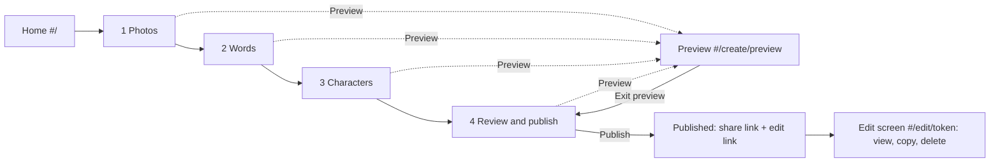
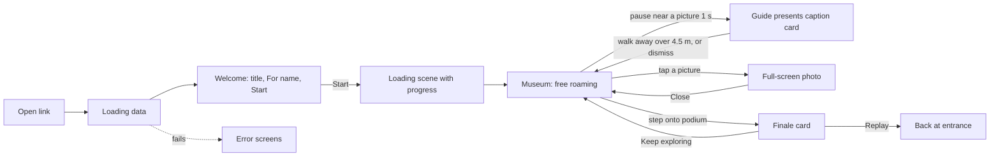

# Design spec: Surprise Museum

Version 1.4 | 30/10/2026 | Owner: ux-ui-designer | Based on requirements v0.3, user stories v0.3 and architecture v1.0

**Change note, v1.4 (readable fallback strip, fitted card, upgrade rule, card widths; 30/10/2026).** Framed screenshots showed the 64 px fallback strip filled by its 44 px header, so the caption was hidden. Changes are in 3.5, 5.6, 6.12.2, 4.1 and the copy deck.
- **The strip is now a caption strip, 104 px tall at normal text size** (token `--panel-peek-height` changes from 4 rem to 6.5 rem). Row 1 is the 44 px header (badge, name, one action, Close). Row 2 is the caption, two lines. **Caption text is always visible in a strip.** "Photo n of N" is dropped visually in a strip (it stays in the accessible name). Look closer moves out of the strip header and is replaced by **Read more** when the caption is cut off.
- **New placement size, "fitted":** a full-style card cut to the clear height in its dock (at least 8 rem). It is tried before any strip, so the strip is a last resort.
- **Upgrade rule (answer: yes, with hysteresis):** a fitted card or strip may move up to a better candidate once that candidate has been clear for 600 ms, tested with a 16 px margin, with a cool-down and a cap. Details in 3.5 Stability.
- **Card widths (answer: adjust).** Minimum card width is **16 rem (256 px)**, not 18 rem. The container query for the Look closer text and a smaller title minimum already stop the pill collapse; 288 px made the card wider than the 30% column the framing reserves. Phone landscape width is `clamp(16rem, 30vw, 22rem)` (the frontend's 30vw is confirmed; only the lower clamp changes). Wide width is now `clamp(18rem, 28vw, var(--panel-max-width))`, because the old 26 rem card (plus 24 px edge) was wider than the 30% column and pushed the Guide's rectangle into it at 1280 px.
- **Framing safe rectangle (6.12.2):** the right bound on landscape and wide is now the smaller of 68% and the card's real left edge minus 8 px, so the framing and the card agree for every width. A small scene change.
- New tokens: `--card-min-width`, `--card-width-landscape`, `--card-width-wide`, `--panel-fit-min-height`, `--panel-strip-lines`.

**Change note, v1.3 (presentation camera as built, CR-2 review, 30/10/2026).** Section 6.12 now matches the scene-developer's build plus the decisions below. Nothing else changed.
- **Token value changed: `--ease-camera`** is now `cubic-bezier(0.37, 0, 0.63, 1)` (ease-in-out sine). Durations are unchanged (800 ms in, 600 ms out). Reason: the old curve peaked at about 2.6 times the average speed (115 to 120 degrees per second for 35 degrees in 800 ms). The new curve peaks at about 1.6 times, so 35 degrees in 800 ms peaks near 70 degrees per second, inside the 80 limit, without a slower move. **The scene must re-read the value (its mirrored curve and `easing.ts`) and a scene check is needed.**
- **Move out is lengthened for big swings:** 600 ms up to 38 degrees, then degrees divided by 60 per second, capped at 1,000 ms (peak about 95 degrees per second at most). The move out was previously exempt from the 80 limit by accident; 600 ms for 60 degrees would peak near 155. The token is unchanged; the scene computes the longer value.
- **Accepted from the tech-lead:** (a) framing waits for 0.25 s of stillness; (b) the scene draws its own veil, 200 ms in, cut, 200 ms out; (c) the picture minimum is scaled by picture width over 1.6 m and by 0.82; (d) the picture wins over the Visitor maximum; (e) the Guide may not stand in the camera-to-Visitor corridor. All are written into 6.12.
- **Targets revised (6.12.2):** the Visitor maximum is raised to 34% (portrait), 50% (phone landscape), 48% (wide), and the phone-landscape picture minimum is lowered from 22% to 17% of the viewport width. These are what the picture minimums physically imply for a 1.7 m Visitor beside a 1.6 m picture at 35 degrees, so they can now all be met together.
- **Acceptance rule (6.12.9):** `pictureVisibleFraction` at least 0.99 on phone portrait and wide, at least 0.90 on phone landscape (the characters' rectangles are conservative bounds, so true coverage is lower). Phone landscape also gains a taller-pitch candidate (up to 26 degrees) to help reach 0.90.
- 3.4 and 8.4 sentences updated to match.

**Change note, v1.2 (two user decisions, 30/10/2026).**
- **Presentation camera (QA N-2, the user chose "move the camera").** New **6.12**: during a presentation the camera eases to a three-quarter side view that frames the whole picture plus both characters, then eases back to the follow camera when the presentation ends, the Visitor moves or the Visitor takes the camera. Framing targets for phone portrait, phone landscape and wide, timing and easing (800 ms in, 600 ms out), reduced motion (a hard cut), input interruption, wall rules and name-label rules are all in 6.12.
  - This **reverses** the v1.0 to v1.1 rule "the camera does not move because of a presentation" (3.4, 6.3, 6.7, 8.4). Those sections are amended: a presentation is now the one camera move the Visitor did not directly ask for, and it is always interruptible. Hints, the finale, the Guide's relocation and the picture list still never move the camera.
  - New tokens `--duration-presentation-camera-in`, `--duration-presentation-camera-out`, `--ease-camera` (0 ms under both reduced-motion paths). The composition targets in 3.4 and ADR 0014 are unchanged for the follow camera.
  - 5.5 gains name-label rules for the framed view; 3.5 gains a QA check at the framed pose; 8.4 and the coverage table are updated. R2 adds a Settings switch (5.13, 6.12.9).
- **"Photos weren't kept" notice (the user chose yes).** New **5.17**: a short inline notice in the builder when a restored draft has no photos. Placement, copy, dismissal, screen-reader announcement and when it disappears are in 5.17; copy deck and 8.3 updated; 2.1 leaving-protection sentence corrected. No new tokens (it reuses `--color-info-tint`).
- Nothing else changed. All new copy is gender-neutral (FR-76).

**Change note, v1.1 (CR-1: gender option, approved 29/10/2026).**
- 9.4: new **Gender** radiogroup (Woman, Man, Neutral; default Neutral; optional) is the first group of the customiser. The **Body** tab moves to first position and becomes the opening tab, so the base shape is chosen before the details.
- 9.4: Facial hair is now shown for both characters (it was Guide only).
- 9.5 (new): preview behaviour when gender changes: a 250 ms shape morph (instant under reduced motion), nothing else changes.
- 9.1 and 9.2: gender shape table; body type labels reworded to **Wider hips** and **Wider shoulders** (ids `curvy` and `broad` unchanged); the bust parameter is removed from body type (chest shape now belongs only to gender).
- 9.6 (new): art guidance for the technical-artist. 9.7 (new): inclusive-combination rules.
- 9.3, 9.4 and 10: defaults, live description and copy deck updated. New token `--duration-gender-morph`.
- 10.1 (new): audit of gendered wording (FR-76). Fourteen spec sentences used "she" or "her" for the Visitor and were reworded. No app-written UI string was found that uses a gendered pronoun or noun.
- Mobile and desktop layouts, the stepper and the 3D visit are otherwise unchanged.

Tokens live in `src/styles/tokens.css` (values) and `src/styles/base.css` (shared rules). This document is the source of truth for look, layout, behaviour and accessibility. Developers build from it and must use tokens, never raw values.

**Release tags.** Each feature is tagged **MVP** (a Must in requirements v0.2) or **R2** (Should or Could, Release 2 or later). R2 items are specified now so that the layout, tokens and component structure leave room for them. Build MVP first.

## Contents

1. Visual direction
2. User flows
3. Layout
4. Design tokens
5. Components
6. 3D interactions
7. Loading and error states
8. Accessibility
9. Appendix A: Avatar kit and customiser
10. Appendix B: Copy deck
11. Appendix C: Requirement coverage

---

## 1. Visual direction

### 1.1 Concept: "A private view"

A gallery after hours, opened for just two people. Warm lamplight, quiet rooms, and every picture lit like it matters. The product is a gift, so the 2D screens feel like a beautifully printed exhibition catalogue and the 3D museum feels like a small, intimate gallery rather than a game level or a generic white cube.

| Quality | What it means in practice |
|---|---|
| Warm | Cream, linen, oak, brass and claret. No cold greys, no pure white, no pure black. Light is about 3000 K |
| Intimate | Dark ceilings and soft pools of light on the pictures and the floor in front of them. Rooms feel lit by the photos. Small rooms, a low horizon, no vast spaces |
| Gallery-like | Picture lights, walnut frames with cream mounts, small museum plaques, a claret carpet runner, a spotlit podium at the end |
| Gentle | Slow, soft motion. Nothing flashes, bounces or races. Everything has a calm alternative under reduced motion |
| Personal | Names are everywhere they should be: the welcome screen, the labels, the caption card header and the closing note |

Shape language: soft rounded rectangles (picture-frame proportions) with a hairline brass inner border (`--shadow-inset-frame`). Brass is decoration on light surfaces and text or icon colour on dark ones.

### 1.2 Typography

| Role | Font | Weight | Size token | Use |
|---|---|---|---|---|
| Display | Fraunces (variable, SIL Open Font Licence), self-hosted, Latin subset | 600 | `--text-display`, `--text-3xl`, `--text-2xl`, `--text-xl` | Welcome title, screen headings, plaque titles, caption card name |
| Reading | Fraunces | 400 | `--caption-size` (1.125 rem, scalable), `--leading-reading` | Photo captions and the closing message. A serif at reading size feels like a handwritten museum label |
| UI and body | System UI stack (`--font-sans`) | 400, 500, 600 | `--text-md`, `--text-sm`, `--text-xs` | Buttons, fields, helper text, name labels, HUD. Zero download and the best legibility on phones |
| Eyebrow | System UI, uppercase, `--tracking-eyebrow` | 600 | `--text-xs` | "A private view" above titles |

- Body text and inputs are never below 16 px, which also stops iOS zooming into fields.
- Fraunces is only needed for headings and captions. Load the Latin subset at weights 400 and 600 only, with `font-display: swap`, from the app's own origin (the CSP is `font-src 'self'`). Budget: 60 kB or less for both files. If it is late, the fallback stack (Iowan Old Style, Palatino, Georgia) is metrically similar, so layout stays stable.
- Names typed by the Creator keep accents, emoji and any script exactly as typed. UI text that shows them uses `.user-text` (see `base.css`) and the system font stack, which carries emoji.
- Text must survive 200% zoom and the WCAG 1.4.12 text-spacing overrides without clipping. No fixed-height text containers.

### 1.3 Colour

Two surface families, so the same brand works in the builder and over a moving 3D scene.

| Family | Where | Base colours |
|---|---|---|
| **Paper** | Builder, home, welcome, error screens, caption card, finale card, dialogs | Parchment `--color-bg`, paper `--color-surface`, ink `--color-text`, claret `--color-accent` |
| **Night** | HUD glass over the scene: joystick, top bar, hint chips, name labels, toasts | Aubergine `--color-night` at 84% (`--color-hud`) with a 14 px blur, text `--color-on-night`, brass `--color-brass` for icons and highlights |

Claret is the one action colour on paper. On night, brass carries highlights and rose (`--color-accent-on-night`) carries links. Danger and success always pair colour with an icon and words.

All text and component pairs, with measured WCAG ratios, are in section 4.2. Never use a pair that is not listed there. In particular, brass is never text on paper (2.2:1).

### 1.4 The museum's architectural look

Applies to the default (only) MVP theme. The technical-artist owns materials and lighting; this table fixes the look and the colour targets. Hex values are tokens named `--scene-*`.

| Element | Look | Colour tokens |
|---|---|---|
| Walls | Warm linen plaster, slightly darker towards the ceiling (vertex-colour gradient, 100% to 75%). Painted skirting 0.12 m high | `--scene-wall`, `--scene-wall-shade`, `--scene-skirting` |
| Floor | Wide oak boards running along the route (along -Z), faint grain, matte with a very soft sheen. A claret runner 1.6 m wide with thin brass edge lines runs down the centreline from the entrance through every doorway to the podium. It is wayfinding without being a tour | `--scene-floor`, `--scene-floor-grain`, `--scene-runner`, `--scene-runner-edge` |
| Ceiling | Dark and warm, so each room feels lit by its pictures. A simple brass ceiling rose or recessed strip per room is enough | `--scene-ceiling` |
| Doorways | 2.4 m wide, 2.7 m high, with a 0.12 m painted architrave. A rounded arch top is optional (visual only; colliders stay boxes) | `--scene-skirting` |
| Lighting | Hemisphere light plus one warm directional light, no shadow maps (architecture 6.11). The mood comes from baked-looking gradients and decals, not real-time lights | `--scene-light-warm`, `--scene-light-sky`, `--scene-light-ground` |
| Picture lights | A small brass bar above each frame with a visible emissive strip, and a soft warm wash on the wall around the frame (additive decal, 10 to 14% alpha) | `--scene-brass`, `--scene-pool` |
| Frames | Border 0.06 m total: 0.02 m walnut outer, 0.04 m cream mount inside. Depth 0.05 m. The photo itself is unlit (`MeshBasicMaterial`, FR-40) so it is always evenly lit, never glared or shadowed | `--scene-frame`, `--scene-mat` |
| Standing-spot pools | A soft warm elliptical glow on the floor in front of each picture, about 1.6 m wide, centred 1.6 m from the wall. It marks "stand here" and makes presentations discoverable without instructions (G-4). It brightens with proximity: 40% at 3 m to 100% at 1.5 m. Optional (Should): it fills over the 1 s dwell. Reduced motion: it steps on when the dwell completes | `--scene-pool` |
| Plaques | A small brass-edged cream plaque beside each frame (0.18 by 0.12 m) showing the picture number ("3"), and a larger title plaque on the entrance hall's left wall. Text is drawn into a `CanvasTexture` using the display font (after `document.fonts.ready`), so no font download is needed in the scene and emoji work. Plaques are decorative; the same information is in the UI. **MVP:** title plaque only. **R2:** numbered plaques | `--scene-plaque`, `--scene-plaque-ink` |
| Entrance hall | Title plaque reads, in order: small caps "A PRIVATE VIEW", the museum title (display, up to 3 lines), "For {Visitor}", "Curated by {Guide}". A low bench and a coat stand are optional dressing if the budget allows | |
| Character contact | A soft elliptical blob shadow under each character | `--scene-blob-shadow` |

Frame hover highlight (desktop) and the "Where next?" glow use `--scene-hint-glow`.

### 1.5 The finale room and podium

The final room is the emotional payoff, so it changes mood clearly from the linen galleries.

| Element | Look |
|---|---|
| Walls | Deep claret plaster (`--scene-finale-wall`), the same warm family but darker and richer, so entering feels like arriving somewhere |
| Floor | Dark polished wood (`--scene-finale-floor`). The claret runner ends in a brass-edged semicircle at the podium |
| Podium | A low cream stone disc, radius 1.5 m, height 0.18 m, with a thin brass inlay ring (`--scene-podium`, `--scene-brass`) |
| Light | A soft warm cone falling from a ceiling oculus onto the podium (`--scene-spot`): additive cone mesh at 8 to 10% alpha, plus a floor pool. A few dust motes drift in the cone (40 points or fewer). Low graphics quality: no cone mesh, floor pool only |
| Lectern | At the far edge: a walnut lectern with a cream open guest book on top. Decorative and solid (0.6 by 0.4 m) |
| Visible from afar | The podium's light is visible down the centre line through the doorways, so the Visitor can see where the museum ends from the entrance |
| On enter | The podium ring brightens over 300 ms and the pool grows 15%. Reduced motion: it switches on instantly. No confetti in the MVP (R2, FR-43, and never under reduced motion) |
| R2 "all viewed" highlight | The podium ring and cone brighten and the ring pulses slowly (4 s cycle). Reduced motion: steady, brighter, no pulse |

### 1.6 Avatar style

Full kit, labels and rules are in Appendix A. In short:

- "Designer toy" proportions: about 5.5 heads tall, large head, soft rounded limbs, mitten hands, simple rounded shoes. Friendly, not cartoonish and not uncanny.
- Flat, bold colour blocking, no outlines. Hair, skin and outfit contrast clearly so each reads at 120 px tall.
- **The Visitor mostly sees their own character from behind**, so hair and the back of the outfit carry identity. Hair styles are designed back-first (ponytail, bun, braids, bob length and afro volume must read from behind). The customiser has a "Back view" button for this reason.
- Face: two dark oval eyes, thin brows in the hair colour, a small smile, soft rose cheek blush. No nose geometry beyond a tiny bump in a slightly deeper skin tone.
- The Guide wears a small brass round badge on the left chest; the Visitor wears a cream "visitor sticker" with a rose heart in the same spot. This quietly signals roles without relying on name labels, and the Guide's badge is the slot for the Creator's face photo in a later release (FR-21).

### 1.7 Motion personality

Slow, soft, never urgent. Standard ease is `--ease-standard`. All durations come from tokens, which fall to 0 ms under reduced motion (section 8.4 lists every animation and its replacement).

### 1.8 Voice and copy

Warm, plain, a little playful. Short sentences. Australian English ("customise", "colour"). Addresses the Creator as "you" and the Visitor by name. Errors never blame the user and always say what to do next. Copy deck in Appendix B.

---

## 2. User flows

### 2.1 Creator (Epic E1, E2, E6)



The builder is one route (`#/create`) with four steps held in component state and browser history state (`history.pushState` with a step number, no new hash routes), so the Back button goes to the previous step rather than leaving and losing work.

| Step | What the Creator does | Key rules |
|---|---|---|
| Home | Reads one sentence and three steps, taps **Create a museum** | No sign-in, no account prompt (FR-1). Static, no 3D, loads fast |
| 1 Photos | Adds 1 to 20 photos, watches progress, writes optional captions, reorders, replaces, removes | Rejections list the file name and reason; valid files continue (FR-3). Retry per photo (FR-4). Reorder by drag or by Earlier and Later buttons (WCAG 2.5.7). Captions 280 characters with a counter |
| 2 Words | Visitor name (required), Guide name (required), museum title (optional), closing message (optional) | 1 to 24 characters for names, 60 for title, 1,000 for the message. A live sample shows the welcome title and both name labels as typed |
| 3 Characters | Styles the Visitor and the Guide with a live 3D preview | Every option is a labelled control. Preview updates within 1 s. Works without WebGL (options still usable) |
| 4 Review and publish | Checks the summary, ticks the consent, optionally previews, publishes | Consent is required (FR-56). Publish shows progress, cannot run twice, and failure keeps all work |
| Published | Copies or shares the **share link**, copies and saves the **edit link** | Edit link has a prominent "save this" warning and must be acknowledged before "Finish" (FR-50) |
| Edit link | Opens `#/edit/<token>`: sees a summary, copies the share link, deletes | Delete needs a confirmation dialog whose default focus is Cancel (US-24). MVP offers view, copy and delete only |

Preview is available from every step once there is at least 1 photo and both names. If not, the Preview button opens a dialog listing what is missing, with a link to each fix (US-8).

Leaving protection: until published, the browser shows its native "leave site?" prompt on close or reload if the draft has content. After a reload the builder restores names, text, characters and the step from `localStorage`, but **not the photos** (photo restore is Release 2, needs IndexedDB). When that happens the builder shows the "Photos weren't kept" notice (5.17), so the Creator is told why the photo list is empty.

### 2.2 Visitor (Epic E3, E4, E7)



| Stage | What the Visitor sees and does |
|---|---|
| Loading data | Paper screen with the brass frame mark and "Opening your surprise". Never blank (FR-57) |
| Welcome | Eyebrow "A private view", the museum title, "For {name}", "Your guide today: {Guide}", a large **Start** button with focus, a small Privacy link. The 3D chunk and the nearest photos download in the background while the Visitor reads |
| Start before ready | The button shows "Getting the gallery ready" with real progress and the screen waits, then cross-fades into the scene. If already ready, the cross-fade is immediate (500 ms, cut under reduced motion) |
| Arrival | The Visitor stands at the entrance facing the route, the Guide beside the Visitor, both labelled. Controls work at once. One quiet coaching hint appears (section 6.1) |
| Free roaming | Walk anywhere. No Next button, no fixed order |
| Presentation | After about 1 s near a picture the Guide walks over and the caption card appears. Walking away or tapping Close ends it, and the Guide follows again |
| Full-screen photo | Tap or click a picture. Zoom, read the caption, Close returns to the same spot |
| Finale | Step onto the podium. The Guide stands beside the Visitor and the closing note appears with **Keep exploring** and **Replay** |

### 2.3 Error states (Epic E6, E7)

| Situation | Screen | Recovery |
|---|---|---|
| Unknown, deleted, expired or mistyped link; any unknown route | **Not found** (7.5): reveals nothing about content, no list of museums | "Go to the home page" |
| Museum data cannot be fetched (offline, server error) | **Couldn't open it** (7.6) with the museum unchanged | "Try again" without a page reload (US-30) |
| WebGL unavailable | **Can't show 3D** (7.7): explanation, supported browsers, how to enable hardware acceleration | R2: "See the photos as a slideshow" |
| Graphics context lost mid-visit | Modal "The 3D view stopped" (7.8) | "Reload" |
| A photo fails to load | In-frame placeholder with a retry affordance, plus a DOM "Retry" chip near the picture, plus a Retry in the full-screen viewer (7.9) | "Retry"; the Guide still presents the caption and the Visitor keeps roaming (FR-58) |
| In-app browser likely to struggle (NFR-9) | Dismissible info card on the welcome screen: "Open in your browser" | Copy link, or the browser's menu |
| Builder: rejected file, failed upload, publish failure, rate limit | Inline messages next to the cause (7.10) | Retry per item; work is never lost |

---

## 3. Layout

### 3.1 Principles

1. **Canvas first.** On the Visit screens the canvas fills the viewport (`.scene-root`). All UI sits above it in `.ui-layer`, which ignores pointer events so empty space still reaches the canvas; each control opts back in with `.ui-hit`.
2. **The centre stays clear.** Controls live at the edges. Panels dock at the edge that is free of the Visitor and the active picture (section 3.5).
3. **Thumb zones.** Movement bottom-left, look-around anywhere else, primary actions in the lower half. Top corners hold rarely used buttons.
4. **Use `dvh`, not `vh`**, and add safe-area insets (`--safe-*`) to every edge so notches, rounded corners and the home indicator never clip a control.
5. **Touch targets 44 by 44 px minimum** (`--touch-target`), 56 px for primary calls to action (`--touch-target-lg`), 8 px or more between targets.
6. Orientation changes never restart anything: position, viewed pictures, panels and the Guide are kept (US-33).

### 3.2 Breakpoints

| Name | Width | Visit layout | Builder layout |
|---|---|---|---|
| Phone portrait | 360 to 639 px | Joystick bottom-left; caption card docks top; sheets are bottom sheets | One column; sticky bottom action bar; stepper is "Step n of 4" with a segmented bar |
| Phone landscape | `(orientation: landscape) and (max-height: 500px)` | Joystick bottom-left; caption card docks right (or left); sheets are right-hand drawers | One column, content capped at `--content-max-width`; action bar becomes a compact right-aligned bar |
| Tablet | 640 to 1023 px | As desktop but controls stay touch-sized; joystick shown when `(pointer: coarse)` | Two columns on the Characters step; one column elsewhere |
| Desktop | 1024 px and wider | No joystick; keyboard and mouse hints; caption card docks right; picture list and settings are side drawers | Left vertical stepper (12 rem), content, and on the Characters step a sticky live preview |

Design floor is 360 px wide. Text content (builder, dialogs, error screens) must also reflow without horizontal scrolling at 320 px (WCAG 1.4.10). The HUD is designed from 360 px.

### 3.3 Visitor screen composition

```text
PHONE PORTRAIT 360 x 640                PHONE LANDSCAPE 740 x 360
+-----------------------------+         +---------------------------------------------+
| [Pictures]  5 of 12   [?]   |         | [Pictures] [Where next?]      5 of 12   [?] |
| +-------------------------+ |         |                                +-----------+|
| | (T) Tom  Photo 3    [X] | |         |                                | (T) Tom [X]||
| | "Caption text ..."      | |         |        (3D scene,              | "Caption   ||
| +-------------------------+ |         |         centre clear)          |  text ..." ||
|                             |         |                                +-----------+|
|    Tom            Sophie    |         |   Tom       Sophie                          |
|     (labels over heads)     |         |                                             |
|  ( joystick )               |         |  ( joystick )                               |
+-----------------------------+         +---------------------------------------------+

DESKTOP 1280 x 720
+--------------------------------------------------------------------------------+
| [Pictures] [Where next?]                 5 of 12                [Reset] [?] [Cog] |
|                                                              +------------------+
|                                                              | (T) Tom   Photo 3 |
|                  (3D scene, centre clear)                    | "Caption ..."  [X]|
|                                                              +------------------+
|        Tom        Sophie                                                         |
|   [ W A S D or arrows to walk . drag to look around ]   (fades after first use)  |
+--------------------------------------------------------------------------------+
```

| HUD element | Position | MVP or R2 | Size |
|---|---|---|---|
| Help button `?` | Top-right | MVP | 44 px round |
| Reset view | Top-right, left of Help; appears only after the camera is turned away from default | MVP | 44 px round |
| Settings | Top-right, left of Reset view | R2 | 44 px round |
| Pictures (list) | Top-left | R2 | 44 px round |
| Where next? | Top-left, right of Pictures | R2 | 44 px tall pill with label |
| Viewed progress "5 of 12" | Top-centre | R2 | Pill, 32 px tall (not interactive) |
| Joystick | Bottom-left, `--hud-margin` plus safe areas from the edges | MVP (touch) | 128 px base, 56 px knob, 176 px hit area |
| Look-around | Whole canvas outside controls and the joystick hit area | MVP | Drag |
| Controls hint chip | Bottom-centre (desktop) or above the joystick (touch) | MVP | Auto-hides |
| Caption card | Docked by the placement rule (3.5) | MVP | Section 5.6 |
| Preview bar | Full-width strip above the HUD in preview only; HUD top inset grows by `--preview-bar-height` | MVP | 44 px |

The Help sheet (MVP) is a short, non-blocking sheet: "How to explore" with the three ideas (walk, pause by a picture, tap a picture), the control table for the current device, and an accessibility note about the keyboard. It is the only way to re-read the coaching hints.

### 3.4 Camera composition targets (for the scene-developer)

The architecture gives a starting boom of 3.5 m at 2.2 m height. At that setting the Visitor fills about half of a portrait screen and hides the picture being looked at, so tune to these screen-space targets instead. Full camera behaviour is in 6.3.

| Viewport | Visitor height on screen | Feet at (from top) | Notes |
|---|---|---|---|
| Phone portrait | 24 to 32% of viewport height | 70 to 74% | The bottom 26% is the joystick zone. The top 30% stays free for the caption card |
| Phone landscape | 42 to 50% | 80% | Left and right 30% columns stay free for the joystick and the caption card |
| Tablet and desktop | 36 to 44% | 82% | Right 30% column stays free for the caption card |

Achieve this with boom length, vertical FOV (50 to 60 degrees), and a constant view offset (`camera.setViewOffset`) that never changes during a session. The offset is a fixed composition, not camera motion.

These targets are for the **follow** camera. During a presentation the camera moves to the framing in 6.12, which has its own targets (the Visitor is smaller than in a close follow view on portrait, 18 to 34% of the viewport height, and larger on landscape and wide screens, up to 50% and 48%, because the picture's minimum width decides the scale; see 6.12.2; and because the picture and both characters must fit). The FOV and the view offset stay exactly the same in both modes.

### 3.5 Caption card placement rule (FR-64, US-12)

The caption card must cover neither the Visitor nor the active picture. Because the camera is user-controlled, the card is placed by a small pure function, `chooseCaptionDock(inputs): Placement`, in `src/ui/overlays/` (frontend-developer), unit-tested.

**Inputs** (screen-space rectangles in CSS px, refreshed about every 100 ms while a presentation is active, not per frame):

| Input | Meaning |
|---|---|
| `viewport` | Window inner size minus safe areas |
| `keepOut` | HUD rectangles the card must not cover: top bar, joystick base (touch), preview bar, and the Look closer or Retry chip when shown |
| `picture` | Bounding rectangle of the active picture's frame projected to the screen, or none if off-screen or behind the camera |
| `actors` | Bounding rectangles of the Visitor and the Guide including their name labels |
| `bigText` | Whether the caption scale is above 1 |

**Candidate placements, evaluated in order.** Each is a dock plus a size. There are three sizes (v1.4):
- **Full:** up to the dock's maximum height, scrolling inside if the caption is longer.
- **Fitted (new):** the same card as Full, in the same dock, anchored at the dock's top edge, with its height cut to the clear height: the distance from the dock's top edge down to the first rectangle that would touch it (picture, actors, keepOut, each grown by 8 px), reduced in 8 px steps. Valid only if the result is at least `--panel-fit-min-height` (8 rem, 128 px) and below the Full height. It keeps the normal header (badge, name, "Photo n of N", Look closer, Close) and shows as many caption lines as fit, scrolling inside for the rest.
- **Strip:** the caption strip in 5.6: 104 px tall at normal text size (`--panel-peek-height`, 6.5 rem), header row plus **two caption lines**, with Read more when the caption is cut off. Strip heights at larger caption scales: 112 px at 1.25 and 124 px at 1.5 (header 44 + padding 12 + two lines at 1 rem x scale x 1.4, rounded up to 4 px). `bigText` never reduces the line count below two.

| Layout | Order |
|---|---|
| Phone portrait | 1 top, full (below top bar, full width minus `--hud-margin`, up to the smaller of 32 dvh and 14 rem). 2 top, fitted. 3 top, strip. 4 bottom strip above the joystick |
| Phone landscape | Card width `--card-width-landscape` = `clamp(16rem, 30vw, 22rem)`. 1 right, full (between top bar and bottom). 2 left, full, above the joystick. 3 right, fitted. 4 right, strip. 5 left, strip, above the joystick |
| Tablet and desktop | Card width `--card-width-wide` = `clamp(18rem, 28vw, var(--panel-max-width))`, 24 px from the edge. 1 right, full (up to 50 dvh). 2 left, full. 3 right, fitted. 4 right, strip. 5 bottom-centre strip |

**Card minimum width (confirmed, adjusted).** `MIN_CARD_WIDTH` is **16 rem (256 px)** (`--card-min-width`), and no dock is ever narrower unless the viewport is. The card is a container (`container-type: inline-size`); Look closer shows its text only when the card is 24 rem or wider, and the title column keeps a minimum of 5.5 rem so a name never wraps one letter per line (the header must fit at 256 px: 12 + 32 + 8 + 88 + 8 + 44 + 4 + 44 + 12 = 252). If QA finds the full header does not fit at 256 px, the developer may raise the constant to 17 rem (272 px) but must then tell the scene-developer, because the framing's right bound uses the same value (6.12.2).

**Where each size lands (expected, for the four test viewports, scale 1).** The dock function measures real rectangles; these are the numbers it should produce when the framing is behaving, so QA can spot a regression. The top bar is taken as about 64 px including its margin.

| Viewport | Dock and card width | Full height | Fitted | Strip (104 px) |
|---|---|---|---|---|
| 360 x 640 | Top, 336 px (full width minus 2 x 12), starts at about y 64 | min(32 dvh = 205, 14 rem = 224) = 205 px, reaches y 269, blocked by the picture (top of the safe rectangle is y 192) | Clear height about 112 px, under the 128 px minimum, so not valid | **Yes: y 64 to 168, clear of the picture by at least 24 px** |
| 390 x 844 | Top, 366 px, starts at about y 64 | min(270, 224) = 224 px, reaches y 288, blocked (safe rectangle starts at y 253) | **Valid: about 168 px (y 64 to 232)** | Not needed |
| 844 x390 | Right, 256 px (30 vw = 253, raised to 256), left edge x 576, between y 66 and y 378 | Up to about 312 px | Valid if the Guide's rectangle blocks the lower part | y 66 to 170 if the column is only partly clear |
| 1280 x 720 | Right, 358 px (28 vw), left edge x 898, between y 72 and y 360 | 50 dvh = 360 px | Valid if blocked below | y 72 to 176 |

**Selection.** Pick the first candidate whose rectangle, grown by 8 px, does not intersect `picture`, any `actors` rectangle, or `keepOut`. If none qualifies, pick the candidate with the least intersection with `picture` (the Visitor takes second priority), **always in strip size** (the 104 px strip, so the caption is still readable). In that last case the strip is allowed to overlap the picture's edge, never the picture's centre third, if any candidate achieves that; if none does, the one with the least picture area wins. Expanding a strip with Read more is an explicit user action, so it may then overlap.

**How the strip avoids covering the picture and Visitor.** The strip is the smallest card that keeps the caption readable, so it is tried only after Full and Fitted fail in every dock. The framing reserves the dock (6.12.2), so on all four test viewports a strip normally lies fully inside the reserved column or band. Where it cannot, the strip overlaps the least picture area, picks the dock with the least overlap with the Visitor second, and the Visitor can still open the full card or the viewer. A strip never covers the Close button of another control (keepOut), and it never grows after placement except by Read more.

**Stability.**
- Once placed, keep the placement unless it has overlapped for 400 ms or more or the layout changes. Never move a card while the Visitor is typing, scrolling its text or has focus inside it.
- **Upgrade rule (v1.4).** A card placed as Fitted, Strip or the least-overlap fallback may move to a better candidate (earlier in the table, so Full beats Fitted beats Strip, and a preferred dock beats a later one). Cards placed as Full in their first-choice dock never move for upgrades. All of these must hold:
  1. **Settled camera only.** Upgrades are evaluated only while the presentation camera mode is `framed`, `follow` or the 300 ms after a `cut` has ended, never during `entering` or `returning`. One free re-choice is allowed at the first `framed` signal if the card appeared earlier (the 1.5 s cap case), with no dwell and no cool-down.
  2. **Dwell.** The better candidate must have been clear (no intersection with `picture`, `actors` or `keepOut`) for **600 ms in a row** of the 100 ms samples. Any sample where it is blocked resets its timer. Each candidate has its own timer.
  3. **Hysteresis.** The upgrade test grows the candidate by **16 px** (the stay test uses 8 px), so a candidate that only just clears is not taken.
  4. **Cool-down.** After any placement change, no upgrade for 1.5 s. After a downgrade (an overlap of 400 ms or more), no upgrade for 3 s.
  5. **Cap.** At most **two upgrades per presentation**, then the placement is frozen until the layout changes.
  6. **Never during interaction.** Not while the card is expanded by Read more, has focus inside it, is being scrolled or touched, or the Visitor is typing. The timers keep running but the move waits until the interaction ends plus 600 ms.
  7. **Same element.** The card is the same DOM element, so focus is not lost. If focus was on Read more and the new size hides it, focus moves to Close. An upgrade is never announced (the live region is not touched) and never replays the entering animation; it cross-fades in `--duration-fast`.
  A downgrade is the existing rule: overlap for 400 ms or more moves the card to the best clear candidate, or to the least-overlap strip.
- Placement changes cross-fade in `--duration-fast`. Under reduced motion they are instant.
- A caption longer than the dock's height scrolls inside the card. The scroll area has `tabindex="0"` so keyboard users can scroll it.
- The Close button is always in the header and never scrolls away.

QA check: in Playwright at 360 by 640, 390 by 844, 844 by 390 and 1280 by 720, with the default camera, the card's rectangle must not intersect the picture rectangle for a short, a 140-character and a 280-character caption.

**Acceptance criteria for the strip, the fitted card and the upgrade rule (v1.4).** Run at the four viewports above, at the framed pose, for a short (30 characters), a 140-character and a 280-character caption, at caption scale 1 and 1.5, and with a Guide name of 1 and of 24 characters.
- **S1 Readable caption.** Whatever size is placed, the caption's first line is visible: its bounding box is inside the card's visible box and has a height of at least 1 line (not clipped by the header or the card edge). In a strip, **two lines** are visible when the caption has two lines or more; a one-line caption shows one. No caption text is ever hidden behind the header (`getBoundingClientRect` of the first caption line is below the header's bottom).
- **S2 Strip size.** A strip's height is 104 px (+/- 1) at scale 1, 112 at 1.25 and 124 at 1.5, and its width is at least 256 px (or the viewport width if narrower). Header row is 44 px.
- **S3 Truncation and Read more.** If the caption needs more than two lines in the strip, the second line ends in an ellipsis and **Read more** is shown (button, at least 44 px high, `aria-expanded="false"`). If it fits, there is no Read more and **Look closer** (icon button, 44 px) is shown in its place. Read more expands in place to the full card (scrolling inside), `aria-expanded="true"`, the label changes to Show less, and focus stays on the button.
- **S4 Controls.** In every size, Close is at least 44 by 44 px and never clipped; no control overlaps another; the name never wraps one letter per line (the name box is at least 5.5 rem wide at 256 px card width and shows an ellipsis if longer); no horizontal scrolling.
- **S5 Footprint.** At the four viewports with the framing behaving, the strip does not intersect the picture rectangle grown by 8 px. If it must (all candidates blocked, forced by a test fixture), it overlaps the picture by no more than 15% of the picture area and not its centre third, and the caption is still readable (S1).
- **S6 Fitted.** At 390 x 844 the placed size is Fitted at roughly 168 px (+/- 16), not a strip, with at least three caption lines visible for the 140-character caption.
- **S7 Widths.** The landscape card is 256 px wide at 844 px (computed from `clamp(16rem, 30vw, 22rem)`), 270 to 280 px at 932, 352 px at 1,200 or wider; the wide card is 358 px at 1280, 288 px at 1024. The card's left edge is at or right of the framing safe rectangle's right edge at 844 x 390 and 1280 x 720.
- **U1 Upgrade happens.** Fixture: the card is placed as a strip because a candidate is blocked; the blocker is removed (move the Guide rectangle away) and stays away. The card upgrades once, between 600 and 800 ms after the blocker clears, and the DOM element and focus are unchanged.
- **U2 No flicker.** Fixture: the blocker toggles on and off every 300 ms for 10 s. The placement changes at most once in that time, never back and forth, and never more than twice per presentation.
- **U3 Hysteresis.** A candidate that clears with a gap of 9 to 15 px is not taken as an upgrade.
- **U4 Cool-down and cap.** No two placement changes are closer than 1.5 s (3 s after a downgrade); a third upgrade never happens.
- **U5 No upgrade during interaction.** With the card expanded, focus in it, or the Visitor scrolling it, no upgrade happens until the interaction ends plus 600 ms.
- **U6 Camera motion.** No upgrade starts during `entering` or `returning`.
- **U7 Reduced motion.** Upgrades are instant (no cross-fade), the same timers apply.
- **U8 No announcement.** An upgrade causes no live-region update.
- **G1 Copy.** The strip and fitted copy contain no he, she, her, him, his, girlfriend or boyfriend (FR-76 scan, 10.1).

**With the presentation camera (v1.2).** The card appears only after the framing has settled or the Guide has arrived, whichever is later (6.12.3), so the dock function always measures the framed pose. The card's rectangle must also not intersect the Visitor's or the Guide's rectangle (labels included) at the framed pose. The framing reserves the card's default dock (top in portrait, right in landscape and wide) in its safe rectangle (6.12.2), so the first candidate placement normally wins. Repeat the QA check above with the framed pose.

### 3.6 Builder layouts

```text
PHONE (360)                              DESKTOP (1280)
+---------------------------+            +---------+-----------------------------------+
| Surprise Museum   Preview |            | Logo    |  Step 3 of 4: Characters           |
| Step 3 of 4  [==][==][=][ ]|            |         |                                    |
|                           |            | 1 Photos|  +-------------+  Guide | Visitor  |
| Characters                |            | 2 Words |  |   live 3D   |  Face and skin   |
| +-----------------------+ |            | 3 Chars |  |   preview   |  Hair             |
| |   live 3D preview     | |            | 4 Publ. |  | (sticky)    |  Outfit           |
| |  Tom        Sophie    | |            |         |  +-------------+  Body             |
| +-----------------------+ |            |         |                                    |
| [Guide: Tom][Visitor: Sophie]|          |         |  [Back]                    [Next] |
| Face | Hair | Outfit | Body|           +---------+-----------------------------------+
| (option tiles ...)        |
+---------------------------+
| [ Back ]          [ Next ]|  sticky action bar, safe-area padded
+---------------------------+
```

The sticky bar and the header never hide a focused control (WCAG 2.4.11): `scroll-padding-block` in `base.css` reserves their height.

---

## 4. Design tokens

### 4.1 Summary

All tokens are CSS custom properties in `src/styles/tokens.css`. Scene tokens (`--scene-*`) and avatar tokens (`--avatar-*`) are references for the technical-artist, who mirrors them in code with a comment pointing to this document.

| Group | Tokens | Notes |
|---|---|---|
| Colour: paper | `--color-bg`, `--color-surface`, `--color-surface-sunken`, `--color-text`, `--color-text-muted`, `--color-border`, `--color-border-strong` | `--color-border` is decoration only; use `--color-border-strong` for control outlines |
| Colour: action | `--color-accent`, `-hover`, `-active`, `-tint`, `--color-on-accent` | Claret |
| Colour: brass | `--color-brass`, `-hover`, `-deep` | Decorative on paper; text and icons on night |
| Colour: states | `--color-danger`, `-hover`, `--color-on-danger`, `-tint`; `--color-success`, `-tint`; `--color-warning-text`, `-tint`, `-border`; `--color-info-tint` | Always with an icon and words |
| Colour: night | `--color-night`, `-raised`, `--color-hud`, `--color-hud-solid`, `--color-on-night`, `--color-on-night-muted`, `--color-accent-on-night`, `--color-danger-on-night`, `--color-scrim`, `--color-viewer-bg` | `--color-hud` falls back to solid without `backdrop-filter` |
| Focus | `--color-focus`, `--color-focus-edge` | Two-tone ring, rule in `base.css` |
| Name labels | `--label-bg`, `--label-fg`, `--label-ring`, `--label-ring-width`, `--label-dot-visitor`, `--label-dot-guide`, `--label-font-size`, `--label-max-width`, `--label-padding-x`, `--label-padding-y` | Section 5.5 |
| Scene | `--scene-wall`, `-wall-shade`, `-skirting`, `-floor`, `-floor-grain`, `-ceiling`, `-runner`, `-runner-edge`, `-frame`, `-mat`, `-brass`, `-brass-deep`, `-plaque`, `-plaque-ink`, `-light-warm`, `-light-sky`, `-light-ground`, `-pool`, `-finale-wall`, `-finale-floor`, `-podium`, `-spot`, `-blob-shadow`, `-hint-glow` | Section 1.4 and 1.5 |
| Avatar | `--avatar-skin-01..10`, `--avatar-skin-blush`, `--avatar-hair-*` (11), `--avatar-outfit-*` (12), `--avatar-denim`, `-trousers`, `-joggers`, `-shoes`, `-sole`, `-eye`, `-badge-*` | Appendix A |
| Type | `--font-display`, `--font-sans`, `--font-body` (alias), `--text-xs..3xl`, `--text-display`, `--leading-*`, `--weight-*`, `--tracking-eyebrow`, `--measure-reading`, `--caption-scale`, `--caption-size` | `--caption-scale` is 1, 1.25 or 1.5 from Settings (R2) |
| Space | `--space-1..6, 8, 10, 12, 16` (4 px scale) | |
| Size | `--touch-target` (44), `--touch-target-lg` (56), `--icon-sm/md/lg`, `--hairline`, `--border-control` (2), `--border-selected` (3), `--joystick-*`, `--hud-margin`, `--panel-max-width`, `--panel-peek-height` (6.5 rem since v1.4), `--panel-fit-min-height` (8 rem), `--panel-strip-lines` (2), `--card-min-width` (16 rem), `--card-width-landscape`, `--card-width-wide`, `--sheet-max-height`, `--content-max-width`, `--content-wide-max-width`, `--preview-bar-height`, `--safe-*` | |
| Shape and depth | `--radius-sm/md/lg/xl/pill`, `--radius-2` (alias), `--shadow-card/panel/hud/label`, `--shadow-inset-frame`, `--blur-panel` | |
| Layers | `--z-canvas` 0, `--z-labels` 5, `--z-hud` 10, `--z-preview-bar` 14, `--z-panel` 20, `--z-sheet` 22, `--z-fade` 24, `--z-viewer` 26, `--z-screen` 28, `--z-modal` 30, `--z-toast` 40 | Name labels sit below every panel (ADR 0011). Pass `zIndexRange={[5, 0]}` to drei `Html` |
| Motion | `--duration-instant/fast/normal/slow/camera/fade-through/gender-morph`, `--duration-presentation-camera-in` (800 ms), `--duration-presentation-camera-out` (600 ms), `--ease-standard/emphasised/out`, `--ease-camera`, `--press-scale` | All durations are 0 ms under reduced motion. The two presentation-camera durations and `--ease-camera` are mirrored by the scene (6.12.3) |

Scaffold names kept for compatibility: `--font-body`, `--radius-2`, `--touch-target`, `--color-accent`, `--color-surface`, `--color-text`, `--space-2`, `--space-4`.

### 4.2 Contrast record (WCAG 2.2 AA)

Ratios calculated from the token hex values with the WCAG relative-luminance formula. Required: 4.5:1 for text, 3:1 for large text, icons and component boundaries. QA should re-verify with a tool.

| Foreground | Background | Ratio | Use |
|---|---|---|---|
| `--color-text` | `--color-surface` | 14.7 | Body text |
| `--color-text` | `--color-bg` | 13.4 | Body text on page |
| `--color-text` | `--color-surface-sunken` | 12.7 | Text in wells |
| `--color-text-muted` | `--color-surface` | 6.0 | Helper text, counters |
| `--color-text-muted` | `--color-bg` / `--color-surface-sunken` | 5.4 / 5.2 | Helper text, placeholders |
| `--color-accent` | `--color-surface` / `--color-bg` / `--color-surface-sunken` | 7.8 / 7.1 / 6.7 | Links, secondary button text |
| `--color-on-accent` | `--color-accent` | 7.8 | Primary button |
| `--color-on-danger` | `--color-danger` | 6.1 | Danger button |
| `--color-danger` | `--color-surface` / `--color-bg` / `--color-danger-tint` | 6.1 / 5.5 / 5.4 | Error text |
| `--color-success` | `--color-surface` / `--color-success-tint` | 5.9 / 5.4 | Success text |
| `--color-warning-text` | `--color-warning-tint` / `--color-surface` | 6.6 / 6.9 | Edit-link warning |
| `--color-warning-border` | `--color-warning-tint` | 3.3 | Warning box outline |
| `--color-border-strong` | `--color-surface` / `--color-bg` / `--color-surface-sunken` | 4.8 / 4.4 / 4.2 | Input and swatch outlines (needs 3) |
| `--color-accent` | `--color-accent-tint` | 6.3 | Selected tile outline |
| `--color-on-night` | `--color-hud-solid` | 15.3 | HUD text and icons |
| `--color-on-night` | HUD glass over a pure white scene pixel (worst case, 84% opacity) | 8.7 | HUD in the worst case |
| `--color-on-night-muted` | `--color-hud-solid` | 9.9 | Secondary HUD text |
| `--color-accent-on-night` | `--color-hud-solid` | 9.1 | Links on night |
| `--color-danger-on-night` | `--color-hud-solid` | 8.7 | Errors on night |
| `--color-brass` | `--color-hud-solid` | 7.3 | Icons and highlights on night |
| `--color-text` | `--color-brass` | 6.6 | Text on a brass button (night primary) |
| `--color-on-night` | `--color-viewer-bg` | 16.8 | Full-screen viewer chrome |
| `--label-fg` | `--label-bg` | 16.3 | Name labels |
| `--color-focus` | `--color-hud-solid` | 12.2 | Focus ring on night |
| `--color-focus-edge` | `--color-surface` / `--color-bg` | 14.7 / 13.4 | Focus ring on paper |

**Name labels over any wall.** The pill has a near-black fill and a near-white hairline ring. Over any backdrop with relative luminance L, the fill edge contrasts at (L + 0.05) / 0.0597 and the ring at 0.97 / (L + 0.05). The worse of the two is never below 3.8:1 at any L (the mid-grey case), so the pill edge is always distinguishable. Checked specifically against linen walls (12.5:1 fill edge), oak floor (5.7:1) and the claret finale wall (11.3:1 ring).

**Not allowed:** brass as text on paper; muted text on night; any text over the 3D scene without a solid or glass backing; colour as the only state cue.

---

## 5. Components

Every control meets 44 by 44 px, has a visible two-tone focus ring (`base.css`), and keeps its state visible without colour alone. State columns: **D** default, **H** hover (pointer only), **F** focus, **A** active (pressed), **X** disabled, **L** loading.

### 5.1 Buttons

| Variant | D | H | A | X | L |
|---|---|---|---|---|---|
| Primary | `--color-accent` fill, `--color-on-accent` text, 56 px tall (calls to action) or 44 px, radius pill | `--color-accent-hover` | `--color-accent-active`, scale `--press-scale` | 45% opacity, `aria-disabled` and a reason in text nearby | Spinner replaces the label's icon, label becomes "Publishing...", `aria-busy`, ignores presses |
| Secondary | `--color-surface` fill, `--border-control` solid `--color-accent`, accent text | Fill `--color-accent-tint` | Tint plus scale | As above | As above |
| Tertiary | Text and icon in accent, underline on hover, 44 px target | Underline | Tint | As above | As above |
| Danger | `--color-danger` fill, `--color-on-danger` text | `--color-danger-hover` | Darker plus scale | As above | As above |
| Night icon (HUD) | 44 px circle, `--color-hud` glass, 24 px `--color-on-night` icon, 1 px `--color-on-night` at 25% ring | Fill `--color-night-raised` | Scale `--press-scale` | 45% | Spinner |
| Night primary | `--color-brass` fill, `--color-text` label | `--color-brass-hover` | Scale | | |

Prefer enabled buttons that explain what is missing on press (inline error plus focus to the first problem) over disabled buttons that hide the reason. Use `aria-disabled` only for genuinely unavailable actions such as Publish while photos are still uploading, and say why in adjacent text.

### 5.2 Fields

| Part | Spec |
|---|---|
| Text field, textarea | Visible label above (never placeholder-only), 16 px text, 48 px minimum height, `--border-control` solid `--color-border-strong`, radius `--radius-md`, fill `--color-surface`. Helper text below in muted. Counter at the bottom right ("12 / 280"). Focus: ring. Error: border `--color-danger`, icon plus message below, `aria-invalid`, `aria-describedby` |
| Character limits | Input stops at the limit and the helper line changes to "That is the limit: 24 characters" (US-4, US-3). The counter is not a live region; the limit message is `role="status"` |
| Name fields | `autocapitalize="words"`, `autocomplete="off"`. The native `maxlength` attribute counts UTF-16 units, so enforce the limit in code by Unicode code points (as `contract.ts` does) so that an emoji counts as one character |
| Closing message | `lang="en-AU"`, spellcheck on, 6 rows, line breaks kept |
| Consent checkbox | 24 px box in a 44 px row, the label is the full sentence. The terms and privacy links open in a new tab with `rel="noopener"`, because the draft is held in memory and must not be lost |

### 5.3 Option tiles, swatches and tabs (customiser)

| Component | Spec |
|---|---|
| Swatch (skin, hair colour, outfit colour) | 44 px circle in a 52 px cell, 2 px `--color-border-strong` ring so the lightest swatches show on paper, selected: 3 px `--color-accent` ring plus a check mark inside, name in `aria-label` and a tooltip-free visible label for the group's current value ("Hair colour: Auburn") |
| Text tile (gender, hair style, outfit, body type, height, facial hair) | 44 px minimum height, label centred, radius `--radius-md`, selected: `--color-accent-tint` fill, `--border-selected` accent ring, and a check icon. Gender tiles are text only, with no pictograms or silhouettes (9.4) |
| Group | `role="radiogroup"` with a visible group label. Arrow keys move and select within the group (roving `tabindex`), Tab leaves the group |
| Tabs (Guide or Visitor; Face, Hair, Outfit, Body) | `role="tablist"`, automatic activation, arrow keys, `aria-selected`, 44 px tall, active tab has a 3 px accent underline plus bold weight |

### 5.4 Photo row (builder step 1)

States: **uploading** (progress bar plus "Uploading 62%"), **processing** ("Preparing photo..."), **ready** (check plus "Ready"), **failed** (alert icon, reason, **Retry**), **removed** (row leaves; announced "Photo removed").

```text
+-----------------------------------------------------+
| [grip] [thumb 64x64 contain]  Photo 3        62%  |
|                               Uploading...         |
| Caption (optional)                                  |
| +-------------------------------------------------+ |
| |                                                 | |
| +-------------------------------------------------+ |
|                                            12 / 280 |
| [ Earlier ] [ Later ] [ Replace ] [ Remove ]        |
+-----------------------------------------------------+
```

- The thumbnail uses `object-fit: contain` on a sunken background, so the Creator sees the true aspect ratio (nothing is cropped, matching the museum).
- Reorder: drag the grip (mouse), long-press 300 ms then drag (touch), keyboard on the grip (Space picks up, arrows move, Space drops, Escape cancels, announced politely: "Photo 3 moved to position 2 of 7"), and the **Earlier** and **Later** buttons, which are the single-pointer alternative required by WCAG 2.5.7. **Earlier** is absent on the first row and **Later** on the last (not just disabled).
- The grip has `touch-action: none`; the rest of the row scrolls normally.
- **Remove** asks for confirmation inline ("Remove photo 3 and its caption? [Remove] [Keep]"). **Replace** keeps the caption (US-3).
- On desktop (1024 px and wider) rows become a three-column grid of the same cards.

### 5.5 Name label (3D, DOM via drei `Html`)

```text
  ( heart )  Sophie        Visitor label: night fill, cream hairline ring, rose heart marker
  ( diamond )  Tom         Guide label:   same, brass diamond marker
```

| Property | Spec |
|---|---|
| Fill and text | `--label-bg` solid, `--label-fg` text, 600 weight, `--label-font-size` (15 px), `--leading-tight` |
| Edge | `--label-ring-width` solid `--label-ring` (hairline that separates the pill from dark walls) plus `--shadow-label` |
| Shape | Pill (`--radius-pill`); one line when it fits, wraps to as many as three lines for long names (`--radius-md` when wrapped), `overflow-wrap: anywhere`, never truncated (names must show exactly as typed) |
| Size | `max-width: min(var(--label-max-width), 44vw)`, padding `--label-padding-y` by `--label-padding-x`. Constant screen size: do not scale with distance |
| Marker | A 10 px CSS shape before the name: heart (rose) for the Visitor, diamond (brass) for the Guide. Decorative, `aria-hidden`. Not relied upon |
| Position | Centred 0.35 m above the head (scaled with height). `pointer-events: none`, `user-select: none`, `aria-hidden="true"` (ADR 0011) |
| Visibility | Always shown while the character is on screen (FR-17). Hidden, with a `--duration-fast` fade, when the wall line-of-sight test fails or the character is off-screen; instant under reduced motion |
| Collision | If the two labels overlap on screen, raise the label of the character farther from the camera by its own height plus 4 px (once) |
| Framed view (v1.2) | While the presentation camera is active (6.12), a label must not cover the picture. The framing solver counts each label's rectangle as part of its character (6.12.4). If a label still intersects the picture rectangle grown by 8 px, shift that label sideways, away from the picture's centre, by up to half its own width (eased over `--duration-fast`, instant under reduced motion). The label is never hidden and never scaled (FR-17). The 5.5 label-collision rule still applies after the shift |
| Layer | `--z-labels`, below the HUD and every panel |
| Builder preview | The same style under each preview character, so Creators see exactly what the Visitor will see (US-7) |

### 5.6 Caption card (Guide presentation) (MVP)

```text
+---------------------------------------------+
| (T)  Tom                    [Look closer][X] |   header: badge, name, actions (44 px)
|      Photo 3 of 12                           |
|---------------------------------------------|
| "We found this place by accident and        |   body: Fraunces 400, --caption-size,
|  stayed all afternoon."                     |   --leading-reading, scrolls if long
+---------------------------------------------+
                 \  (optional tail towards the Guide)
```

| Property | Spec |
|---|---|
| Surface | `.surface-paper`, radius `--radius-lg`, brass inset hairline. Opaque, so ink text is 14.7:1 over any scene |
| Header | 36 px round badge filled with the Guide's outfit colour showing the first letter of the Guide's name (letter colour chosen at runtime for 4.5:1; `aria-hidden`), the Guide's name in the display font ("labelled with the Guide's name", FR-26), "Photo n of N" in muted text, a 44 px **Look closer** button (opens the full-screen viewer, 5.8; icon plus text, text hidden below 400 px wide with `aria-label` kept), and a 44 px Close button |
| Body | Caption text with `.user-text` (line breaks kept). Max measure `--measure-reading` |
| Strip variant (v1.4) | Used only when placement gives a strip (3.5). Same paper surface, radius and element as the full card; height 104 px at scale 1 (`--panel-peek-height`). **Row 1 (44 px):** 28 px badge, the Guide's name (Fraunces 600, `--text-md`, one line, ellipsis), then on the right one action and Close. "Photo n of N" is not drawn in a strip (it stays in the region's accessible name, as visually hidden text); it is drawn again if the card is 22 rem or wider and the name leaves room (muted, after the name). **Row 2:** the caption, Fraunces 400 at `calc(var(--text-md) * var(--caption-scale))`, `--leading-reading` capped at 1.4, `.user-text` colour, clamped to **two lines** (`-webkit-line-clamp: var(--panel-strip-lines)`, 2), line breaks collapsed to spaces so the two lines carry as much text as possible, ellipsis at the cut, **no fade-out and no clipping**. Padding 12 px sides, 4 px top, 8 px bottom. **The action:** if the caption is cut off, a text button **Read more** (`--text-sm`, 44 px high, brass-on-paper link style, `aria-expanded`, `aria-controls` the caption); if it is not cut off, the **Look closer** icon button (44 px) instead. Read more expands in place to the full card (Look closer is in its header again) and becomes **Show less**. Close is always 44 by 44. Width needed at 256 px: 12 + 28 + 8 + name 60 + 8 + Read more 80 + 4 + Close 44 + 12 = 256 (the name ellipsises first) |
| Fitted variant (v1.4) | The full card cut to a clear height (3.5): normal header, caption scrolls inside; no Read more (the whole card is already the reading view); the scroll area has `tabindex="0"` |
| Tail (Should) | A 12 px triangle on the card edge pointing at the Guide's head position; hidden if the Guide is off-screen. Decorative |
| States | **Entering:** fade and rise 8 px in `--duration-fast` (instant under reduced motion). **Open.** **Strip:** header row plus two clamped caption lines and **Read more** (see Strip variant; v1.4 replaced the fade-out). **Scrolling:** a thin scroll shadow at the clipped edge. **Exiting:** fade in `--duration-fast`. There is no loading state: it appears when the Guide arrives or after 1.5 s at most (architecture 6.4) |
| Close | The Close button, Escape, or Enter or Space while focus is on the canvas. Dismissal ends the presentation and suppresses that picture until the Visitor is past 4.5 m (FR-27, A-19). Walking away past 4.5 m closes it with no action |
| No caption | No card appears (FR-71). The Guide still walks over and faces the picture |
| Semantics | `role="region"` with `aria-labelledby` on the header. Not a dialog: it does not trap focus or steal it. Announcement is by a separate `role="status"` live region (8.3). Placement: 3.5 |
| Release 2 | The greeting (FR-9) reuses the same card with the header "Tom says hello" |

### 5.7 Finale card (MVP)

Same shell as the caption card with these differences.

| Property | Spec |
|---|---|
| Header | A brass heart seal icon, the heading "A note from {Guide}" (display font), and no Close button; the footer buttons dismiss it |
| Body | The closing message, `.user-text`, `--caption-size`, line breaks preserved. If empty: heading "The end" and the text "Thanks for visiting, {Visitor}." |
| Footer | **Keep exploring** (primary) and **Replay from the start** (secondary), each at least 44 px tall, always visible below the scroll area |
| Long message | Up to 1,000 characters. In a compact dock the body shows about 5 lines with **Read the whole note**, which opens a full-height reading sheet (modal, focus trapped, Escape closes) that has the same footer buttons |
| Entering | Appears within 1.5 s of stepping on the podium (as the caption card). Reduced motion: appears instantly with no celebratory effect |
| Re-entry | Stepping off the podium (beyond r + 1 m) and back on shows it again (US-14) |

### 5.8 Full-screen photo viewer (MVP)

| Part | Spec |
|---|---|
| Surface | `--color-viewer-bg`, `--z-viewer`, modal dialog (`role="dialog"`, `aria-modal`, labelled "Photo n of N"), focus moves to Close, focus returns to the canvas on close (the Visitor is exactly where they were, FR-35) |
| Photo | `` at the `full.jpg` URL with `alt` equal to the caption, or "Photo n of N" if there is none (FR-63). `object-fit: contain`, never cropped. Shows the blurred LQIP while loading |
| Caption | Beneath the photo on its own band in `--color-on-night` (not over the photo). Fraunces, `--caption-size`. Scrolls if long |
| Controls | Close (top-right, 44 px). Zoom in, zoom out, Reset zoom (bottom-right cluster, 44 px, for keyboard and switch users) |
| Zoom | Pinch (touch), wheel (mouse, 1.0 to 5.0 times), double-tap or double-click (toggles 1 and 2.5), plus and minus keys. When zoomed: drag to pan, arrow keys pan. Panning is clamped to the image. Reduced motion: no zoom easing |
| States | **Loading:** LQIP blurred plus a chip "Loading full photo...". **Error:** the LQIP dimmed plus "We couldn't load this photo" with **Try again** and **Close**. **Loaded:** crossfade (instant under reduced motion) |
| Scene behind | Rendering pauses and Visitor input is disabled while open. The Guide and presentation state are untouched |
| Closing | Close button, Escape, or a tap on the dark background outside the photo (when not zoomed) |

### 5.9 Joystick (MVP, touch)

| Part | Spec |
|---|---|
| Base | `--joystick-size` circle, `--color-hud` glass, 2 px `--color-on-night` ring at 40%, faint N, E, S, W ticks. 70% opacity idle, 100% while held |
| Knob | `--joystick-knob` circle, `--color-on-night` at 92%, `--shadow-hud` |
| Hit area | `--joystick-hit` square centred on the base, `.ui-gesture` and `touch-action: none`. Pointer capture on `pointerdown`; the pointer id is tracked so a second finger can orbit independently |
| Mapping | Knob offset limited to `--joystick-travel`. Inside `--joystick-dead-zone` there is no movement. Beyond it, magnitude maps linearly to 0.35 to 1.0 of walking speed. Direction is camera-relative (forward is away from the camera). Output is a `MoveIntent` written to `inputState` |
| Release | Knob returns to centre in `--duration-fast` (instant under reduced motion). Movement stops at once |
| Left-handed (R2) | A Settings option mirrors the joystick to the bottom-right and the look-around to the left |
| Alternative (R2, recommended for MVP) | A Settings option replaces the joystick with four arrow buttons (44 px, press and hold to move). This satisfies WCAG 2.5.7 for users who cannot drag precisely |
| Accessibility | `role="application"` is not used; the joystick is a pointer-only enhancement and the keyboard and arrow-button paths are the accessible ones. It has `aria-hidden="true"` so screen readers do not read a meaningless control |

### 5.10 Look-around and canvas (MVP)

The canvas wrapper is focusable (`tabindex="0"`, `role="application"`, `aria-roledescription="3D museum"`, label "Museum. Press H for help.", `aria-describedby` pointing to the controls description). Focus ring is the inset ring in `base.css`. Detail in 6.1 to 6.3.

### 5.11 Hint chip, edge arrow and progress pill (R2)

| Component | Spec |
|---|---|
| Where next? button | 44 px pill in the top-left cluster, brass compass icon and the label "Where next?" (label hidden below 400 px wide, icon stays, `aria-label` keeps the text). When every picture has been viewed it reads "To the finale" |
| Edge arrow | A 48 px night glass chip with a brass arrow at the screen edge in the direction of the target picture, and the distance in metres ("about 12 m"). If the target is on screen it is replaced by the in-scene frame glow only. Non-interactive, `aria-hidden`; the announcement carries the information |
| Frame glow | The target frame's emissive brass glow `--scene-hint-glow` pulses 3 times over about 4 s then holds steady until 6 s, then fades. Reduced motion: steady glow for 6 s, no pulse |
| Progress pill | Night glass pill, 32 px tall, "5 of 12" in `--text-sm` with a small ring. `role="status"` is not used (the caption announcement already covers the change). Visible label for assistive tech: `aria-label="5 of 12 pictures viewed"` |

### 5.12 Picture list sheet (R2)

| Part | Spec |
|---|---|
| Container | Phone portrait: bottom sheet up to `--sheet-max-height`, drag handle plus Close, scrim. Landscape and desktop: right drawer 22 rem wide. `role="dialog"`, `aria-modal`, focus trapped, Escape closes, focus returns to the canvas |
| Row | 56 px tall button: thumbnail 48 px (`object-fit: contain` on sunken fill), "Photo 3" plus the first line of the caption (ellipsis), and a "Viewed" text with a check icon when viewed (not colour alone). Final row: "Finale: a note from {Guide}" |
| Action | Pressing a row closes the sheet and walks the Visitor's character to stand in front of that picture. The jump is a cut hidden by a `--duration-fade-through` fade veil at `--z-fade` (instant under reduced motion). The camera snaps behind the Visitor facing the picture, the Guide relocates beside the Visitor, and the presentation starts as usual (US-44) |
| Announcement | "Moved to photo 3 of 12" |

### 5.13 Settings sheet (R2)

| Setting | Control | Default |
|---|---|---|
| Sound (shown only when the museum has audio) | Switch "Sound on or off" | On after Start |
| Graphics | Segmented: Auto, Low | Auto |
| Caption text size | Segmented: Normal, Large, Extra large (sets `data-caption-size`) | Normal |
| Motion | Segmented: Follow my device, Reduce, Full (sets `data-motion`) | Follow my device |
| Controls | Segmented: Joystick, Arrow buttons | Joystick |
| Joystick side | Segmented: Left, Right | Left |
| Help | Button "How to explore" | |

Changes apply immediately and persist in `localStorage` (`settingsStore`). Same sheet container as the picture list.

### 5.14 Dialogs, toasts, alerts

| Component | Spec |
|---|---|
| Dialog | `role="dialog"` (or `alertdialog` for destructive and context-lost), `aria-modal`, labelled and described, focus trapped, Escape closes unless it is blocking, initial focus on the safest control (Cancel for delete), focus returns to the trigger, `--z-modal`, `--color-scrim` |
| Alert (inline) | Icon plus bold lead-in plus message, tinted background (`--color-danger-tint`, `--color-warning-tint`, `--color-success-tint`, `--color-info-tint`), border `--hairline` in the state colour; errors use `role="alert"`, progress and success use `role="status"` |
| Toast | Night glass pill at the bottom-centre above the safe area (`--z-toast`), 4 s, then gone; pauses while hovered or focused; every toast outcome is also reflected in the UI (for example the Copy button reads "Copied") so a missed toast loses nothing |

### 5.15 Link field with Copy and Share (publish screen)

| Part | Spec |
|---|---|
| Field | Read-only text input showing the full link, selects all on focus, labelled "Share link" |
| Copy | Primary 56 px button. On success the label changes to "Copied" with a check for 3 s and a `role="status"` message "Link copied". On failure: "We couldn't copy automatically. The link is selected: press and hold, then choose Copy" |
| Share | Shown only when `navigator.share` exists. Opens the device share sheet. Absent otherwise (US-28) |
| Edit link | Same field, label "Private edit link", a warning alert above it, and an acknowledgement checkbox (5.16) |

### 5.16 Stepper and action bar (builder)

| Part | Spec |
|---|---|
| Stepper (phone) | Text "Step 2 of 4: Words" plus four 44 px-tall segments (the visible bar is 6 px; the tap target is taller). Current: `aria-current="step"`. Completed steps are links back; future steps are not focusable until reachable |
| Stepper (desktop) | Vertical list in the left rail with numbered markers and a check when complete. Not colour-only |
| Action bar | Sticky bottom bar on phones: **Back** (secondary) and **Next** (primary), safe-area padded. Last step: **Publish** replaces Next. On step change focus moves to the new step's heading (`tabindex="-1"`) and a polite status announces "Step 3 of 4: Characters" |
| Document title | Updates per step for WCAG 2.4.2, for example "Characters, step 3 of 4 | Surprise Museum" |

### 5.17 Restored-draft notice: "Photos weren't kept" (builder, MVP, v1.2)

A short, calm inline notice that explains why the photo list is empty after a reload. It is information, not an error: no alert role, no danger or warning colour, nothing blocks the Creator.

```text
PHONE (360)                                   DESKTOP (content column)
| Step 3 of 4: Characters        |            | Step 3 of 4: Characters                     |
| +----------------------------+ |            | +-----------------------------------------+ |
| | (i) Photos aren't kept     | |            | | (i) Photos aren't kept after a reload.   | |
| |  after a reload. Please    |[X]|          | |     Please add them again. Your names,  [X]| |
| |  add them again. Your      | |            | |     words and characters are still here. | |
| |  names, words and          | |            | |     [ Add photos ]  (steps 2 to 4 only)  | |
| |  characters are still here.| |            | +-----------------------------------------+ |
| |  [ Add photos ]            | |            | (the step's own content follows)             |
| +----------------------------+ |
```

**Show when (all three):** the builder restored a draft from `localStorage` on this page load; the restored draft has no photos; and the stored draft holds something worth restoring (a name, any text, any character choice that is not the default, or a saved step later than 1). A stored draft that equals the defaults shows nothing, because nothing was lost. It is decided once, at restore time. It is never shown for a draft that was started in this page load (for example when the Creator removes their own photos).

| Property | Spec |
|---|---|
| Placement | Inside the step content column, directly **below the step heading and above everything else in the step** (above the Add photos area on step 1, above the preview on step 3, above the checklist on step 4). It is shown on whichever step the draft reopens on, and stays visible when the Creator moves between steps until it goes away (below). It scrolls with the content: it is not part of the sticky header or the sticky action bar, so it never covers a control (WCAG 2.4.11). On step 4 it sits above, and does not replace, the "Add at least one photo" issues. When a step's error summary is also showing, the notice comes first, then the summary |
| Surface | `--color-info-tint` fill, `--hairline` solid `--color-border-strong` outline, `--radius-md`, padding `--space-3` by `--space-4`, full width of the content column (max `--content-max-width`). Not paper, not the warning box of the edit-link screen |
| Icon | A 20 px (`--icon-md`) circled "i" in `--color-accent`, `aria-hidden`. Never a triangle, exclamation mark or cross |
| Text | First line `--text-md`, weight 600, `--color-text`: "Photos aren't kept after a reload. Please add them again." Second line `--text-sm`, `--color-text-muted`: "Your names, words and characters are still here." Wraps freely; no fixed height; works at 320 px wide and at 200% text zoom |
| Action | Steps 2, 3 and 4 only: a text button **Add photos** (accent text, 44 px tall). It goes to step 1 and moves focus to the step 1 heading, as any step change does (5.16). Not shown on step 1, where the Add photos area is directly below |
| Dismiss | A 44 px icon button (X) at the top-right with `aria-label="Dismiss notice"`. It removes the notice for this page load only (not saved). After dismissal, focus moves to the step heading (`tabindex="-1"`), because the dismiss button has just left the page. Escape does not dismiss it (it is not a dialog) |
| Contrast (calculated; QA to re-verify) | `--color-text` on `--color-info-tint` 13.4:1; `--color-text-muted` on `--color-info-tint` 5.3:1; `--color-accent` on `--color-info-tint` 6.8:1; `--color-border-strong` outline on `--color-info-tint` 4.3:1 (needs 3:1) |
| Motion | Appears with no animation on load. On removal it fades and collapses in `--duration-fast` (instant under reduced motion). Nothing pulses or moves |
| Semantics | A `div` inside the persistent polite live region `role="status"` of the builder (see Announcement). The text is real text, in reading order straight after the step heading. No heading element inside it, so the step's heading outline is unchanged |

**Announcement (screen readers).**
- The builder keeps one persistent `role="status"` region (`aria-live="polite"`, `aria-atomic="true"`) in the DOM from the first render; the notice is rendered inside it, or its text is written into a visually hidden copy inside it, **after** the region exists (the visible notice may sit outside the region if the developer prefers, as long as the same text is announced once). Content added to a region that was created in the same render is often not announced.
- Announced **once**, about 600 ms after the step announcement ("Step 3 of 4: Characters", 5.16), so it queues behind it rather than replacing it: "Photos aren't kept after a reload. Please add them again. Your names, words and characters are still here."
- It never takes focus on load. The page load puts focus on the step heading as usual, so the notice is the next thing in reading order.
- Removal is silent. Adding a photo is already announced by the photo row ("Uploading", "Ready"); a second "notice removed" message would be noise. Dismissal is silent too.
- It is not re-announced when the Creator moves between steps, or when it scrolls into or out of view.

**When it goes away.** Any one of:
1. The Creator adds a photo. It disappears the moment the first photo row is created (when the file is picked, not when the upload finishes).
2. The Creator dismisses it.
3. The draft is published, discarded or replaced (the builder starts a new draft), or the Creator leaves the builder.

It does not come back if the Creator later removes every photo. It does appear again after the next reload if the draft still holds content and no photos, because it is true again. Dismissal and "added a photo" are held in memory only, never in `localStorage`.

**Interaction with other builder rules.** The "Add at least one photo" messages on steps 3 and 4 and the Preview dialog's missing list are unchanged. The leaving-protection prompt (2.1) is unchanged. In Release 2, when photos are restored from IndexedDB (US-29 AC-1), the notice is never shown for a draft that has photos, so no change to the notice is needed.

---

## 6. 3D interactions

Every interaction is specified as Trigger, Feedback, Camera, Exit, Touch, Keyboard.

### 6.1 Interaction: Move

- **Trigger:** touch joystick; W A S D or arrow keys; (R2) arrow buttons.
- **Feedback:** the Visitor walks (walk cycle only while moving, FR-18) and turns to face the direction of travel; footsteps are silent (no audio in MVP). Maximum speed 1.6 m/s (a leisurely gallery pace; the longest museum, 64 m, takes about 40 s). Keyboard has a 150 ms acceleration ease; the joystick scales speed with deflection (5.9). Walls and frames stop the character, which slides along them (FR-34).
- **Camera:** follows the Visitor's translation. It never rotates on its own (6.3).
- **Exit:** release the stick or keys; the character stops at once and idles.
- **Touch:** joystick bottom-left, hit area 176 px.
- **Keyboard:** focus the canvas (it takes focus after Start). Movement is camera-relative. Tab always leaves the canvas; arrow and letter keys are only captured while it has focus.
- **Coaching:** after Start, one hint at a time, each shown once per session, never modal, auto-hidden on first use or after 8 s:
  1. Touch: "Drag to walk" near the joystick and "Drag here to look around" on the right. Desktop: "W A S D or arrow keys to walk. Drag to look around".
  2. About 3 s later if no presentation has happened: "Walk up to a picture and {Guide} will tell you about it".
  3. After the first presentation: "Tap a picture to look closer" (desktop: "Click a picture to look closer").
  Reduced motion: static chips, no ghost-finger animation.

### 6.2 Interaction: Look around (orbit)

- **Trigger:** drag on the canvas (one finger or the mouse, left or right button) outside controls and outside the joystick hit area; Q and E, or Shift with the arrow keys.
- **Feedback:** the camera orbits the Visitor. Touch: 0.3 degrees per px. Mouse: 0.25 degrees per px. Keyboard: 90 degrees per second yaw, 60 degrees per second pitch.
- **Limits:** pitch (camera elevation above the horizontal) 4 to 55 degrees; no panning; yaw unlimited.
- **Exit:** release. The camera stays where the user left it (no snap-back).
- **Touch:** a drag that starts in the joystick hit area is the joystick; a second finger anywhere else orbits independently.
- **Keyboard:** Q and E, or Shift with the arrow keys, as above. R resets (see 6.4).
- **Tap, not drag:** movement under 8 px and 350 ms is a tap, which may select a picture (6.6).
- **Cursor (desktop):** `grab` over the canvas, `grabbing` while dragging, `pointer` over pictures.

### 6.3 Interaction: Camera follow

- **Style:** third-person follow (A-4). Composition targets are in 3.4. Distance (boom) is adjustable only on desktop (wheel, plus and minus keys): 2.5 to 6.0 m, 0.4 m per wheel notch.
- **Follow:** the camera's position follows the Visitor's translation with 120 ms critical damping. Yaw and pitch change only from user input. Movement is camera-relative, so there is no need to swing the camera behind the character as it turns, which avoids unexpected rotation.
- **Occlusion:** when a wall blocks the line to the Visitor the boom shortens, down to 1.2 m, easing over 150 ms.
- **Moves on its own only for a presentation (v1.2).** The camera does not move because of the Guide's walking, a hint, a picture list jump or the finale. The only non-input changes are (a) following the Visitor's own movement, (b) a cut to the default pose after Replay or a jump-to-picture, which the user caused, and (c) the **presentation camera** (6.12), which eases to a framing of the picture when a presentation starts and eases back when it ends or the Visitor moves. (c) is the single exception, it is always interruptible by any input, and it is a cut under reduced motion.
- **Reduced motion:** the same, with no damping (the camera is rigidly attached), no eased boom change, no eased Reset, and no fade-through (hard cuts). The presentation camera becomes a hard cut in and out (6.12.6).
- **Not used:** camera shake, head bob, FOV changes, motion blur, auto-orbit, intro fly-through (there is no intro; the welcome screen is the intro).

### 6.4 Interaction: Reset view

- **Trigger:** the Reset view HUD button (appears once the camera is more than 20 degrees from the default yaw or pitch, or the boom is changed); R on the keyboard.
- **Feedback:** the camera returns to behind the Visitor at default pitch and boom over `--duration-camera` (instant under reduced motion). The button then hides.
- **Exit:** automatic.

### 6.5 Interaction: Hover a picture (desktop)

- **Trigger:** pointer over a photo mesh. Characters are not pickable (their raycast is disabled so clicks pass through to the picture behind them).
- **Feedback:** cursor `pointer`; frame emissive brass tint 0 to 25% over `--duration-fast` (instant under reduced motion). Highlight within 100 ms.
- **Exit:** pointer leaves.
- **Touch:** no hover state; the standing-spot pool and the onboarding hint carry the affordance.
- **Keyboard:** not applicable; see the Pictures list (R2) and the controls in 6.7.

### 6.6 Interaction: Open a picture full-screen

- **Trigger:** click (desktop) or tap (touch, under 8 px and 350 ms) on a picture from anywhere it is visible; Enter on a focused picture in the Pictures list (R2).
- **Feedback:** frame highlight within 100 ms, then the viewer (5.8) opens within 200 ms. The picture counts as viewed (A-17).
- **Camera:** does not move. Rendering pauses behind the viewer.
- **Exit:** Close, Escape, or the background. The Visitor is exactly where they were.
- **Touch:** same as click; no hover.
- **Keyboard:** pictures live in the 3D world, not the DOM, so they have no tab stops. Every picture that is being presented has a keyboard path through a **Look closer** button (44 px): it is in the caption card header (5.6), and for a picture with no caption, where no card appears (FR-71), it appears as a small night-glass chip, "Look closer at photo 3", at the bottom-centre above the joystick zone while that presentation is active. This gives FR-61 a complete path in the MVP without the Pictures list. In R2 the Pictures list adds a path to any picture, not only the one being presented.
- **Failed photo:** tapping a failed frame retries it (6.10).

### 6.7 Interaction: Presentation (Guide walks over and presents)

- **Trigger:** the Visitor stays within 3 m of a picture's presentation zone for 1 s (FR-26). Values are tunable (A-16); the design does not depend on the numbers.
- **Feedback sequence:**
  1. Approaching: the standing-spot pool brightens with proximity (continuous cue).
  2. Dwell complete: the Guide stops following, turns, and walks to a spot beside the Visitor facing the picture. It never stands between the Visitor and the picture and never hides the Visitor from the camera (FR-30).
  3. Arrival, or 1.5 s at most: the Guide's presenting gesture plays once (R2), a soft brass ring (0.55 m radius, 200 ms fade) appears under the Guide's feet, and the caption card appears (5.6). A polite announcement is made (8.3).
  4. Leaving: past 4.5 m or Close, the ring and card fade out in `--duration-fast` and the Guide resumes following (FR-27).
- **Camera (v1.2):** eases to the presentation framing (a three-quarter side view of the picture, the Visitor and the Guide) at dwell completion, and eases back at step 4 or on any movement input. Full rules in 6.12.
- **Reduced motion:** the Guide fades in beside the Visitor over 250 ms instead of walking across the room (FR-62), there is no presenting gesture (a still pose), the camera cuts to the framing as the Guide appears (6.12.6), and the card appears instantly.
- **Interrupt rules:** pass-through in under 1 s starts nothing; a second zone replaces the first after its own dwell; nothing queues (FR-28). The card must not flicker at the boundary, because the exit distance (4.5 m) exceeds the entry distance (3 m).
- **No caption:** the Guide walks over and faces the picture, no card, the picture still counts as viewed (FR-71).
- **Touch and keyboard:** nothing to press. Dismiss with Close, Escape, Enter or Space on the canvas, or by walking away.

### 6.8 Interaction: Guide presence cues

| Cue | When | Spec |
|---|---|---|
| Name label | Always on screen | 5.5 |
| Follow behaviour | Roaming | Guide stays 2 to 5 m away and idles when the Visitor stops. It never stands in the camera-to-Visitor corridor (yield: sidestep, or fade to 35% opacity, FR-30) |
| Floor ring | During a presentation | Brass ring under the Guide's feet |
| Card header | During a presentation | Guide badge and name |
| Relocate | More than 8 m away or stuck for 3 s | 250 ms fade out, reappear beside the Visitor, 250 ms fade in. Reduced motion: opacity changes instantly, no fade |
| Off-screen pointer (Should) | The Guide has been off-screen for more than 1.5 s while not presenting | A small edge chip with the Guide's name and an arrow, `aria-hidden`, non-interactive, fades after the Guide returns. Never shown during a presentation |
| Badge | Always | Brass badge on the Guide's chest (1.6) |

### 6.9 Interaction: Finale

- **Trigger:** the Visitor steps into the podium zone (radius 1.8 m, FR-29). Per the assumed default (Q-21), this triggers the closing message whatever has been viewed. In R2 (FR-70), if pictures are unviewed, the Guide first asks "You haven't seen everything yet. Show the note now?" with **Show the note** and **Keep exploring**.
- **Feedback:** the podium ring brightens (300 ms). The Guide walks (or fades in) beside the Visitor on the podium. The finale card appears within 1.5 s.
- **Camera:** does not move.
- **Exit:** **Keep exploring** closes the card and suppresses it until the Visitor leaves the zone plus 1 m. **Replay from the start** returns the Visitor and Guide to the entrance (a `--duration-fade-through` veil with a hard cut under reduced motion), clears the viewed count, resets the camera behind the Visitor, and announces "Back at the entrance. Viewed pictures have been cleared."
- **Touch and keyboard:** the two footer buttons; Escape equals Keep exploring.
- **Reduced motion:** no dust motes, no pulse, no confetti.

### 6.10 Interaction: Retry a failed photo

- **Trigger:** the frame shows the failed placeholder (a dark warm panel with a circular-arrow glyph over the blurred LQIP). Tap the frame, or use the DOM **Retry** chip, which appears at the bottom-centre above the joystick when the Visitor is within 6 m of a failed picture ("Photo 3 did not load. Retry").
- **Feedback:** the glyph spins while retrying (a static ellipsis under reduced motion); on success the photo crossfades in over `--duration-normal` (instant under reduced motion).
- **Keyboard:** the DOM chip is a normal button, reachable by Tab; in R2 also from the Pictures list.

### 6.11 Interaction: Customiser preview (builder)

- **Trigger:** change any option; drag the preview to turn the characters (yaw only, 0.4 degrees per px); **Turn left**, **Turn right** and **Back view** buttons (44 px) for keyboard and switch users; click a character to switch the active tab.
- **Feedback:** the changed part updates within 1 s (FR-15), with no flicker. A gender change morphs the shape over 250 ms (instant under reduced motion), section 9.5.
- **Camera:** fixed framing; only the characters turn. Default angle is a three-quarter front view. There is no auto-spin (an optional slow idle turn is allowed only with full motion).
- **Exit:** not applicable.

### 6.12 Interaction: Presentation camera (v1.2, resolves QA N-2)

During a presentation the camera leaves the follow position behind the Visitor and eases to a **three-quarter side view** in which the whole picture is visible and clear, with the Visitor and the Guide standing beside it. It eases back when the presentation ends or the Visitor moves. The aim is calm: one slow move in, one quicker move out, never any roll or zoom, and any input from the Visitor wins.

Terms: **picture** is the active frame including its mat (a rectangle on the wall), **n** is the wall's normal pointing into the room, **V** and **G** are the Visitor and the Guide, **saved pose** is the user's yaw, pitch and boom just before the move.

- **Trigger:** the Guide has been told to present (dwell of 1 s inside 3 m, 6.7). The framing is solved using the Visitor's position and the Guide's destination spot, so it does not wait for the Guide to arrive. **It does wait for the Visitor to be still (v1.3):** the move starts at the later of 150 ms after dwell completion and 0.25 s of stillness (no movement intent past the dead zone and the Visitor's speed at zero), and the solve uses the position at that moment. Movement before the move has started only delays it; it does not cancel it. If the Visitor never stops, there is no framing for this presentation (the follow camera stays, as in the fallback in 6.12.4). Pictures with no caption are framed too (the Guide still presents, FR-71).
- **Feedback:** the camera eases to the framing pose (6.12.3). The caption card appears only once the camera has settled and the Guide has arrived, whichever is later, and never later than 1.5 s after dwell completion (architecture 6.4); if framing is still easing at 1.5 s, the card appears anyway and the dock function re-measures when the camera settles.
- **Camera:** 6.12.2 to 6.12.7.
- **Exit:** see 6.12.7. In short: the card's Close, Escape, Enter or Space on the canvas, any movement input, any look-around or zoom input, Reset view, a new presentation (re-frames directly), Replay or a jump.
- **Touch and keyboard:** nothing extra to press. All the exits above already exist.

#### 6.12.1 What stays the same

Vertical FOV (60 degrees portrait, 52 otherwise) and `camera.setViewOffset` are **not changed** (3.4, ADR 0014): the framing is made by where the camera stands and aims, so a viewport rotation or resize never makes it jump. The camera never rolls. The follow camera's rules (120 ms damping, boom 2.5 to 6.0 m, pitch 4 to 55 degrees) apply again the moment the presentation camera releases.

#### 6.12.2 Framing pose and targets

**Pose.** The aim point is the centre of the world-space box that contains: the four picture corners, and for each of V and G the feet and the top of the head. **Azimuth** (compass direction of the camera from the aim point) is n rotated by a **yaw offset** to one side. **Pitch** is the saved pitch limited to 8 to 20 degrees (if the saved pitch is outside that range, it eases to the nearest limit; default 12 degrees when the saved pitch is the default 14). **Boom** is the shortest distance, from 2.5 up to 6.5 m, at which the fit set below lies inside the safe rectangle when projected through the real camera including the constant view offset. The vertical position of the group on screen therefore comes from the same view offset as the follow camera, and the safe rectangle's bottom edge keeps the joystick zone clear.

**Fit set, in priority order.** (1) The whole picture, always. (2) The Visitor, from feet to head top, with the name label. (3) The Guide, with the name label. If the safe rectangle cannot hold all three at the minimums below, drop the Guide from the fit set first (the Guide may then sit partly off-screen; the label hides as in 5.5). The picture is never cropped, and never shrinks below its minimum width.

**Targets, as fractions of the viewport after safe-area insets.** The dock columns follow 3.5, so the caption card's default dock is left clear.

| Viewport (class as ADR 0014) | Safe rectangle for the fit set (x from left, y from top) | Picture on screen | Visitor height on screen | Why |
|---|---|---|---|---|
| Phone portrait (narrower than 640 px) | x 5 to 95%, y 30 to 74% | Width at least 45% of the viewport width, at most 90%; height at most 85% of the safe height | 18 to 34% of viewport height | Top 30% is the caption dock and top bar, bottom 26% is the joystick zone (3.4). The group has about 44% of the height. The upper bound is 34% (was 28%) because 45% of a 360 px screen already makes a 1.7 m Visitor about 33% of 640 px |
| Phone landscape (landscape, 500 px tall or less) | x 5 to **R**, y 16 to 82% (R in the note below) | Width at least **17%** of the viewport width (was 22%), at most 60% of the safe width | 26 to **50%** | The right 30% column holds the caption card; top 16% holds the HUD; the joystick sits bottom-left over the scene. The screen is only 390 px tall, so a readable picture means large characters. 17% is about 143 px wide at 844 px; the Visitor can open the picture full screen (5.8) |
| Wide (tablet, desktop) | x 4 to **R**, y 10 to 84% (R in the note below) | Width at least 20% of the viewport width, at most 60% of the safe width | 24 to **48%** | Right 30% column holds the card; the HUD top bar is 10% |

**Right bound R (v1.4).** On phone landscape and wide, **R = the smaller of 68% and the card's left edge minus 8 px, as a fraction of the viewport width**, where the card's left edge is `W - edge margin - card width` (edge margin is `--hud-margin` plus the safe inset on phone landscape and 24 px on wide; card width is `--card-width-landscape` or `--card-width-wide` in 3.5, never under `--card-min-width`). Examples: 844 px landscape gives (844 - 12 - 256 - 8) / 844 = 67.3%; 667 px landscape gives 58.6%; 1280 px wide gives 68% (card 358 px, edge 24, so 69.5% is capped); 1024 px wide gives (1024 - 24 - 288 - 8) / 1024 = 68.8%, capped to 68%; 768 px wide gives 58.3%. If R falls below 55%, drop the Guide from the fit set before narrowing further. This keeps the framing and the caption column in agreement, so the Guide's rectangle does not push a full card out of its dock.

**Scaling of the picture minimum (v1.3, as built).** The minimum width in the table is for a 1.6 m wide picture seen at the 35 degree yaw. For any picture it is multiplied by (the picture's own width in metres divided by 1.6) and by 0.82 (the foreshortening at 35 degrees). This keeps the on-screen scale in pixels per metre the same for every picture, so a narrow or tall picture does not force the characters to be huge. The 0.82 factor is applied at every yaw (it is not re-derived at 45 or 52 degrees, which can only make the picture larger than needed).

**Priority (v1.3).** The picture's minimum width **wins** over the Visitor maximum: the boom stops growing once the picture reaches its minimum, even if the Visitor then exceeds the table maximum. With the revised maxima this should not happen for a Visitor of the reference height of 1.7 m (the check normalises other heights: on-screen height multiplied by 1.7 and divided by the Visitor's real height in metres). If the Visitor would come out below the lower bound, drop the Guide from the fit set (above) before accepting a smaller Visitor.

These are acceptance ranges, not exact values: the solver picks the shortest boom that fits.

**Guide corridor (v1.3).** At the framed pose the Guide's spot must not be inside the camera-to-Visitor corridor (the strip between the camera and the Visitor, about 0.6 m wide), or the Guide's yield rule (FR-30) would make the Guide sidestep out of the framing. A candidate that puts her there fails; the next one is tried.

**Yaw offset candidates, tried in this order** (6.12.4): 35, 45 and then 52 degrees. 35 degrees is the intended three-quarter view (the picture is foreshortened to about 82% of its full width). The limit is 52 degrees, where the picture is still about 62% of its full width. Never more.

#### 6.12.3 Timing and easing

| Move | Delay | Duration | Easing | Notes |
|---|---|---|---|---|
| In (follow to framing) | 150 ms after dwell completion, or 0.25 s of Visitor stillness if that is later (6.12 Trigger), so the Guide's turn reads first | `--duration-presentation-camera-in` (800 ms) for a swing of up to 35 degrees; longer swings take the swing in degrees divided by 45 degrees per second, up to a cap of 1,300 ms | `--ease-camera` (`cubic-bezier(0.37, 0, 0.63, 1)` from v1.3, ease-in-out sine: slow start and slow stop; no overshoot) | Position, aim, yaw, pitch and boom all use the same progress value, so the move is one smooth arc. Peak speed is about 1.6 times the average, so the peak turning speed is about 70 degrees per second at 35 degrees in 800 ms, and about 72 at the longest swing the eased move allows (60 degrees in 1,300 ms). Limit: 80 |
| Out (framing to follow) | None: it starts on the input that caused it | `--duration-presentation-camera-out` (600 ms) for a swing of up to 38 degrees, shorter because the Visitor is now walking and should not wait. Larger swings (up to 60) take the swing in degrees divided by 60 degrees per second, up to 1,000 ms (v1.3). Peak turning speed limit for the move out: 100 degrees per second (about 92 for 35 degrees in 600 ms) | `--ease-camera` | Target is the saved pose at the Visitor's current position (a moving target, so the follow damping takes over from the first frame) |
| Re-frame (second presentation replaces the first) | 150 ms | As In, measured from the current pose | `--ease-camera` | Goes straight from one framing to the next. It does not return to the follow pose in between |
| Interrupted mid-move | None | Retargets from the current pose, never jumping: time = the larger of 300 ms and the full duration multiplied by the fraction of the move still to go | `--ease-camera` | A move in that is interrupted by movement turns round at once and returns |
| Swing over 60 degrees (the Visitor had turned the view far from the picture) | None | A fade-through veil instead of an eased swing, to avoid a fast whirl: **200 ms fade in, the cut, 200 ms fade out, 400 ms in total** (that is `--duration-fade-through` in total, half each way; the Replay veil in 6.9 uses the full token each way and is unchanged). The scene draws this veil itself (a fixed full-screen layer in `--color-night` at `--z-fade`, no pointer events, hidden from assistive technology) because the UI veil has no scene trigger. Fades use a linear opacity ramp | n/a | Under reduced motion, a hard cut with no veil, as everything else |
| Return when the swing is over 60 degrees | None | Do not swing back. Keep the framing's yaw and pitch as the new user pose and ease only the boom and the pivot to follow in 600 ms. The Reset view button appears (6.4) so the Visitor can go back to default | `--ease-camera` | Stops a fast turn in the middle of walking |

Mirror the durations and the easing in the scene constants with a comment that points to this section.

#### 6.12.4 How the solver chooses a pose

A pure function in the camera domain (`src/domain/camera/`, scene-developer, unit-tested like `composition.ts`). Inputs: the viewport class and size, the picture's corners and wall normal, V and G positions and heights, label rectangles in screen pixels, the saved pose, the wall list (outer and partition, with openings) and the ceiling height. Output: a pose, or none.

Candidates are tried in this order; the first that passes all tests wins:

1. Side order: the **side nearest to the camera's current azimuth** first (the shortest swing), then the other side. For each side, the yaw offsets 35, 45 and 52 degrees at the pitch from 6.12.2.
2. If none pass, repeat the whole list with the pitch raised to 20 degrees (looking slightly more down so the characters fall below the picture's lower edge). **Phone landscape only (v1.3):** if none pass, repeat once more at 26 degrees. This is the single exception to the 8 to 20 degree pitch range, and it applies only on phone landscape, where the screen is too short for the characters to clear the picture otherwise.
3. If none pass, pick the candidate with the **least overlap of the picture by a character or label**, as long as the picture is fully inside the safe rectangle and no wall rule (6.12.5) is broken. A label that still overlaps is moved sideways (5.5).
4. If every candidate breaks a wall rule, return **none**: the camera stays on the follow camera and the presentation goes ahead as in v1.1 (this is the N-2 behaviour, accepted for this rare case).

**Tests each candidate must pass:**
- The picture's four corners lie inside the safe rectangle, and the picture meets its minimum width in the table.
- The Guide is not in the camera-to-Visitor corridor (6.12.2, v1.3).
- The picture is unobstructed: the rectangles of V's and G's bodies and their labels, grown by 8 px, do not intersect the picture's rectangle. (The body rectangle is a conservative bound: a body radius of 0.3 m either side of the feet and head along the camera's right, so real coverage is lower.) The Visitor's body and label are checked first; the Guide's second (the Guide may be in front of the picture's side edge only if no other candidate clears).
- The caption card's default dock rectangle, grown by 8 px, does not intersect the picture or either character (3.5).
- 6.12.5 passes.

The result is stable: it is computed once per presentation (and again only for a new presentation or a viewport change), not every frame, so the camera cannot hunt between two poses.

#### 6.12.5 Walls and the room

| Wall type | Rule |
|---|---|
| Outer walls (hard, ADR 0014) | The segment from the aim point to the camera must not cross an outer wall. Allowed boom is the distance to the wall minus 0.3 m. The framing never shortens the boom to squeeze in (that would crop the picture); a candidate that needs a longer boom than the wall allows fails and the next candidate is tried. Keep the camera at least 0.3 m below the ceiling |
| Partition walls between the camera and the picture (or the picture's wall face) | The candidate **fails**. The picture must be seen at full opacity, never through a faded wall |
| Partition walls between the camera and V or G only | Allowed. They fade to 0.25 opacity as in ADR 0014 (eased; instant under reduced motion). Collision, navigation and line of sight for presentations are unchanged. Name labels show through a faded wall |
| Doorways | A candidate seen through a doorway opening counts as clear. Check the picture's four corners against the wall list, not just its centre |
| The picture's own wall | The camera is always on the room side of n. A candidate whose camera position is behind the picture's wall fails |

On release (6.12.7) the follow camera's normal occlusion rules apply again (outer walls shorten the boom to 1.2 m, partitions fade).

#### 6.12.6 Reduced motion

When the effective reduced-motion setting is on (8.4), the presentation camera is a **hard cut**: the camera jumps to the framing pose in a single frame at the moment the Guide's 250 ms fade-in begins (so the change is read together with the Guide appearing), and jumps back at the moment of release. There is no eased move, no veil and no fade (the veil would flash; a cut does not), and `--duration-presentation-camera-in` and `-out` are 0 ms. A viewport change re-solves the pose with a cut. The framing, wall rules and input rules are otherwise identical.

#### 6.12.7 Input and interruptions

| Input during a presentation | What the camera does | What the presentation does |
|---|---|---|
| Movement: joystick past its dead zone (15% deflection), W A S D or arrows, arrow buttons (R2) | Releases at once and eases back to the saved pose in 600 ms (reverses a move still in progress) | Continues: the card and the Guide stay until Close or the Visitor passes 4.5 m (6.7). The camera does **not** frame this presentation again, so there is no tug of war if the Visitor steps back and forth. A new presentation (a new dwell) frames again |
| Look-around: drag on the canvas, Q and E, Shift with arrows | **Takes over instantly, with no ease.** The user's pose becomes whatever the camera shows at that frame; the follow camera resumes from it. It does not return to the saved pose | Continues; no further framing for this presentation |
| Zoom: wheel, plus and minus (desktop) | Same as look-around: takes over from the current pose | Continues |
| Reset view (button or R) | Eases to default behind the Visitor in `--duration-camera` (instant under reduced motion) | Continues |
| Close, Escape, or Enter or Space on the canvas (card dismissal, 5.6) | Eases back in 600 ms, while the card fades out in `--duration-fast` | Ends and suppresses that picture until the Visitor is past 4.5 m (FR-27, A-19) |
| Tap or click the picture, or Look closer | Stays where it is. Rendering pauses behind the viewer (5.8). On close the camera is exactly as it was and the presentation is unchanged | Continues |
| A second presentation starts | Re-frames directly from the current pose (6.12.3) | The first is replaced after its own dwell (FR-28) |
| Replay from the finale, a jump (R2) | Cut to the default pose, as 6.9 (a presentation does not survive these) | Ends |
| Rotation or window resize (US-33) | Re-solves the pose for the new viewport class and eases to it in `--duration-camera` (cut under reduced motion) | Continues, nothing restarts |
| Hint chips, the Help sheet, the settings sheet, Tab, a failed photo retry | No effect | No effect |

The camera is never driven by anything except those rows and the Guide's presentation starting. Walking past 4.5 m needs movement, so the camera has already released by then.

After release, the Visitor may be standing between the camera and the picture again (the v1.1 view). That is accepted: the Visitor chose to walk or to take the camera.

#### 6.12.8 Name labels while framed

See 5.5, "Framed view". In short: labels stay on, stay the same size, count as part of their character in the solver, and slide sideways, never up over the picture, if a label would still touch the picture. Labels hidden by the wall line-of-sight test stay hidden. The Visitor's and the Guide's labels never swap sides.

#### 6.12.9 Calm rules, setting and accessibility

- **Calm rules.** One slow move in and one quicker move out per presentation; no roll; no FOV change and no dolly zoom; eased start and stop; no overshoot; peak turning speed at most 80 degrees per second on the move in and 100 on the move out (6.12.3); pitch stays between 8 and 20 degrees while framed (26 on phone landscape in the rare crowded case, 6.12.4); the camera cannot hunt (one solve per presentation); no screen shake; the card, Guide and ring appear as in 6.7, not timed to the camera's motion.
- **Setting (Should, R2; with Settings, 5.13).** A switch "Move the camera to show each picture" (on by default). When off, the camera stays on the follow camera during presentations (the v1.1 behaviour), and the caption card still avoids the picture (3.5). Helper text: "When this is off, the view stays behind your character." The switch is separate from "Reduce motion", which turns the move into a cut but does not turn it off.
- **Screen readers.** The camera move is not announced: the presentation announcement is unchanged (8.3), and no focus moves. Nothing in this section changes what is read.
- **Keyboard.** The existing exits are the keyboard paths (movement keys, Q and E, R, Escape). No new key.
- **WCAG.** 2.3.3 (animation from interactions): the move is the only non-essential motion, is a cut under reduced motion, and the Visitor can stop it by any input and (R2) switch it off. 2.2.2 (pause, stop, hide): the move lasts under 1.3 s and ends by itself. No flashing.
- **QA hook.** `snapshot().presentationCamera = { mode: 'follow' | 'entering' | 'framed' | 'returning' | 'cut', yawOffsetDeg, pictureVisibleFraction, fallback, guideDropped, settled, cutSeq, settledSeq, lastMoveInMs, lastMoveOutMs, photoId, veil }` (as built), where `pictureVisibleFraction` is the share of the picture rectangle that is inside the viewport and not covered by a character or label rectangle. The hook uses no pixels. After a hard cut `mode` is `cut` for 300 ms, then `framed`. The same state is published as the `surprise-museum:presentation-camera` window event and `data-presentation-camera` on the canvas, which the caption card uses to wait for `settled`. When no framing happens (fallback, finale, walking), `mode` stays `follow` and `settled` is true.
- **Acceptance checks.** At 360 by 640, 390 by 844, 844 by 390 and 1280 by 720: (a) when `mode` is `framed` (and `fallback` is false), `pictureVisibleFraction` is at least **0.99 on phone portrait (360 by 640, 390 by 844) and wide (1280 by 720), and at least 0.90 on phone landscape (844 by 390)**, and the picture rectangle is always fully inside the viewport (never cropped), for pictures on both side walls, in portrait, landscape and square, in a doorway-adjacent room and in the last room. Reason for the lower landscape bar: the screen is 390 px tall and the picture needs at least 17% of the width, so the characters cannot always clear it; the covering rectangles are conservative, so 0.90 on paper is a small real overlap, and no framed view is accepted below 0.90; (b) the Visitor's height, normalised to the 1.7 m reference (6.12.2), is inside the table range (18 to 34%, 26 to 50%, 24 to 48%), or the Guide was dropped from the fit set, or the picture is at its minimum width (the picture wins); the picture is never below its scaled minimum (6.12.2) in any case; (c) the caption card does not intersect the picture or either character (3.5); (d) the move in lasts 800 to 1,300 ms and the move out 600 to 1,000 ms (`lastMoveInMs`, `lastMoveOutMs`), the peak turning speed measured from sampled yaw is at most 80 degrees per second in and 100 out, a swing over 60 degrees shows the veil for 400 ms in total (200 in, cut, 200 out), the move is a single frame under reduced motion with no veil, and the move starts no earlier than 0.25 s after the Visitor stops; (e) each row of 6.12.7 behaves as written, including no re-frame after a movement release; (f) `partitionOpacity` is 1 for any partition between the camera and the picture; (g) the Visitor's name label is never hidden while framed unless a wall hides it; (h) the existing 3.4 composition numbers are unchanged for the follow camera before and after a presentation.

---

## 7. Loading and error states

### 7.1 Loading: opening the link (MVP)

Full-screen paper (`--z-screen`). Centre: a 120 px brass picture-frame mark; below it "Opening your surprise" in the display font; below that a progress line. Phase 1 (fetching the museum) is indeterminate (a slow brass sweep along the frame; static under reduced motion). Phase 2 (after Start, assets) is determinate with real progress.

- Progress element: `role="progressbar"` with `aria-valuenow`. Track `--color-surface-sunken` with a `--color-border-strong` outline; fill `--color-accent`. Text percentage beneath ("Hanging the pictures... 62%").
- Messages: "Opening your surprise" (data), "Hanging the pictures" (assets), "Almost there" (after 6 s). The `role="status"` region updates at most every 5 s or at 25% steps, so screen readers are not flooded.
- Never blank: this screen is the first paint of the route.

### 7.2 Welcome (MVP)

```text
+---------------------------------------+
|  +-------------------------------+    |   brass hairline double frame, inset 16 px
|  |        A PRIVATE VIEW         |    |   eyebrow
|  |                               |    |
|  |   A museum for Sophie         |    |   --text-display, display font, balanced
|  |                               |    |
|  |   For Sophie                  |    |   --text-2xl, claret
|  |   Your guide today: Tom       |    |   --text-md, muted
|  |                               |    |
|  |      [   Start   ]            |    |   56 px, min width 12 rem, focused
|  |                               |    |
|  |         Privacy               |    |   small link
|  +-------------------------------+    |
+---------------------------------------+
```

- States: **ready**, **Start pressed but scene not ready** (button label "Getting the gallery ready", progress line, `aria-busy`, further presses ignored), **in-app browser notice** (dismissible info alert above the card), **WebGL unavailable** (replaced by 7.7).
- The title may be up to 60 characters and wraps. "For {Visitor}" uses `.user-text`.
- Start has initial focus (US-11). Enter and Space activate.
- Document title: the museum title.

### 7.3 Loading: scene after Start (MVP)

Covered by 7.1 phase 2 and the Start button's state. Photos that are not yet loaded show their blurred LQIP in the frame, never blank (NFR-3). Frames load nearest-first, so close pictures sharpen first. A frame never pops: the sharp texture cross-fades over `--duration-normal` (instant under reduced motion).

### 7.4 Frame placeholders in the scene (MVP)

| State | Look |
|---|---|
| Placeholder | The 24 px LQIP, smoothly upscaled, with a slow diagonal sheen (static under reduced motion) |
| Loading | As placeholder plus a tiny three-dot glyph in the frame centre |
| Loaded | The photo, crossfaded |
| Failed | The LQIP desaturated and dimmed to 40%, a circular-arrow glyph (brass on night) in the centre |

### 7.5 Not found (MVP)

Paper screen, centred, no navigation to other museums.

- Illustration: an empty walnut frame hanging slightly crooked under a brass picture light (static SVG, 20 kB or less, `aria-hidden`).
- Heading (h1): "We can't find that museum".
- Body: "The link might have a typo, or the museum may have been taken down. Check the link, or ask the person who sent it to send it again."
- Action: **Go to the home page** (secondary). No other content, no hints about what existed.
- Used for unknown, deleted and expired links and unknown routes (FR-55). R2 adds "expired" and "not yet" variants with the same layout.

### 7.6 Couldn't open it (MVP)

Heading "We couldn't open your surprise". Body: "It looks like the connection dropped. Check you're online and try again." Action: **Try again** (primary; re-fetches without reloading the page). `role="alert"` on the heading region.

### 7.7 WebGL unavailable (MVP message, R2 slideshow)

- Heading "This device can't show the 3D museum".
- Body: "Your browser couldn't start the 3D view. Try the latest Chrome, Safari, Edge or Firefox, and check that hardware acceleration is turned on in its settings."
- R2 action: **See the photos as a slideshow** (primary). Slideshow: full-screen night background, the photo `contain` in the upper area, caption in a band beneath it (never over the photo), "Photo 3 of 12", **Previous** and **Next** (56 px), arrow keys, and a final slide with the closing note. A "Back" link returns to this message.
- Also shown inside the builder's Characters step as "3D preview isn't available on this device. Your choices are still saved." (options remain usable).

### 7.8 Graphics context lost (MVP)

`alertdialog` over the dimmed scene: "The 3D view stopped. This can happen when a phone is low on memory." Actions: **Reload** (primary), and the message "Your place in the museum won't be kept." (NFR-11).

### 7.9 Failed photo (MVP)

Three places, as 6.10: the in-scene glyph, the DOM Retry chip, and the viewer's error state. The Guide still presents the caption and the Visitor keeps roaming (FR-58).

### 7.10 Builder errors (MVP)

| Situation | Presentation |
|---|---|
| Rejected files | A `role="alert"` box above the photo list: "3 files weren't added", then a list of "{file name}: {reason}". Persistent until dismissed. Valid files carry on |
| Failed upload | The row shows an alert icon, "Upload failed: check your connection", and **Retry** (only this photo) |
| HEIC cannot be read | Row error: "We couldn't open this HEIC photo. Try exporting it as a JPEG." |
| Over 20 photos | "You can add up to 20 photos. Remove one to add another." |
| Missing required fields | Inline error under the field plus a summary alert at the top of the step with links to each field; focus moves to the summary on a failed Next |
| Publish failure | `role="alert"`: "We couldn't publish your museum. Your photos and words are safe." plus **Try again** |
| Rate limit | "That's a lot of tries in a short time. Please wait a few minutes and try again." |
| Offline | Persistent bar "You're offline. We'll carry on when you're back." Uploads resume |
| Edit link not found or deleted | The not-found screen (7.5) |

### 7.11 Preview mode (MVP)

A 44 px strip at the top (`--z-preview-bar`): a brass "Preview" tag, "This is how {Visitor} will see it", and **Exit preview**. The HUD's top inset grows by `--preview-bar-height`. The welcome screen is included. Exit returns to Review with everything intact (US-8). If the minimum is not met, the preview is replaced by the list of what is missing (2.1).

---

## 8. Accessibility (WCAG 2.2 AA)

### 8.1 Keyboard

Every Visitor action is available by keyboard (FR-61). Canvas shortcuts are active only while the canvas has focus (WCAG 2.1.4). Tab always moves focus out of the canvas; the canvas never traps it.

| Key (canvas focused) | Action |
|---|---|
| W A S D, arrow keys | Walk (camera-relative) |
| Q and E, or Shift with Left and Right | Turn the view |
| Shift with Up and Down | Tilt the view |
| Plus, Minus (desktop) | Camera closer, further |
| R | Reset view |
| Escape | Close the topmost panel, card or viewer |
| Enter or Space | Dismiss the caption card when focus is on the canvas (otherwise normal activation) |
| H | Open Help |
| P | Open Pictures (R2) |
| N | Where next? (R2) |

Tab order on the Visit screen: skip link to the canvas, canvas, caption or finale card when open, HUD buttons (top-left to top-right), then any chips. Dialogs and sheets trap focus, restore it on close, and are dismissible with Escape.

Focus is never moved automatically onto the caption card (the Visitor may be walking). Instead the announcement (8.3) tells keyboard and screen reader users the card is open, and the first Tab from the canvas reaches it. Exception: the finale card is a decision point and takes focus on **Keep exploring** when it appears, if the previous focus was the canvas.

### 8.2 Visual

- Contrast per section 4.2. Name labels and captions have solid backings, 4.5:1 or better (NFR-12).
- Non-text contrast 3:1: control outlines, focus ring, swatch rings, progress bars.
- Visible focus on every interactive element: two-tone ring (`base.css`). In Windows High Contrast the ring becomes a system `Highlight` outline.
- Colour is never the only cue: selected tiles have a check, viewed pictures say "Viewed", errors have an icon and words, role markers on labels are decoration.
- Reflow: content works at 320 px wide without horizontal scrolling; at 200% text zoom nothing is clipped; text-spacing overrides (WCAG 1.4.12) do not break cards (no fixed-height text boxes).
- Target size: 44 px minimum everywhere (the AA minimum is 24 px).
- Orientation: both orientations are supported; nothing is locked.
- No content flashes more than three times a second.

### 8.3 Screen readers and the scene description

| Region | Behaviour |
|---|---|
| Canvas label | "Museum. {Title}. Press H for help." with `aria-describedby` to a visually hidden controls description |
| Scene description (visually hidden, on Start) | "You are in the entrance hall of {title}. {N} pictures hang along {R} galleries, leading to a finale room. {Guide}, your guide, is beside you. Walk freely. Pause by a picture and {Guide} will tell you about it." |
| Presentation live region (`role="status"`, polite) | "{Guide}, photo 3 of 12: {caption}". With no caption: "Photo 3 of 12" (FR-63). Announced once when the presentation starts |
| Room changes (polite, throttled to one per 4 s) | "Entrance hall", "Gallery 2 of 3", "Finale room" |
| Finale | "Finale. {Guide} is sharing a note." then the note's text is read from the card (the card gets focus on its primary button, 8.1) |
| Hint (R2) | "Nearest picture you haven't seen: photo 4 of 12, about 9 metres ahead on your left" |
| Jump (R2) | "Moved to photo 3 of 12" |
| Replay | "Back at the entrance. Viewed pictures have been cleared." |
| Failed photo | "Photo 3 did not load. A Retry button is available." |
| Builder, restored draft (v1.2) | Once, about 600 ms after the step announcement: "Photos aren't kept after a reload. Please add them again. Your names, words and characters are still here." Polite, never takes focus, removal and dismissal are silent (5.17) |
| Builder | Upload progress per photo is `role="progressbar"` with text; reorder, remove and replace outcomes are announced politely; step changes are announced; copy success is announced |

The picture's alternative text is its caption, or "Photo n of N" if there is none (FR-63). Name labels are `aria-hidden`; names are announced through the above regions.

### 8.4 Reduced motion (FR-62, US-32)

Effective setting: Settings (R2) over the operating system's `prefers-reduced-motion`. The frontend mirrors it to `<html data-motion="reduce">` and the scene reads the same value from `settingsStore`.

| Animation | Normal | Reduced motion |
|---|---|---|
| Camera | Follows the Visitor with 120 ms damping | Rigidly attached. Moves on its own only for a presentation, as a hard cut (below) |
| Presentation camera (6.12) | Eases in over 800 ms (up to 1,300 ms for a long swing) and out over 600 ms (up to 1,000 ms for a long swing), after 0.25 s of stillness | A hard cut in as the Guide's fade-in begins, and a cut out on release. No veil |
| Reset view and boom changes | Eased 150 to 450 ms | Instant |
| Guide to the Visitor for a presentation | Walks | Fades in beside the Visitor over 250 ms |
| Guide relocation | 250 ms fade out and in | Instant |
| Presenting gesture | Plays once | Still pose |
| Replay and jump | 400 ms fade-through veil | Hard cut |
| Standing-spot pool | Brightens with proximity and dwell | Steps on at dwell completion |
| Podium ring and dust motes | Brightens, pulses (R2), motes drift | Steps on, no pulse, no motes |
| Confetti (R2) | Plays up to 5 s | Never |
| Loading sweep, frame sheen | Slow looping sweep | Static |
| Panels, sheets, toasts, hover tints | `--duration-*` eased | Instant (durations are 0 ms) |
| Hint glow | Pulses 3 times | Steady |
| Joystick knob return | Eased | Instant |
| Customiser gender change (9.5) | 250 ms shape morph | Instant, same end state |

Reduced motion never removes information: every effect above has a still equivalent.

### 8.5 Non-3D alternatives

| Need | Alternative |
|---|---|
| Walk without a pointer | Keyboard (MVP), arrow buttons (R2, recommended) |
| Reach a picture without steering | Pictures list with jump (R2) |
| See photos and captions without 3D | Slideshow (R2, FR-60). The MVP shows an explanatory message only. See the open question |
| Read captions without sight | Live region announcements and the viewer's `alt` text |
| Larger captions | Caption text size setting (R2), and browser zoom always works |

### 8.6 WCAG 2.2 AA checklist for the build

| Criterion | How it is met |
|---|---|
| 1.1.1 Non-text content | Picture alt is the caption or "Photo n of N"; decorative art is `aria-hidden` |
| 1.3.1, 1.3.2 | Real headings, lists, labels and landmarks (`main`, `nav`); DOM order matches visual order |
| 1.3.4 Orientation | No lock |
| 1.4.3, 1.4.11 | Section 4.2 |
| 1.4.4, 1.4.10, 1.4.12 | rem-based type, reflow at 320 px, no fixed-height text |
| 1.4.13 Content on hover or focus | No hover-only content; there are no tooltips |
| 2.1.1, 2.1.2, 2.1.4 | Keyboard for everything; canvas never traps; shortcuts only when focused |
| 2.2.2 Pause, stop, hide | Moving ornament is slow, small, and off under reduced motion; hints auto-hide but are re-readable in Help |
| 2.3.1, 2.3.3 | No flashing; reduced motion |
| 2.4.1, 2.4.2, 2.4.3, 2.4.6, 2.4.7 | Skip link, titles per step, logical focus order, descriptive headings, visible focus |
| 2.4.11 Focus not obscured | `scroll-padding-block`, sticky bars are measured |
| 2.5.1, 2.5.2 | No multi-finger or path gestures are required (pinch has buttons; joystick has the keyboard and, in R2, arrow buttons) |
| 2.5.3 Label in name | Visible labels are contained in accessible names |
| 2.5.7 Dragging movements | Reorder has Earlier and Later buttons; the joystick has alternatives (see the open question for MVP) |
| 2.5.8 Target size | 44 px |
| 3.2.6 Consistent help | The Help button is always in the same place |
| 3.3.1, 3.3.2, 3.3.3, 3.3.4 | Labels, instructions, error text with a fix, review step before publish |
| 3.3.7 Redundant entry | Names are entered once and reused everywhere |
| 3.3.8 Accessible authentication | No authentication; the R2 passcode field allows paste and has no puzzle |
| 4.1.2, 4.1.3 | Names, roles and values on custom controls; status messages through live regions |

Test plan for QA: automated axe checks on every builder step and overlay; manual keyboard-only run of the full Visitor path; VoiceOver (iOS and macOS) and TalkBack on the welcome, the museum and the finale; reduced-motion run; 200% zoom and 320 px reflow; forced-colours check.

---

## 9. Appendix A: Avatar kit and customiser

### 9.1 Proportions (medium height, 1.70 m)

| Part | Spec |
|---|---|
| Overall | About 5.5 heads tall |
| Head | Slightly oval sphere, 0.30 m wide and 0.32 m tall, on a 0.05 m neck |
| Torso | 0.55 m, shoulders 0.40 m wide (regular) |
| Legs | 0.80 m, hips 0.30 m wide (regular) |
| Arms | 0.62 m including the mitten hand |
| Feet | Rounded boxes 0.26 m long |
| Heights | Shorter 0.91 (about 1.55 m), Medium 1.00 (1.70 m), Taller 1.09 (about 1.85 m), uniform scale |
| Gender shape (v1.1) | Multipliers on the Neutral values above, applied first. Full table below. Neutral is all 1.00 and is exactly the shape every museum had before v1.1 (FR-72, FR-75). Gender never changes head size, overall height, or hair, outfit, skin, facial hair, body type or height choices |
| Body types | Applied on top of the gender shape (multiplied). Slim: torso and hips 0.90. Regular: 1.00. Wider hips (`curvy`): hips 1.12, waist 0.96, chest depth 1.04. Wider shoulders (`broad`): shoulders 1.15, torso 1.08, hips 1.00. Head size never changes with body type. The 1.04 chest depth on Wider hips is a legacy value kept so published Neutral museums look identical (FR-75); do not add chest changes to any other body type |
| Budget | 6,000 triangles and 10 draw calls per character (architecture 6.7). Prefer a few clean shapes to many small ones |

**Gender shape table (v1.1).** Values are multipliers on Neutral, so Neutral renders exactly as before. Gender and body type multiply. The technical-artist may tune each value by up to 0.03 to read well, but must keep the ordering Woman < Neutral < Man for shoulders, waist, neck, limbs and brow, and the reverse for hips, jaw softness and eye size.

| Parameter | Woman | Neutral | Man | Why |
|---|---|---|---|---|
| Shoulder width | 0.95 (0.38 m) | 1.00 (0.40 m) | 1.07 (0.43 m) | Main back-view cue |
| Waist width | 0.92 | 1.00 | 1.02 | Taper between shoulders and hips |
| Hip width | 1.06 (0.32 m) | 1.00 (0.30 m) | 0.97 (0.29 m) | Main back-view cue |
| Shoulder to hip ratio (result) | about 1.19 | about 1.33 | about 1.47 | Neighbours differ by 10% or more |
| Torso length | 0.98 | 1.00 | 1.02 | Legs scale 1.01, 1.00, 0.99 so the total height is identical |
| Chest depth | 1.04 | 1.00 | 1.02 | Soft front curve inside the torso scale; no separate shape |
| Neck width | 0.92 | 1.00 | 1.12 | Neck length is unchanged |
| Arm and leg thickness | 0.94 | 1.00 | 1.06 | Hands 0.95, 1.00, 1.05 |
| Head width and height | 1.00 | 1.00 | 1.00 | Never changes; name labels and hair never move |
| Jaw (lower-head width) | 0.94 | 1.00 | 1.06 | Rounder or squarer, same head mesh |
| Brow thickness | 0.90 | 1.00 | 1.15 | Still a thin stroke |
| Eye size | 1.06 | 1.00 | 0.97 | Eyes stay two dark ovals |
| Mouth, nose bump, cheek blush | same | same | same | Identical on every shape |

Combined extremes stay inside these limits, so no runtime clamp should fire: shoulders 0.34 to 0.50 m (Man with Wider shoulders is 0.49 m), hips 0.26 to 0.36 m (Woman with Wider hips is 0.36 m). Unit-test the 12 gender and body type combinations against these limits.

### 9.2 Option labels and swatches

Option ids are the stable storage keys in `contract.ts`. The labels below are the display text and the accessible names. Hex values are the `--avatar-*` tokens.

| Option | Ids and labels |
|---|---|
| Skin tone (10) | `skin-01` Very light `#FBE3D0`, `skin-02` Light `#F4CFB0`, `skin-03` Light medium `#EBB68F`, `skin-04` Medium `#DDA073`, `skin-05` Medium tan `#C98858`, `skin-06` Tan `#B06F44`, `skin-07` Medium brown `#8F5733`, `skin-08` Brown `#70412A`, `skin-09` Deep brown `#52301F`, `skin-10` Very deep `#3A2218` |
| Hair style (12) | `shaved` Shaved, `buzz` Buzz cut, `short-crop` Short crop, `side-part` Side part, `curly-short` Short curls, `bob` Bob, `long-straight` Long straight, `long-wavy` Long wavy, `ponytail` Ponytail, `bun` Bun, `afro` Afro, `braids` Braids |
| Hair colour (11) | `black` `#1C1618`, `dark-brown` `#3B2820`, `brown` `#5E3E2B`, `auburn` `#8B3A22`, `ginger` `#C2652A`, `blonde` `#DDB45E`, `platinum` `#EEE3C6`, `grey` `#A19DA3`, `white` `#F2EFEA`, `pink` `#E487A9`, `blue` `#4D7BD6`. Labels: Black, Dark brown, Brown, Auburn, Ginger, Blonde, Platinum, Grey, White, Pink, Blue |
| Outfit style (6) | `tee-jeans` T-shirt and jeans (top in the outfit colour, fixed denim `--avatar-denim`), `hoodie` Hoodie (hoodie in the outfit colour, fixed joggers), `shirt-trousers` Shirt and trousers (shirt in the outfit colour, fixed charcoal trousers), `dress` Dress (all in the outfit colour, skin-tone legs), `suit` Suit (jacket and trousers in the outfit colour, cream shirt), `jumpsuit` Jumpsuit (all in the outfit colour) |
| Outfit colour (12) | `red` `#C23B3B`, `coral` `#EE7B66`, `orange` `#E98A2E`, `mustard` `#D9A82B`, `green` `#4F9A5E`, `teal` `#2F8F8F`, `sky` `#6DB2E0` (Sky blue), `navy` `#263A66`, `purple` `#7B55A6`, `pink` `#E58FB0`, `charcoal` `#3A3A44`, `cream` `#EFE3CC` |
| Gender (3, optional, v1.1) | `feminine` **Woman**, `masculine` **Man**, `neutral` **Neutral** (default). Ids are the architect's to confirm in the schema decision; the labels are fixed. Display order is Woman, Man, Neutral |
| Body type (4) | `slim` Slim, `regular` Regular, `curvy` **Wider hips**, `broad` **Wider shoulders**. Ids are unchanged, only the display text and accessible names change (see the review below) |
| Height (3) | Shorter (about 1.55 m), Medium (about 1.70 m), Taller (about 1.85 m) |
| Facial hair (5, both characters, v1.1) | None, Stubble, Moustache, Goatee, Full beard (in the hair colour). Available with every gender |
| Glasses (R2) | None, Round, Square (thin walnut frames) |
| Hat (R2) | None, Beanie, Cap (in the outfit colour) |

Shoes are fixed (`--avatar-shoes` with a `--avatar-sole`). Skin tones are neutral-warm so they read true under the warm light; the technical-artist should check all ten against the finale room's claret and the linen walls.

How options read in the scene:

| Option | Reads as |
|---|---|
| Skin tone | Face, neck, hands, arms and legs share one colour. A faint blush disc (`--avatar-skin-blush`) on the cheeks |
| Hair style | Silhouette first, designed from the back. Volume and length are exaggerated slightly so styles differ at 120 px tall |
| Hair colour | Applies to hair, brows and facial hair |
| Outfit | Large flat colour block plus one fixed contrasting garment, so it reads from behind |
| Gender | Silhouette (shoulders, waist, hips, neck, limbs) and a small change to the jaw, brows and eye size. Head size, height and every other choice stay as they are |
| Body type, height | Silhouette only; the head stays constant |

**Review of the body type labels beside Gender (v1.1).**

| Old label | Problem next to Gender | New label (id unchanged) |
|---|---|---|
| Slim | None. Describes size only | Slim |
| Regular | None | Regular |
| Curvy | Reads as a word about women's bodies, so "Man, Curvy" and "Woman, Broad" look like contradictions or jokes. It is also a judgement about a body rather than a description of the shape | **Wider hips** (`curvy`) |
| Broad | Reads as a word about men's bodies, with the same problem | **Wider shoulders** (`broad`) |

The new labels describe where the shape is wider, which is what the model actually does, so they can sit under any gender. The group label stays **Body type**. In the preview description they read "slim build", "regular build", "wider hips" and "wider shoulders". Tiles are in a two-column grid, so "Wider shoulders" (about 120 px at `--text-md`) fits at 320 px and wraps to two lines at larger text sizes without clipping.

### 9.3 Defaults for a new draft

| | Guide | Visitor |
|---|---|---|
| Gender | Neutral | Neutral |
| Skin tone | `skin-04` | `skin-04` |
| Hair style, colour | `short-crop`, `dark-brown` | `bob`, `brown` |
| Outfit, colour | `shirt-trousers`, `navy` | `jumpsuit`, `coral` |
| Body type, height | Regular, Medium | Regular, Medium |
| Facial hair | None | None (now offered, v1.1) |

Defaults avoid assuming anyone's gender and keep the two characters visibly different at a glance. Neutral is a middle shape, not a "default man": a draft or museum with no gender value always loads as Neutral and looks exactly as before (FR-75), and the customiser then shows Neutral selected. The Creator is never asked to choose.

### 9.4 Customiser layout and behaviour

**Phone portrait.** The live preview is the top 42 dvh. One canvas shows both characters side by side on a shared round plinth (Guide left, Visitor right), each with its name label, so the Creator sees both together (US-7). The active character has a brass ring on its plinth. Below the preview:

1. Tabs: **Guide: {name}** and **Visitor: {name}** (just "Guide" and "Visitor" until names are entered).
2. A second tab row: **Body**, **Face**, **Hair**, **Outfit** (v1.1: Body moves from last to first and is the tab selected when the step opens, because gender sets the base shape the other choices sit on).
3. The options for the chosen tab, each group labelled:
   - Body: **Gender (optional)**; Body type; Height. Gender is always the first group, so it is the first control after the tabs in the tab order.
   - Face: Skin tone; Facial hair (both characters, v1.1).
   - Hair: Hair style; Hair colour.
   - Outfit: Outfit style; Outfit colour.
4. Preview controls on the preview itself: **Turn left**, **Turn right**, **Back view** (44 px, night glass, top-right of the preview), and **Shuffle** and **Reset** under the tabs (tertiary buttons; R2 or Could).

**Phone landscape.** Preview takes the left 45% at full height; the controls scroll in the right 55%.

**Desktop.** Two columns: a sticky preview on the left, the controls on the right.

**Behaviour.**
- Selecting an option updates the preview within 1 s (FR-15), rebuilding only the affected part. There is no "Apply" button.
- Selections persist in the draft; coming back to the step shows them (US-6).
- All option groups are radiogroups with arrow-key navigation. Tabs use automatic activation.
- The preview is `role="img"` with a live text description that updates (debounced 400 ms, polite). Template: "{Name}: [woman or man, only when not Neutral, ]{height} height, {build}, {hair style} {hair colour} hair[, {facial hair}], {outfit}." Examples: "Tom: man, medium height, regular build, short crop dark brown hair, goatee, navy shirt and trousers." and, for Neutral, "Sam: medium height, regular build, bob brown hair, coral jumpsuit." The gender word is the label of the option the Creator chose and appears only here and in the Gender group, never in any Visitor-facing text (A-20). Announce only the description of the character that changed, not both, to keep screen-reader chatter low.
- Gender, facial hair and the reset button are scoped to the active character: the Guide and the Visitor each keep their own value, and switching the Character tab shows that character's selection.
- **Reset** returns the active character to the starting look (9.3), including Neutral. Choosing a gender never resets anything else.
- Drag-to-turn is an enhancement; the Turn buttons are the keyboard and switch path.
- **Loading:** a skeleton silhouette pair and "Getting your characters ready". **Failure:** "We couldn't show the 3D preview. Your choices are still saved." and **Try again**; the option lists stay usable (US-6). **No WebGL:** the text description replaces the preview.
- Lighting in the preview is neutral and slightly cool-white on a soft cream backdrop, so skin and hair colours read true while they are chosen.

### 9.5 The Gender control and the preview change (v1.1)

**Control.**

| Item | Spec |
|---|---|
| Type | Text-tile `role="radiogroup"` (5.3), the same as Body type and Height. Roving `tabindex`, Arrow keys move and select, Space selects, Tab leaves the group. No new component |
| Label | Group label **Gender (optional)** (visible, `--text-sm`, `--weight-semibold`, as the other groups). The radiogroup is `aria-labelledby` that label and `aria-describedby` the helper text |
| Options | **Woman**, **Man**, **Neutral**, in that order. Text only; no icons, pictograms or silhouettes, so the tiles cannot stereotype |
| Default | Neutral is selected on a new draft for both characters and for any older draft or museum with no value. It is shown selected (accent ring and check), not as an empty state. Nothing is required and there is no "skip" control |
| Helper text | "Changes the shape and face. Your other choices stay as they are." Below the tiles, `--text-sm`, `--color-text-muted` (contrast as the other helper text, 4.2). Always visible, not a tooltip |
| Layout, all sizes | One row of three equal tiles: `grid-template-columns: repeat(auto-fit, minmax(5rem, 1fr))`, gap `--space-2`, tiles 44 px tall (`--touch-target`). Down to 320 px they stay in one row; at 200% zoom they may wrap, never clip. Phone portrait, phone landscape and desktop use the same row: it sits at the top of the Body tab, then Body type (two columns), then Height (one row of three) |
| States | Default, hover (`--color-accent-tint` at half strength, desktop only), focus (two-tone ring from `base.css`), selected (tint, `--border-selected` ring, check), disabled never (the control stays usable while the preview loads or fails, US-46) |
| Announcement | The radio's own "Woman, radio button, 2 of 3, selected" is enough. The debounced preview description follows 400 ms later (9.4) |

**Preview behaviour on change (FR-15, US-46).**

| Case | Behaviour |
|---|---|
| Trigger | Selecting a Gender tile by click, tap, Arrow key or Space |
| What changes | Only the active character. Shoulders, waist, hips, torso, neck, limbs, hands, jaw, brows and eye size move to the values in 9.1. Hair, outfit, facial hair, badge, name label, camera and the other character do not move |
| Motion | One 250 ms morph (`--duration-gender-morph`, `--ease-standard`): every shape parameter interpolates linearly from its current value to the target in the same tween. No pop, sparkle, spin, scale overshoot or sound |
| Timing | The first changed frame appears within 100 ms of the change and the final shape within 350 ms, well inside the 1 s limit |
| Reduced motion | The target shape appears in one frame, with no tween (`--duration-gender-morph` is 0 ms; the scene must read the effective setting from `settingsStore`, 8.4) |
| Rapid changes | A new choice retargets the tween from the current values. There is no queue, so sweeping Arrow keys across the three tiles never lags and ends on the selected shape |
| Parts that depend on shape | Outfit, hair, facial hair and the badge are attached to the same shape parameters, so they follow the morph. If a part must be rebuilt, rebuild it in the first frame and tween only transforms. Never show an unclothed, hairless or empty frame |
| Loading and failure | The choice is saved at once. While the preview is loading, the skeleton silhouettes are generic and do not depend on gender. If the preview fails, the Gender group stays usable and the preview shows the saved choice when it recovers (Try again) |
| Visit and Visitor preview | The same kit and parameters render the characters in the Visitor preview and the visit, so the shape matches the builder on every device |

### 9.6 Art guidance: how Woman, Man and Neutral differ (for the technical-artist)

Principle: **one body, three proportion sets.** The three shapes are the same mesh with different parameters (9.1). They must look like three members of one family within the "designer toy" style (1.6), not three different characters. Differences are in proportion, never in props, colour or clothing.

| Area | Woman | Neutral | Man | Notes |
|---|---|---|---|---|
| Silhouette from behind (most important, the Visitor is seen from behind) | Narrower shoulders, a clear waist, fuller hips | Today's shape | Broader shoulders, straighter taper, narrower hips | Render each shape as a flat single-colour silhouette at 120 px tall. The shoulder to hip ratio must differ by 10% or more between neighbouring shapes, or raise the shoulder and hip values by up to 0.02 each |
| Shoulders | 0.38 m, rounded | 0.40 m | 0.43 m, a little squarer | Keep the soft rounded form; no hard edges |
| Waist | Gentle waist | Straight | Straight | Never an exaggerated hourglass |
| Hips | 0.32 m | 0.30 m | 0.29 m | |
| Neck and limbs | Slightly slimmer | Today's | Slightly thicker | The mitten hands scale with the limbs |
| Face | Rounder jaw, slightly larger eyes, thinner brows | Today's | Squarer jaw, thicker brows, slightly smaller eyes | Same two dark oval eyes, tiny nose bump, small smile and rose blush on all three. No eyelashes, no lips, no eye shadow, no stubble by default |
| Head, height, name label | Identical | Identical | Identical | Gender never makes a character taller or shorter |

Do not add: separate bust geometry (the chest change is a depth scale only), heels or different shoes, gendered colours, gendered accessories, or different badge and sticker designs. The brass Guide badge and the Visitor sticker stay on the left chest and follow the chest depth so they never float or clip.

Keep the budget: no new geometry for gender, so the 6,000 triangle and 10 draw-call limits are unchanged. If the budget is tight, the product-manager's fallback applies: ship the shape and proportion changes and defer the face changes to Release 2.

**Neutral is unchanged.** All Neutral multipliers are 1.00, so it must be vertex-identical to today's character. Add a snapshot test of a Neutral character against the v1.0 build, because FR-75 requires older museums to look the same.

### 9.7 Inclusive combinations

Every option works with every gender. The customiser never hides, reorders, pre-selects or disables an option because of the gender chosen, and the Creator can build any look, for example a Man in a dress, a Woman with a full beard, or a Neutral character with a bun and a suit.

Technical-artist check list (extends 9.2; run in the builder preview and in the visit):

| Check | Range |
|---|---|
| No clipping or gaps between outfit, body and hair | All 6 outfits by 3 genders by 4 body types by 3 heights (216 combinations), with the outfit sleeves, collars, skirt and trouser hems following shoulder, waist and hip values. The dress skirt starts at the waist and flares from the hip value, so it fits all shapes |
| Hair against shoulders | All 12 hair styles by Man with Wider shoulders (broadest) and Woman with Slim (narrowest). Long, ponytail, braids and afro must not pass through the shoulders or leave a gap at the neck |
| Facial hair on the jaw | All 4 styles (not None) by 3 genders by the 12 hair styles. Facial hair attaches to the jaw parameter so it follows a rounder or squarer jaw without floating |
| Skin tone | All 10 skin tones by 3 genders. Brows and blush stay visible: thin Woman brows in black or dark brown on `skin-09` and `skin-10` must still read at the preview's default size; if not, raise the Woman brow value to 1.00 |
| Hair colour | All 11 hair colours for brows and facial hair, including white and platinum on `skin-01` |
| Back view and front view | Every shape in both views, since the Visitor sees their own character from behind |

The Visitor-facing experience never shows a gender label (A-20). Name labels, the badge and the sticker are the same for every gender.

---

## 10. Appendix B: Copy deck (Australian English)

| Where | Copy |
|---|---|
| Home heading | "Turn your photos into a little museum" |
| Home body | "Add your photos, meet your guide, and send a link. They open it on their phone and wander through, with you as their guide." |
| Home steps | "1 Add up to 20 photos", "2 Make your two characters", "3 Send the link" |
| Home primary | "Create a museum" |
| Home footer | "Privacy", "Terms", "Report a problem" (destination to be confirmed). "For pricing or contracts, please contact our Sales team." |
| Step names | "Photos", "Words", "Characters", "Review and publish" |
| Add photos | "Add photos" / "You can add 1 to 20 photos. JPEG, PNG, WebP or HEIC, up to 15 MB each." |
| Photo order help | "Photos hang along the museum from the entrance to the finale, in this order." |
| Caption label | "Caption (optional)" / helper "This is what your guide says about the photo." |
| Visitor name | "Who is this museum for?" / helper "Their name floats above their head. Up to 24 characters." |
| Guide name | "Your name" / helper "Your guide wears this above their head. Up to 24 characters." |
| Title | "Museum title (optional)" / helper "Leave it blank and we'll use \"A museum for {name}\"." |
| Closing message | "Closing message (optional)" / helper "Your guide shares this when they reach the finale. Up to 1,000 characters." |
| Consent | "I have the right to share these photos, and the people in them know about this and are comfortable with it." plus "Read the terms" and "Privacy policy" |
| Publish | "Publish museum" / progress "Publishing your museum... 80%" |
| Published heading | "Your museum is ready" |
| Share link | "Share link" / "Send this to {name}. Opening it on a phone works best." / "Copy link" / "Share..." / "Copied" |
| Edit link | "Private edit link" |
| Edit warning | "Save this link now. It is the only way to change or delete your museum, and we can't recover it if you lose it. Don't share it." |
| Edit acknowledgement | "I've saved my edit link." / button "Finish" |
| Delete dialog | Title "Delete this museum for good?" Body "{name}'s link will stop working straight away, and your photos and words will be removed. This can't be undone." Buttons "Cancel" (default) and "Delete museum" |
| Deleted | "Your museum has been deleted. The link no longer works." / "Make a new museum" |
| Welcome | Eyebrow "A private view", title as set, "For {name}", "Your guide today: {Guide}", button "Start" |
| First hints | "Drag to walk", "Drag here to look around", "Walk up to a picture and {Guide} will tell you about it", "Tap a picture to look closer" |
| Card header | "{Guide}" / "Photo 3 of 12" |
| Caption strip (v1.4, 5.6) | Buttons "Read more" and "Show less" (accessible names "Read more of the caption" and "Show less of the caption"). Strip region name: "{Guide}, photo 3 of 12" (the visually hidden text). Look closer keeps its label |
| Finale | "A note from {Guide}" / "Keep exploring" / "Replay from the start" / no message: "The end" "Thanks for visiting, {name}." |
| Hint | "Where next?" / "To the finale" |
| Retry chip | "Photo 3 did not load." / "Retry" |
| Restored draft notice (v1.2, 5.17) | Line 1 "Photos aren't kept after a reload. Please add them again." Line 2 "Your names, words and characters are still here." Action "Add photos" (steps 2 to 4). Dismiss button label "Dismiss notice". Announcement is the three sentences in one |
| Camera setting (R2, v1.2, 6.12.9) | Switch "Move the camera to show each picture" / helper "When this is off, the view stays behind your character." |
| Not found | As 7.5 |
| Context lost | As 7.8 |
| Customiser, gender (v1.1) | Group label "Gender (optional)"; options "Woman", "Man", "Neutral"; helper "Changes the shape and face. Your other choices stay as they are." |
| Customiser, body type (v1.1) | Group label "Body type"; options "Slim", "Regular", "Wider hips", "Wider shoulders" |
| Customiser, tabs (v1.1) | "Body", "Face", "Hair", "Outfit" (in that order) |
| Customiser, facial hair | Group label "Facial hair"; "None", "Stubble", "Moustache", "Goatee", "Full beard"; shown for the Guide and the Visitor |
| Preview description | As 9.4: "{Name}: [woman or man, ]{height} height, {build}, {hair}, [{facial hair}, ]{outfit}." Names the gender only when it is not Neutral |

### 10.1 Audit of gendered wording (FR-76, US-48)

Scope: app-written text in this spec. The app never writes a gendered pronoun or noun (she, her, he, him, girlfriend, boyfriend) for the Guide, the Visitor or the Creator. Singular "their" and "your" are allowed. The words "woman" and "man" appear only as the Creator's own Gender choice in the builder (labels and the preview description) and never in the Visitor experience.

Result of the search: no copy deck entry, no UI string and no screen-reader string in this spec used a gendered word. Fourteen sentences of behaviour prose (which developers copy into code comments and test names) used "she" or "her" for the Visitor. They are reworded here.

| Section | Was | Now |
|---|---|---|
| 1.6 | "The Visitor mostly sees her character from behind" | "...sees their own character from behind" |
| 2.2 Welcome | "while she reads" | "while the Visitor reads" |
| 2.2 Arrival | "the Guide beside her" | "the Guide beside the Visitor" |
| 2.2 Finale | "stands beside her" | "stands beside the Visitor" |
| 3.4 | "the picture she is looking at" | "the picture being looked at" |
| 5.8 Viewer | "exactly where she was" | "exactly where they were" |
| 5.12 Picture list | "walks the Visitor to stand...", "relocates beside her" | "walks the Visitor's character to stand...", "relocates beside the Visitor" |
| 6.1 Move | "stop her and she slides", "she stops at once" | "stop the character, which slides", "the character stops at once" |
| 6.3 Follow | "behind her as she turns" | "behind the character as it turns" |
| 6.6 Viewer exit | "exactly where she was" | "exactly where they were" |
| 6.7 Presentation | "between her and the picture and never hides her" | "between the Visitor and the picture and never hides the Visitor" |
| 6.8 Guide cues | "when she stops" | "when the Visitor stops" |
| 6.9 Finale | "beside her", "until she leaves", "behind her" | "beside the Visitor", "until the Visitor leaves", "behind the Visitor" |
| 7.9 Failed photo | "and she keeps roaming" | "and the Visitor keeps roaming" |

Remaining watch list for other owners (not in this document):
- Code comments and test names under `src/` (for example `FinaleSignal.test.ts`, `composition.ts`, `AutonomousGuideSource.ts`, `hair.ts`) use "she" and "her" for the Visitor. They are not app-written text, so they are out of scope for FR-76, but the frontend-developer can reword them when passing by.
- `docs/requirements/user-stories.md` story text (for example US-7 "walking with her", US-8 "what she will see") uses gendered pronouns in the story prose; this is not UI copy. The product-manager may want to reword it.
- Guard test: scan app-written strings for the whole-word list she, her, hers, he, him, his, herself, himself, girlfriend, boyfriend. Do not include "woman" or "man", which are the Creator-facing Gender labels.

---

## 11. Appendix C: Requirement coverage

| Requirement | Where addressed |
|---|---|
| FR-1 to FR-8, FR-10 to FR-12 (builder) | 2.1, 3.6, 5.1 to 5.4, 5.15, 5.16, 7.10, 7.11 |
| FR-13 to FR-16, FR-20 (characters) | 1.6, 9 |
| FR-72, FR-73 (gender, shape only), FR-15 (preview within 1 s) | 9.1, 9.4, 9.5, 9.6, 9.7 |
| FR-74, FR-75 (render everywhere, older museums are Neutral) | 9.3, 9.6 (same kit and same parameters in builder, preview and visit) |
| FR-76 (no gendered pronouns or nouns) | 10.1 (the v1.2 notice and setting copy use none) |
| FR-26, FR-30, FR-62, QA N-2 (presentation camera, picture fully visible) | 3.4, 3.5, 5.5, 6.3, 6.7, 6.12, 8.4 |
| FR-12, US-6 AC-3, US-29 AC-1 partial (restored draft, photos not kept) | 2.1, 5.17, 8.3, 10 |
| FR-17, FR-18 (labels, animation) | 5.5, 6.1, 6.8 |
| FR-24, FR-25 (welcome, arrival) | 2.2, 7.2 |
| FR-26 to FR-31, FR-71 (Guide) | 3.5, 5.6, 6.7, 6.8 |
| FR-29 (finale) | 1.5, 5.7, 6.9 |
| FR-32, FR-69, FR-70 (hint, progress, prompt) | 5.11, 6.9, 8.3 (R2) |
| FR-33 to FR-36 (movement, viewer, list) | 5.8, 5.9, 5.12, 6.1 to 6.6 |
| FR-39, FR-40 (layout, lighting) | 1.4 |
| FR-47 to FR-52, FR-55, FR-56 | 2.1, 5.15, 7.5 |
| FR-57 to FR-60 (loading, failures, WebGL) | 7 |
| FR-61 to FR-65 (accessibility, reduced motion) | 8 |
| NFR-10 (devices, 44 px) | 3.1, 3.2 |
| NFR-12 (WCAG 2.2 AA, 4.5:1 labels) | 4.2, 5.5, 8 |
| NFR-13 (privacy link) | 7.2, 10 |
| NFR-23 (Australian English, DD/MM/YYYY) | 1.8, 10 |
| NFR-25 (live-readiness) | The card, labels and cues read presentation and state from the registry and `sessionStore` only, so a future network source needs no design change. In live mode the Guide's header and card would be driven by the Creator's input without layout changes |
